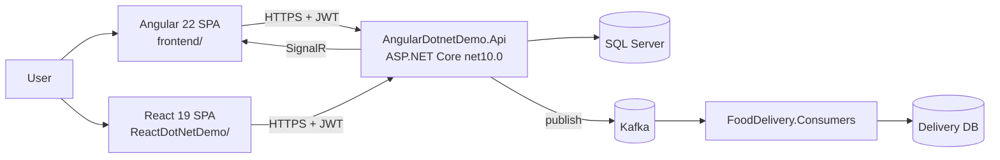
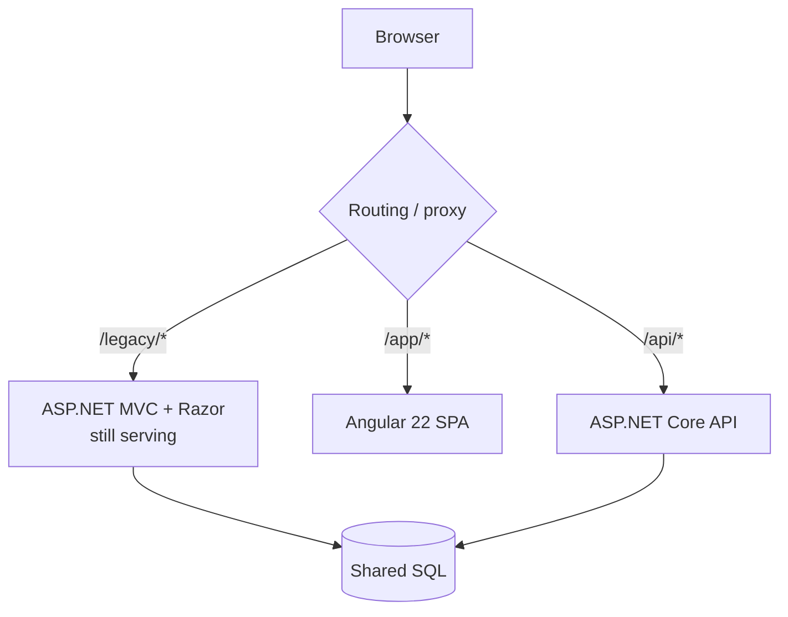
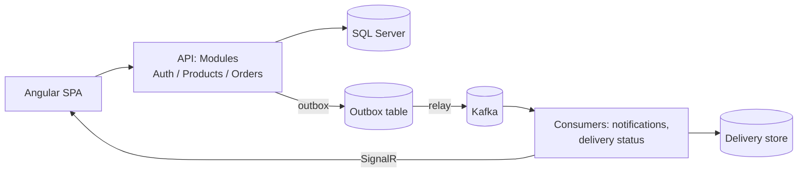

# Chapter 9 — Architecture Ownership & Technical Decision-Making

**Why this chapter exists:** at senior level you answer "how would you build X?". At lead level you must answer "**should** we build X, what do we give up, who owns it, and how do we get there from the code we already have?"

This repo is an unusually good teaching artefact for exactly that, because it contains **a deliberate mess** that mirrors real enterprises:

- `frontend/` — Angular 22 SPA
- `ReactDotNetDemo/` — React 19.2 SPA (Vite)
- `backend/AngularDotnetDemo.Api` — ASP.NET Core (net10.0) API serving the Angular app
- `DeliverFoodApp/src/` — three projects: `FoodDelivery.Api`, `FoodDelivery.Consumers`, `FoodDelivery.Shared` (message-driven, MassTransit/Kafka/SignalR/gRPC)
- `azure-pipelines.yml`, `docker-compose.yml`, four `Dockerfile`s

That is **two front-end frameworks, one monolith API, and one service-oriented system, deployed via containers through one pipeline**. As a technical lead you would be handed exactly this and asked "what do you do?" — so let's make that your flagship architecture story.

---

## 1. What "technical ownership" actually means

A lead's architecture responsibilities, in the order a hiring manager cares:

1. **Decide, and record why** — decisions, not diagrams.
2. **Keep the system changeable** — the only durable architectural quality is the cost of the *next* change.
3. **Own the cross-cutting contracts** — API surface, event schemas, data ownership, auth, error model.
4. **Set boundaries so teams can move independently** — the org chart and the architecture are the same conversation (Conway's Law, used deliberately).
5. **Manage the migration path** — you rarely get a greenfield. Your value is the *route* from here to there.
6. **Take responsibility for cost, operability and risk** — architecture that cannot be operated or afforded is not architecture.

> Interview framing: *"I don't think my job is to have the best architecture. It's to make sure we can change the architecture cheaply, and that every significant choice has a written reason and an owner."*

---

## 2. The decision toolkit (name these; they signal practice, not theory)

### 2.1 ADR — Architecture Decision Record

Structure (use it verbatim — it is universally recognised):

```markdown
# ADR-014: Standardise new front-end work on one framework

## Status
Accepted (2025-03-11) — supersedes ADR-009

## Context
We maintain an Angular 22 app (frontend/) and a React 19 app
(ReactDotNetDemo/). Team of 3 engineers + 1 lead. Average tenure on
front-end: 14 months. Two engineers are strong in Angular, one in React.
Both apps share the same ASP.NET Core back end and the same design
requirements. Maintenance cost of two frameworks: duplicate component
implementations, two build toolchains (@angular/build vs Vite), two test
stacks (Vitest+jsdom vs Vite/Vitest), two mental models, one hiring pool
split in two.

## Decision
Angular is the standard for new product UI. React app enters maintenance
mode: bug fixes and security patches only. No new features. Target for
full migration or retirement: 12 months, reviewed quarterly.

## Consequences
+ One component model, one build, one test stack, one hiring profile.
+ Team can pair; no more than one person able to touch a screen.
- We lose the fast-iteration ergonomics the React team liked.
- Migration cost: ~6 weeks of one engineer's time spread over 4 sprints.
- Risk: if we later need a React-only ecosystem package, we pay a
  deliberate, documented cost.
## Alternatives rejected
- Keep both: rejected — 3 engineers cannot carry two mental models.
- Migrate to React instead: rejected — 2 of 3 engineers are stronger in
  Angular and the app at risk (revenue-facing) is Angular. Migration risk
  should land on the smaller asset (ReactDotNetDemo/).
```

**What an interviewer listens for:** a *rejected alternative with a reason*, and a *consequence you accept*. An ADR with no negative consequences is a rationalisation, not a decision.

**When an ADR is required** (a good rule to state): it is hard to reverse, or it touches more than one team, or someone will ask "why is it like this?" in 12 months. Roughly: 1–2 ADRs per month for a small team.

### 2.2 C4 model — four zoom levels, one page each

| Level | Shows | Your repo equivalent |
|---|---|---|
| **Context** | System + users + external systems | Angular/React SPA → API → SQL → (email/payments) |
| **Container** | Deployable units and protocols | `frontend` (nginx container, port 8082), `ReactDotNetDemo` (static), `backend` API container, `FoodDelivery.Api`, `FoodDelivery.Consumers`, Kafka, SQL |
| **Component** | Major pieces inside a container | Controllers → services → repositories → DbContext; interceptors, guards, stores |
| **Code** | Class-level (rarely worth drawing) | Don't — it rots instantly |

**Lead-level point:** *"Mermaid in the repo beats a Visio file in someone's OneDrive, because it lives next to the code and gets reviewed with it."*

```markdown

```

### 2.3 Quality attributes — the words that make you sound like an architect

Never list these abstractly. Attach a **target and a mechanism**:

| Attribute | Naive answer | Lead answer (target + mechanism) |
|---|---|---|
| Performance | "It's fast" | "p95 API latency < 300 ms at 200 rps; measured with App Insights; enforced by a k6 smoke test in the pipeline" |
| Availability | "We have retries" | "99.9% monthly (43 min downtime budget); health checks + 2 replicas + zone-redundant SQL; measured by synthetic ping" |
| Scalability | "It scales" | "Stateless API behind a load balancer; scales on CPU 70%; the *database* is the real ceiling, so we cache reads and batch writes" |
| Security | "We use JWT" | "OIDC via Entra ID, short-lived access tokens + refresh rotation, secrets in Key Vault, no secret ever in `appsettings.json`, dependency scanning in CI" |
| Maintainability | "Clean code" | "≤ 400-line PRs, 70% coverage on domain logic, arch tests blocking cross-module references, ADRs for irreversible choices" |
| Observability | "We log" | "Structured logs with correlation ID per request, distributed trace across API→Kafka→consumer, 3 dashboards, 5 alerts that page a human" |
| Cost | (usually forgotten) | "£X/month, 60% of it SQL + Log Analytics retention; we tier old logs to hot/cold and right-size the App Service plan" |

**The phrase that wins the round:** *"Every quality attribute is a trade against another one. If someone asks for all of them, they're asking me to find the constraint they actually care about."*

### 2.4 The trade-off framework (use this shape for every design answer)

For any significant decision, walk these five lines:

1. **Options** — at least 3 (including "do nothing" and "buy it").
2. **Criteria** — cost, time-to-first-value, operational burden, team skill, reversibility, blast radius.
3. **Scoring** — rough, explicit, honest ("option B wins on cost, loses badly on team skill").
4. **Decision + owner + date.**
5. **Reversal trigger** — "we revisit if traffic exceeds 1k rps or the team grows past 6".

> The **reversal trigger** is what separates lead-level answers. It says: *I know my decision is conditional, and I've pre-committed to the evidence that would change it.*

---

## 3. The big structural decision: monolith, modular monolith, or services

### 3.1 The honest comparison

| | Monolith | Modest modular monolith | Microservices |
|---|---|---|---|
| Best team size | 1–5 | 3–12 | 4+ per service, many teams |
| Cost to build | Lowest | Low | 3–10× the first two, up front |
| Cost to operate | Lowest | Low | Highest (traces, gateways, contracts, on-call) |
| Independent deploy | No | Per-module flags, one deploy | Yes (the only real reason) |
| Failure isolation | Poor | Moderate | Good |
| Hardest problem | Coupling over time | Enforcing module boundaries | Distributed data + eventual consistency |
| Who wins | Startups, internal tools | **Most enterprise teams** | Genuinely independent scaling/ownership |

### 3.2 The answer that gets nods

> "Microservices are an **organisational scaling technique**, not a technical quality setting. You adopt them when independent deployability or independent scaling is worth paying the distributed-systems tax. For a team of three on a product that isn't constrained by deployment contention, the modular monolith is almost always the better economic choice — and it's the architecture that *preserves the option* to extract a service later, if you keep the module boundaries honest."

### 3.3 How you enforce module boundaries in .NET (concrete, and it impresses)

This is the part most candidates miss. Boundaries without enforcement are decoration.

```csharp
// 1. Project-level enforcement: one project per module, one-way references.
//    Orders.csproj MUST NOT reference Billing.csproj.
//    Cross-module calls go through a published interface + integration event.

// 2. Interface at the boundary, implementation hidden:
namespace Orders.Contracts;                       // small, referenced by others
public interface IStockAvailability
{
    Task<bool> HasStockAsync(Guid productId, int qty, CancellationToken ct = default);
}

// 3. Architecture test — this is the killer detail for an interview.
[Fact]
public void Orders_must_not_reference_Billing_internals()
{
    var result = Types.InAssembly(typeof(Order).Assembly)
        .ShouldNot()
        .HaveDependencyOn("Billing.Internal")
        .GetResult();

    Assert.True(result.IsSuccessful,
        string.Join(", ", result.FailingTypeNames ?? []));
}
```

**Say this:** *"The boundary is only real if a test fails when someone crosses it. Otherwise it's a comment."*

---

## 4. Migration architecture — your highest-value story

Nearly every enterprise lead job is **migration**, not greenfield. And you have the perfect one in this repo: an ASP.NET MVC + Razor + jQuery codebase whose screens are being replaced by a SPA.

### 4.1 The Strangler Fig pattern (name it, then make it concrete)

Replace the legacy system incrementally behind a routing layer, screen by screen, so that both can run in production at once and you can stop at any point.



Three implementations by scale, in order of cost:

| Implementation | Mechanism | When |
|---|---|---|
| **Path-based proxy** | YARP / Front Door routes `/app/*` to the SPA container, everything else to MVC | Simplest, works today |
| **Per-route reverse proxy** | YARP route table per screen, moved one at a time | Fine-grained incremental |
| **Server-side shell (edge composition)** | MVC layout renders the SPA shell for migrated areas | When shareable URLs + SEO matter |

.NET answer if pushed:
```csharp
// YARP in backend/AngularDotnetDemo.Api — a 20-line strangler.
builder.Services.AddReverseProxy().LoadFromConfig(builder.Configuration.GetSection("ReverseProxy"));

app.MapReverseProxy();   // reads ReverseProxy:Routes from appsettings
```

### 4.2 The migration plan you can whiteboard (7 steps)

1. **Inventory and rank** — every screen, its traffic, its inbound links, its business owner, and its dependency count. Rank by *(value ÷ risk)*, not by convenience.
2. **Fix the seams first.** The legacy app must expose data through a **stable API contract** before you move any UI. Otherwise each migration re-invents a data path and you get two systems with two truths.
3. **Choose the first slice deliberately:** high visibility, low coupling, one owner, reversible. Never start with the hardest screen (you'll burn the quarter proving it's hard) and never with a trivial one (you'll learn nothing about the real risk).
4. **Auth across both worlds** — cookie auth in MVC vs bearer token in SPA. Use **OIDC with a shared IdP** (Entra ID) so both rely on the same session source; do not attempt dual-mode custom auth. This is the #1 migration blocker; solve it in week 1, not week 9.
5. **Parallel-run and feature-flag per route** — a route flag that can flip back in 30 seconds. Migration is a *rollback-able* operation or it is a gamble.
6. **Delete as you go.** A migration where the old path is never deleted is not a migration; it's a duplication. Put deletion in the definition of done per slice.
7. **Measure**: routes migrated ÷ total, legacy lines deleted, legacy-only dependency count (target 0), and the trend of incidents attributable to the seam.

### 4.3 The migration risks you must volunteer (unprompted — this is the lead move)

| Risk | Mitigation |
|---|---|
| **Two truths** — same data written by both systems | Single writer per aggregate; legacy becomes read-only for migrated areas |
| **Auth/session split-brain** | Shared OIDC IdP; one token issuer; no dual cookie+bearer hacks |
| **Temporary becomes permanent** | Each slice carries a deletion ticket; legacy route count is on the team dashboard |
| **Deep links / bookmarks / SEO break** | Redirect map + 301s from day one; canonical URLs owned by the router |
| **Team velocity dip in the middle** | Plan the dip explicitly; communicate it as a curve, not an excuse |
| **Knowledge concentration** | Pair every legacy-area migration with the person who knows it, and write the runbook as you go |

---

## 5. Front-end architecture governance (the lead-specific gap)

Most full-stack candidates can wire a component; few can govern a front-end **as a lead**. This section is your differentiator.

### 5.1 The decisions a lead owns on the front end

| Decision | Options | Lead's criteria |
|---|---|---|
| Framework | Angular / React / Blazor | Hiring pool, existing asset risk, team skill, longevity |
| Rendering | SPA / SSR / SSG / hybrid | SEO, TTFB, infra cost, complexity budget |
| State | Signals / RTK / TanStack Query / context | Amount of server state vs client state |
| Component library | Angular Material / MUI / Tailwind / in-house | Accessibility cost, theming, upgrade burden |
| Monorepo vs polyrepo | Nx / Turborepo / separate repos | Shared types, atomic refactors, CI cost |
| Testing | Vitest / Playwright / RTL | Signal vs cost; e2e only for journeys |
| Contracts | OpenAPI-generated clients vs hand-written | Drift risk — **generated is almost always right** |

### 5.2 The single most valuable governance artefact: a generated API client

> "If the front end hand-writes its DTOs, the contract is a rumour. I generate the client from the OpenAPI document the API publishes, and the build fails when they diverge."

For this repo that means: `backend/AngularDotnetDemo.Api` publishes OpenAPI (it already exposes an OpenAPI endpoint), the front end generates typed models from it, and CI runs generation + `git diff --exit-code` — if the API changed and the client wasn't regenerated, the build goes red. That is a **concrete, cheap, senior-lead answer** to "how do you keep FE and BE in sync with three developers?"

### 5.3 Module boundaries on the front end (the same discipline as the back end)

```
frontend/src/app/
  core/        # singleton: auth, interceptors, error handling — no UI
  shared/      # dumb, reusable components only — no feature knowledge
  features/
    orders/    # owns its routes, state, api calls, components
    products/
  app.routes.ts  # lazy-loads features
```

Rules that a lead enforces (and can defend):
- A **feature never imports another feature's internals** — only `shared/`.
- `shared/` has **no** store or HTTP knowledge.
- Feature routes are **lazy-loaded**, so one team's regression cannot slow the whole app's boot.
- A feature owns its **state**: no global store for state one screen cares about. (In Angular: a feature-scoped signal service or store; in React: local state or a slice scoped to the feature.)

### 5.4 Accessibility and design systems — the things juniors skip and leads are judged on
- WCAG 2.2 AA is a **legal** requirement in many markets, not a nicety. Say: "it's in the definition of done, and axe checks run in the pipeline on the main journeys."
- One design-token source (colours, spacing, typography) so a rebrand is a token change, not 400 components.
- Component library upgrade policy: **never more than one major version behind**, budgeted as a recurring (not emergency) task.

### 5.5 The "Angular vs React" interview question — the winning shape

You will be asked this. Do **not** pick a favourite; pick a **criterion set**:

> "Both are production-grade. The difference that matters to a lead is what the team pays for over time.
> **Angular** gives you batteries: DI, router, forms, HTTP, a schema for structure, and one blessed way to do things — which is a genuine advantage for a mixed-seniority team because it reduces the number of decisions and makes code review faster across people. The cost is a heavier conceptual load (RxJS, signals, decorators, modules vs standalone) and slower onboarding for someone coming from plain JS.
> **React** gives you a smaller core and a huge ecosystem, so you get faster iteration and easier hiring for general JS skills. The cost is *choice*: routing, state, forms and structure are decisions you must make and then standardise, and a three-person team can drift into three patterns.
> With a mixed-seniority team of three where I'm accountable for consistency and review throughput, I'd standardise on one and write the rule down. My trade-off would land on Angular for structure if the team is junior-heavy or has existing Angular assets; React if the hires are already React-native and the product needs rapid UI iteration.
> In this repo both exist — and my first ADR would be to **consolidate**, because two frameworks for three engineers is not a strategy, it's an accident."

---

## 6. API design governance

### 6.1 The rules a lead writes once and enforces everywhere

| Rule | Why | Cost of not having it |
|---|---|---|
| Version the API (`/api/v1`) or version the media type | Mobile clients cannot be force-updated | Silent client breakage |
| **Additive-only** changes within a version | Consumers survive | Every release is a negotiation |
| Consistent error envelope (RFC 9457 ProblemDetails) | One client-side error handler, not 40 | 40 bespoke error UIs |
| Idempotency keys on POST that creates | Retries are inevitable | Duplicate orders |
| Pagination on every collection, from day one | Bolting it on is a breaking change | Outage at 10k rows |
| `202 Accepted` + status resource for long work | Timeouts kill synchronous long jobs | Hung requests, invisible failures |
| Contract published as OpenAPI, tested in CI | Generated clients stay honest | FE/BE drift |
| Never expose EF entities — always contracts | Schema changes leak | Coupling you can't undo |

### 6.2 ProblemDetails — one error shape (concrete)

```csharp
// Program.cs
builder.Services.AddProblemDetails(o =>
{
    o.CustomizeProblemDetails = ctx =>
        ctx.ProblemDetails.Extensions["traceId"] = ctx.HttpContext.TraceIdentifier;
});

// Anywhere: throw or return the standard shape, never an anonymous object.
return TypedResults.Problem(
    title: "Insufficient stock",
    detail: "Requested 5, available 2.",
    statusCode: StatusCodes.Status409Conflict);
```

And the lead's point: *"The front end then has exactly one place to render errors, and support has a `traceId` they can paste into Application Insights."*

### 6.3 Versioning strategy comparison

| Strategy | Example | Pros | Cons |
|---|---|---|---|
| URL path | `/api/v2/orders` | Obvious, cache-friendly, easy routing | Duplicates routes |
| Query string | `?api-version=2` | No route duplication | Easy to forget; caching |
| Header | `api-version: 2` | Clean URLs | Hard to test in a browser |
| Media type | `Accept: application/vnd.x.v2+json` | Most "correct" REST | Nobody does it by hand |

Recommendation for a .NET team: **URL path + deprecation headers + a published sunset date.** Name the deprecation mechanic — it is the part candidates forget:
```
Deprecation: true
Sunset: Wed, 31 Dec 2026 23:59:59 GMT
Link: </api/v2/orders>; rel="successor-version"
```

---

## 7. Data architecture: the questions leads get asked

### 7.1 Ownership: one writer per table

> "The fastest way to create a distributed monolith is two services writing the same table. I assign an owning service per aggregate; everyone else reads through an API or a published event. If a team asks for write access, that request is a design smell and we talk about it."

### 7.2 Shared database vs database-per-service

| | Shared DB | DB per service |
|---|---|---|
| Joins across domains | Free | Must be modelled / denormalised |
| Transactions across domains | Free | Needs saga/outbox |
| Independent deploy | Fragile (schema coupling) | Real |
| Best for | Small teams, one product | Independent ownership |

Lead answer: *"With a team of three I'd take a shared database with **strict schema-per-module ownership** — one writer per schema, no cross-schema joins outside a read model — because the outbox/saga tax is not worth paying until we have real independent teams. I'd keep the module boundaries clean so extraction stays possible."*

### 7.3 Read vs write models
Reads are 90% of traffic. Cheapest wins, in order: **fix the N+1 → add the right index → cache → add a read replica → CQRS projection.** Say the order out loud; candidates who jump to CQRS first get marked as pattern-driven.

### 7.4 Migrations as a code-owned, pipeline-run artefact
- Migrations in source control, applied by the pipeline (or an init job), **never** by a developer against production.
- **Expand → migrate → contract** for any breaking change (add nullable column / dual-write / backfill / switch reads / drop old). Name this; it's the EF Core equivalent of versioning.
- Every migration has a **rollback story**: usually "forward-only fix", stated explicitly.
- Never rename or drop in the same release that stops using it.

---

## 8. Caching: the four tiers and the discipline

| Tier | Tool | Hit latency | Invalidation |
|---|---|---|---|
| Browser | `Cache-Control`, ETag | ~0 ms | Versioned URLs + max-age |
| CDN / edge | Front Door | 5–30 ms | Purge + surrogate keys |
| App memory | `IMemoryCache` | <1 ms | TTL + explicit eviction |
| Distributed | Redis | 1–5 ms | TTL + write-through |

Rules a lead enforces:
- **Name the invalidation strategy before writing the cache.** "TTL 30 s" is a decision; "we'll figure it out" is an incident.
- **Never cache authorisation decisions** without a key that includes the user's permissions.
- **Cache the assembled view, not the query result**, where possible.
- **Watch the stampede**: jitter TTLs, use `GetOrCreateAsync` with a lock.
- **Measure hit ratio**; a cache with 20% hit ratio is pure complexity cost.

---

## 9. Reference architectures — three you should be able to draw in 5 minutes

### 9.1 The repo's actual shape (modular monolith + one async service)



Talking points: outbox solved the dual-write problem; consumers are idempotent; SignalR pushes status so the SPA doesn't poll.

### 9.2 The scale-out shape (when the team grows to 3 teams)
Split by business capability, not by layer. Each team owns a capability end to end: its routes, its API module, its schema, its deploys, its on-call. Cross-capability communication via published events only.

### 9.3 The multi-tenant shape (common enterprise requirement)
| Model | Isolation | Cost | Use |
|---|---|---|---|
| Shared DB, tenant column + query filter | Low | Lowest | Many small tenants |
| Shared DB, schema per tenant | Medium | Low | Mid-size |
| DB per tenant | High | Highest | Regulated/compliance |

In EF Core the mechanism is a **global query filter** plus a tenant resolution middleware — and the lead-level warning: *"a global query filter is a safety net, not a security boundary; the boundary is the connection string or the schema. I'd never rely on a filter alone for cross-tenant isolation, and I'd write an integration test that tries to read another tenant's row and must fail."*

---

## 10. Architecture review: how to run one and how to answer "review this design"

### 10.1 The 8 questions to ask any design (memorise — this is your checklist on a whiteboard)

1. **What problem does this solve, and what happens if we don't build it?**
2. **What's the simplest version, and what does it cost us?** (the "boring baseline")
3. **What are the failure modes?** What happens when the DB, the queue, or the third-party API is unavailable or slow?
4. **What's the data ownership and consistency model?** Who writes what, and what is allowed to be stale?
5. **How does it deploy, roll back, and get observed?**
6. **What's the operational and financial run cost?**
7. **Who owns it, and does that match the team's skills and boundaries?**
8. **What would make us reverse this decision, and when do we check?**

### 10.2 The 10 red flags you should name on sight
Distributed transaction without saga · two owners of one table · retries without idempotency · chatty service calls in a loop · synchronous chain across 4 services · feature flags without an expiry · caching with no invalidation story · shared DTOs across service boundaries · "we'll add logging later" · stateful app servers.

### 10.3 Answering "critique this architecture" in an interview
1. **Restate the constraints** you were given and state your assumptions.
2. **Name what's good first** (2 lines) — shows judgement, not just criticism.
3. **Identify the single biggest risk**, not ten small ones.
4. **Offer 2–3 options with cost.**
5. **Recommend one, with a reversal trigger.**

---

## 11. Technical debt as a managed portfolio (not a complaint)

### 11.1 Classify before you negotiate — this is how you get budget

| Type | Example in this repo | Fix style |
|---|---|---|
| **Deliberate & prudent** | Class-based `HTTP_INTERCEPTORS` + `withInterceptorsFromDi()` in `app.config.ts` (works, pre-v15 pattern) | Planned upgrade |
| **Reckless & prudent** | No test projects in the solution | Immediate, non-negotiable |
| **Bit rot** | Angular 22 vs React 19 tooling divergence; four Dockerfiles to keep in sync | Recurring maintenance budget |
| **Architectural** | Two front-end frameworks, one product | ADR + roadmap item |
| **Documentation** | `README`s describing old commands | Opportunistic, in the PR that changes behaviour |

### 11.2 The negotiation technique that works
Express debt in **business** terms with a **trend**:
> "Two of our three engineers cannot work on the React app. That means every React change is queued behind one person, and our change-failure rate there is 22% vs 6% in Angular. Six weeks of consolidation work removes that single point of failure and cuts our largest delivery risk. I'd like to take 20% of each sprint for four sprints — I'm not asking for a stop-the-world week."

Leads get debt work approved when they present **risk + trend + a small ask**, and rejected when they present **principle + indignation**.

### 11.3 The standing agreement
A **20% capacity rule** for engineering health (debt, upgrades, tests, dashboards), visible on the board as real work — never a hidden tax on estimates. Say you'd defend it once and then renegotiate with data.

---

## 12. Chapter 9 — questions you must be able to answer out loud

1. Walk me through how you make a significant architecture decision, from problem to recorded outcome.
2. What goes in an ADR, and when do you bother writing one?
3. What's the difference between a monolith, a modular monolith, and microservices — and how do you choose?
4. How do you enforce module boundaries when the compiler won't?
5. We have an ASP.NET MVC app with Razor and jQuery, and we've decided to move to a SPA. How do you plan the migration?
6. What's the first thing you fix in that migration, and why? *(auth seams)*
7. Design the front-end structure for a team of three. What are the rules?
8. Angular or React for our new product? Walk me through the decision.
9. How do you stop the front end and back end drifting apart?
10. How do you version an API you can't force clients to update?
11. Two services want to write to the same table. What do you do?
12. How would you add caching to a slow read endpoint, and how do you invalidate it?
13. How do you get technical debt funded by a product owner?
14. Give me an example of an architecture decision you reversed. What signal made you reverse it?
15. Critique this design *(they draw something)* — what's the biggest risk?

**Next:** `10-DELIVERY-AND-ENGINEERING-EXCELLENCE.md` — how the work actually gets to production, predictably.
