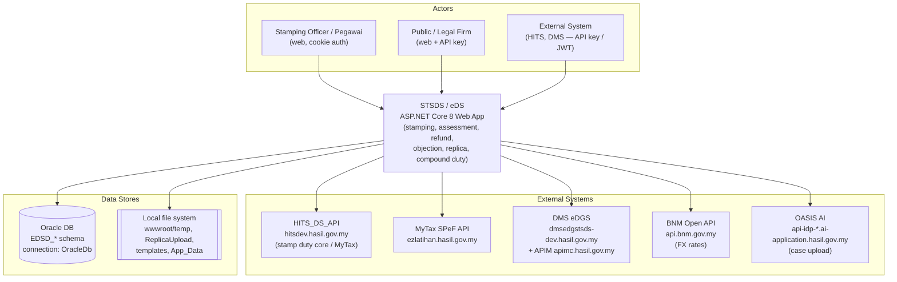
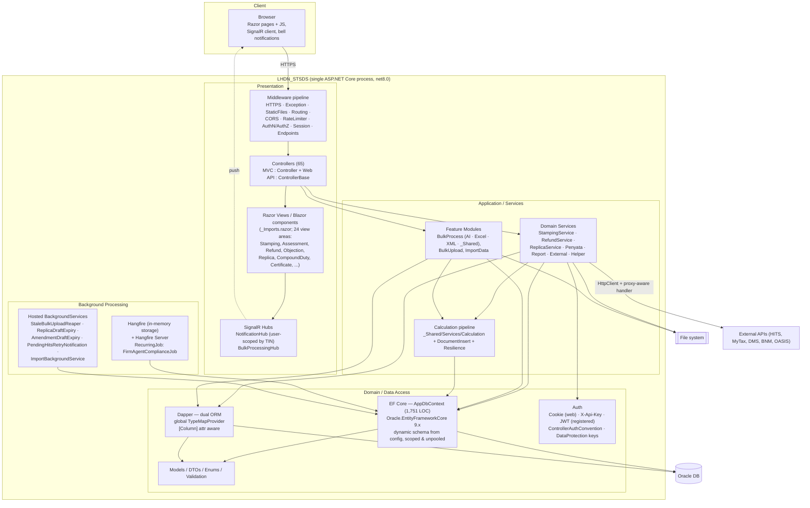
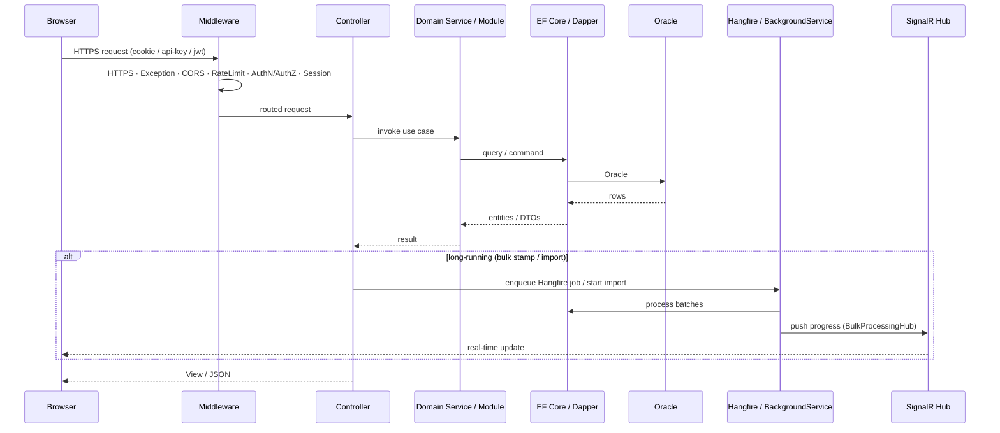
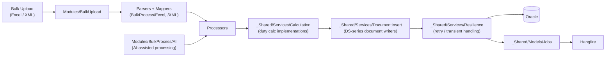
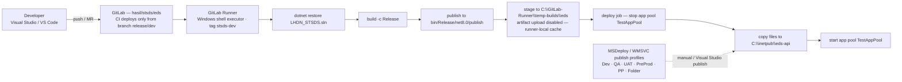
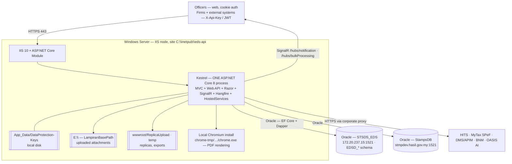

# STSDS / eDS — Architecture

**System:** LHDN STSDS ("eDS" — electronic Stamp Duty / *eDuti Setem* system)
**Stack:** ASP.NET Core 8 (`net8.0`), MVC + Razor Views, Oracle DB, EF Core + Dapper, Hangfire, SignalR
**Solution root:** `LHDN_STSDS/` · ~685 `.cs` files · ~65 controllers

> Diagrams use Mermaid. Render in any Mermaid-aware viewer (GitLab, VS Code, GitHub).
>
> **Read this first if you are new to the project or to DevOps:** [`DEVOPS-101.md`](./DEVOPS-101.md)
> teaches the delivery vocabulary (CI/CD, environments, artefacts, monolith vs services)
> using this system as the worked example. Related: [`CICD-DEVOPS.md`](./CICD-DEVOPS.md) and
> [`MICROSERVICES-MIGRATION.md`](./MICROSERVICES-MIGRATION.md).

---

## 1. System Context (C4 Level 1)

Who and what the eDS system talks to.

---

## 2. Container / Layered View (C4 Level 2)

---

## 3. Request / Dependency Flow

---

## 4. Bulk Processing Sub-System

The heaviest part of the domain — large Excel/XML stamp submissions.

---

## 5. Key Components & Concerns

| Area | Where | Notes |
|------|-------|-------|
| Composition root | `Program.cs` (~1,300 LOC) | service registration, middleware, Hangfire recurring jobs, Oracle warm-up query |
| DbContext | `Data/AppDbContext.cs` (~1,751 LOC) | Oracle provider, **dynamic schema from config**, registered **scoped + unpooled** (`Program.cs:137`) |
| Dual ORM | EF Core + Dapper | Dapper overrides `SqlMapper.TypeMapProvider` globally, checking `[Column]` first |
| Auth | `Auth/` | Cookie (web) + `X-Api-Key` + JWT (registered, currently unused) in one chain; `ControllerAuthConvention`, `SwaggerOnlyOpenApiConvention`; DataProtection key ring in `App_Data/` |
| Background jobs | `Services/BackgroundServices/`, Hangfire | reapers, draft-expiry, HITS retry notifications, firm-agent compliance (recurring) |
| Real-time | `Hubs/` | `NotificationHub` groups connections by TIN claim; `BulkProcessingHub` for bulk progress |
| Feature modules | `Modules/` | `BulkProcess`, `BulkUpload`, `ImportData` — the newer module-organised code |
| Legacy domain services | `Services/`, `Interface/` | interface + implementation split (`IStampingService`, `IRefundService`, `API`, `External`) |
| External I/O | `Services/External`, `Services/StampingService` | `HttpClient` with proxy-aware handler; `new HttpClient` × 35 |
| Persistence artifacts | `wwwroot/`, `App_Data/` | generated certificates, replica uploads, Excel templates, DataProtection keys |
| Config | `appsettings.json` + per-env (Dev/QA/UAT/PreProd/Prod) | connection string `OracleDb`, `Security:apiKey`, integration `BaseUrl`s |

### External integration endpoints (from `appsettings.json`)
- **HITS** — `https://hitsdev.hasil.gov.my/HITS_DS_API/rest/` (stamp duty core)
- **MyTax (SPeF)** — `https://ezlatihan.hasil.gov.my/spefapi/api/MyTAX/`
- **DMS** — `https://dmsedgstsds-dev.hasil.gov.my` via APIM `https://apimc.hasil.gov.my`
- **BNM** — `https://api.bnm.gov.my` (currency / FX list)
- **OASIS AI** — `https://api-idp-uat.ai-application.hasil.gov.my/api/oasis/case-upload`

---

## 6. Deployment & Topology

No containers: the app ships as a **plain `dotnet publish` output hosted on IIS / Windows Server** (there is no `Dockerfile`, compose file or Kubernetes manifest anywhere in the repo).

### 6.1 Build & release pipeline

- Stages: `build` → `deploy`. Only `release/dev` triggers the pipeline; deploy values are **hard-coded** (`IIS_SITE_PATH=C:\inetpub\eds-api`, `APP_POOL_NAME=TestAppPool`), so every environment currently deploys to the *same* path/pool shape.
- Artifacts are deliberately **not** uploaded to GitLab (`LOCAL_BUILD_CACHE=C:\GitLab-Runner\temp-builds\eds`) — build output never leaves the runner.
- A parallel, manual path exists: `Properties/PublishProfiles/*.pubxml` (MSDeploy over WMSVC, `AllowUntrustedCertificate=True`, one profile per environment: Dev / QA / UAT / PP / Folder).

### 6.2 Runtime topology (one node)

Per-node side effects — everything below is **on the box itself**, not shared:

| Concern | Local resource | Consequence for scaling |
|---|---|---|
| Data protection | `App_Data/DataProtection-Keys` (config `DataProtection:KeysPath`) | Cookies/auth tickets are node-specific → no second node shares its key ring |
| File storage | `E:\` (`LampiranBasePath`), `wwwroot/ReplicaUpload`, temp folders | Attachments/replicas invisible to another node |
| PDF rendering | Local Chromium executable | Each node needs its own Chromium install + `chrome-tmp` writable |
| Job queue | Hangfire **in-memory** storage, server in the same process | Job state dies on restart; a second node cannot see or co-ordinate jobs |
| DB access | Scoped, **unpooled** `DbContext` + Dapper on the same Oracle instance | Every node opens its own connection set |

### 6.3 Environments

One site + one Oracle service per environment; behaviour is switched purely by `ASPNETCORE_ENVIRONMENT` → `appsettings.{Env}.json` (Dev, QA, UAT, PreProd, Prod).

| Environment | Config file | Publish profile | Data source |
|---|---|---|---|
| Development | `appsettings.Development.json` | Dev Environment | local / dev Oracle |
| QA | `appsettings.QA.json` | QA Environment | internal IIS host, site `eds-qa` |
| UAT | `appsettings.UAT.json` | UAT Environment | internal IIS host |
| PreProd | `appsettings.PreProd.json` | PP Environment | internal IIS host, site `eDS` |
| Production | `appsettings.Prod.json` | (CI deploy job) | `OracleDb` → `172.20.237.15:1521` |

### 6.4 Topology observations

- **Prod config points at pre-prod endpoints:** `appsettings.Prod.json` still uses `hitspre2.hasil.gov.my` (HITS) and UAT OASIS/MyTax hosts, and its `OracleDb`/`StampsDB` values look like lab credentials — worth confirming before relying on it.
- **Secrets are committed:** Oracle passwords, HITS bearer tokens, `Security:apiKey` and the JWT signing key live in `appsettings*.json`. Any move to a shared/prod topology should push these into a secret store (Key Vault) — the target configuration provider is specified in [`CICD-DEVOPS.md` §5.4](./CICD-DEVOPS.md#54-worked-example--secrets-management-with-key-vault).
- **Single-node by construction** (see §6.2): local DataProtection keys, local file storage, in-memory Hangfire. Scale-out requires sticky sessions *plus* shared key ring, shared attachment store and persistent Hangfire storage (e.g. SQL/Oracle) — otherwise bulk processing and SignalR break.
- **Egress is proxy-dependent:** outbound HTTPS (HITS, MyTax, DMS, BNM, OASIS) resolves a proxy at runtime; TLS 1.2/1.3 is pinned globally. If the proxy is unreachable, integrated flows fail rather than degrade.
- **No health-check / readiness endpoint** was found for the site, so the app-pool restart in the deploy job is the only "is it up?" signal.
- **Deployment is in-place, single-slot:** the CI job stops `TestAppPool`, copies to `C:\inetpub\eds-api` and restarts it (see §6.1) — there is no idle slot, so a release is an outage and rollback means rebuilding. The blue/green replacement is specified in [`CICD-DEVOPS.md` §7.4](./CICD-DEVOPS.md#74-worked-example--msdeploy-bluegreen-deploy-on-iis), and the IIS infrastructure it depends on — the two app pools, the `blue`/`green` slot sites and the ARR/URL-Rewrite front-site rule (`MonolithUpstream`) — is provisioned as code in [`CICD-DEVOPS.md` §8.1](./CICD-DEVOPS.md#81-worked-example--provisioning-the-bluegreen-slots--arr-rewrite-powershell-dsc).

> Target-state build, release and operations for a decomposed topology are specified in
> [`CICD-DEVOPS.md`](./CICD-DEVOPS.md) — see in particular §5.4 (Key Vault secret management),
> §7.4 (blue/green deploy) and §8.1 (the IIS/ARR slot infrastructure it needs); the decomposition itself is in
> [`MICROSERVICES-MIGRATION.md`](./MICROSERVICES-MIGRATION.md).

---

## 7. Observations / Risky Spots

- **Version skew:** `Oracle.EntityFrameworkCore 9.23.80` vs `EF Tools 10.0.6`.
- **Dual ORM everywhere:** EF Core (863 `AsNoTracking`, 1,293 `Include`, 1,150 `ToList()`) *and* raw SQL (`FromSqlRaw` × 9, `ExecuteSqlRaw` × 6, `ExecuteSqlInterpolated` × 21) — two modelling paths to keep consistent.
- **Error handling:** 883 `catch (Exception)` and 145 `Console.WriteLine` — broad catches swallow detail; logging is not uniform.
- **HttpClient:** 35 `new HttpClient` instantiation sites — socket-exhaustion / DNS-staleness risk versus `IHttpClientFactory`.
- **Sync-over-async:** 21 `.Result`, 2 `.Wait()`, 7 `Task.Run`.
- **Hangfire storage is in-memory** — job history/state is lost on restart.
- **DbContext** registered **scoped, unpooled** — no connection pooling at the EF level.
