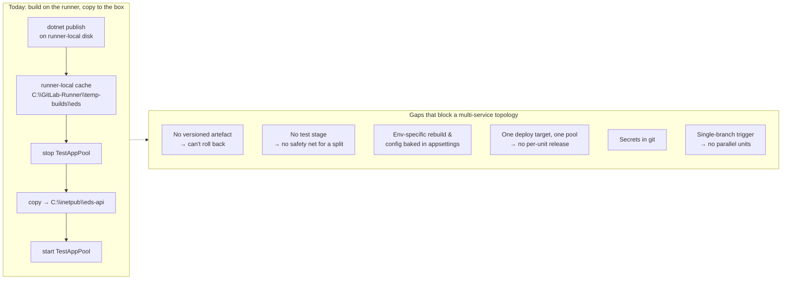
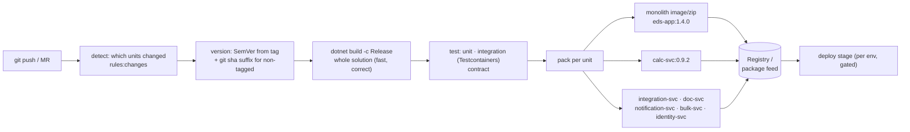
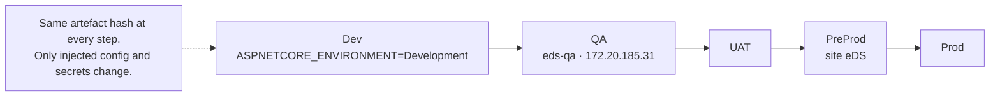
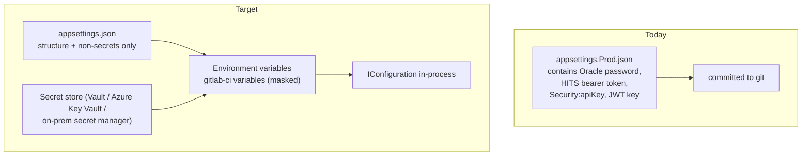
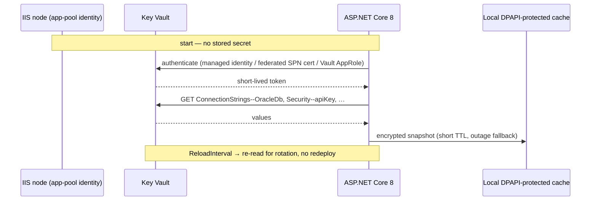
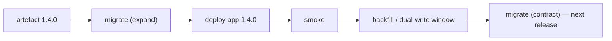
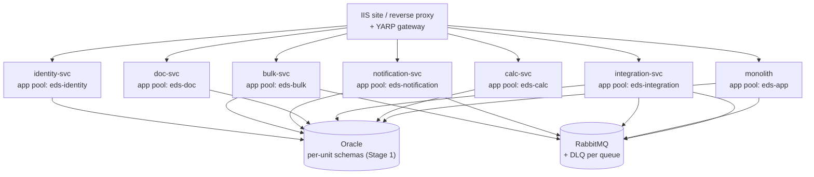
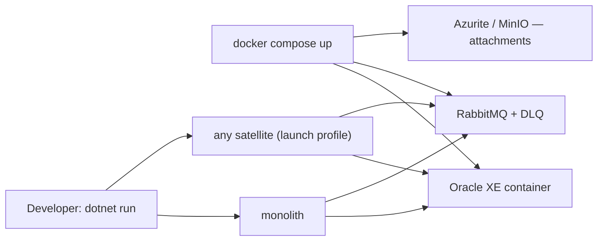

# STSDS / eDS — CI/CD & DevOps for the Modular-Monolith + Satellite-Services Architecture

> Companion to [`ARCHITECTURE.md`](./ARCHITECTURE.md) (current state) and
> [`MICROSERVICES-MIGRATION.md`](./MICROSERVICES-MIGRATION.md) (why and how we split).
> This document answers a different question: **once we have a modular monolith plus
> 4–6 satellite services (`calc`, `integration`, `doc`, `notification`, `bulk`, `identity`),
> how do we build, test, ship, configure, observe and roll back all of them?**

> **New to DevOps, CI/CD or microservices?** Read
> [`DEVOPS-101.md`](./DEVOPS-101.md) first — it teaches the vocabulary (pipeline, artefact,
> promotion, blue/green, monolith vs services) from first principles using this same
> system as the example. This document assumes that vocabulary.

Everything below is written against the state of this repository at
`eDScompoundCalculation` / `af4ff4b5b`. Where a recommendation replaces something that
exists today, the current artefact is named explicitly (`.gitlab-ci.yml`, the
`Properties/PublishProfiles/*.pubxml` files, `appsettings.{Env}.json`).

---

## 1. Purpose & scope

**In scope:** build pipelines, artefact packaging, versioning, contract testing,
environment promotion, configuration & secrets, database migrations, deployment
strategies, rollback, local development, observability and the security gates that a
government-facing system needs.

**Out of scope:** the *why* of decomposition and the service boundaries themselves
(see `MICROSERVICES-MIGRATION.md` §3–§4), and the runtime coupling model (saga, outbox,
DLQ — see that document's §5.5–§5.6).

**Guiding constraint:** the target is a **modular monolith (1 deployable) + 4–6 satellite
services (N deployables)**. That is a *small* fleet. The CI/CD design must not become more
expensive to operate than the system — which is exactly why we do **not** adopt a full
Kubernetes/GitOps platform as the starting point.

---

## 2. Where we are today (honest baseline)

### 2.1 What exists

| Area | Current state | Source |
|---|---|---|
| CI stages | 2 — `build`, `deploy` | `.gitlab-ci.yml` |
| Runner | Windows **shell** executor, tag `stsds-dev` | `.gitlab-ci.yml` |
| Trigger | `only: release/dev` — CI deploys from **one branch only** | `.gitlab-ci.yml` |
| Build | `dotnet restore` + `build -c Release` + `publish` → `bin\Release\net8.0\publish` | `.gitlab-ci.yml` |
| Artefact | **none** — staged to a runner-local folder `C:\GitLab-Runner\temp-builds\eds`; GitLab artefacts deliberately disabled | `.gitlab-ci.yml` (comment: *"we can't handle it"*) |
| Deploy | Stop `TestAppPool` → copy to `C:\inetpub\eds-api` → start pool | `.gitlab-ci.yml` |
| Alternative path | MSDeploy / **WMSVC** publish profiles to `172.20.185.31`, app path `eds-qa`, `EnableMsDeployAppOffline=true`, backup on, `AllowUntrustedCertificate=True`, user `…/zen_admin` | `Properties/PublishProfiles/QA Environment.pubxml` (+ Dev/UAT/PP/Folder) |
| Environments | Dev, QA (`eds-qa`), UAT, PreProd (`eDS`), Prod — selected by `ASPNETCORE_ENVIRONMENT` + `appsettings.{Env}.json` | `appsettings*.json` |
| Tests | **No test project exists in the solution** — `LHDN_STSDS.sln` contains exactly one project (`LHDN_STSDS`, GUID `FB542176-…`). No test stage in CI. | `LHDN_STSDS.sln` |
| Secrets | Oracle passwords, HITS bearer token, `Security:apiKey`, JWT key committed in `appsettings*.json` | `appsettings.Prod.json`, others |
| Job state | Hangfire storage is **in-memory**; job history lost on app-pool recycle | `Program.cs` |
| Node state | DataProtection keys on local `App_Data/`; attachments on `E:\` (`LampiranBasePath`); PDF via a local Chromium (`chrome-tmp/…/chrome.exe`) | `Program.cs`, `appsettings*.json` |

### 2.2 What that means



The two structural blockers for the target architecture are **G1 (no immutable,
versioned artefact)** and **G4 (one deploy path for everything)**. A monolith + 6
satellites needs to ship each unit *independently* from a *promotable* artefact. Neither
is possible with "publish to a runner folder, then copy to a fixed IIS path".

---

## 3. Target CI/CD model

### 3.1 Principles

1. **Build once, promote the same artefact** through Dev → QA → UAT → PreProd → Prod.
   Configuration is injected at deploy time, never baked at build time.
2. **One pipeline per deployable unit**, independently releasable. The monolith and each
   satellite carry their own version and their own release cadence.
3. **Artefacts are immutable and versioned** (SemVer derived from a git tag) and stored in
   a package/container registry — never in a runner-local folder.
4. **Database changes are deployed as a separate, ordered stage** using expand/contract,
   decoupled from application deployment order.
5. **Every unit is observable and has a rollback path** before it is allowed to deploy.
6. **Path-filtered CI**: changing `calc-svc` must not rebuild and redeploy the monolith.

### 3.2 Repository strategy

Keep the **monorepo** (`hasil/stsds/eds`) rather than splitting into N repositories.

| For monorepo | Against multi-repo |
|---|---|
| Atomic commits across a contract change (`stamping` → `integration` event schema) | Contract changes become multi-PR choreography across repos |
| Reuses the existing GitLab project, runner and branch protection | Requires N× runner setup, N× secret stores, N× pipeline maintenance |
| One place for the shared `contracts` package and the solution | Version-skew between repos is invisible until runtime |
| Path filters give per-unit independence anyway | — |

Multi-repo only becomes justified when a unit gets a genuinely separate team, a separate
release authority, or a compliance boundary. Not yet.

### 3.3 Build & artefact model



Two acceptable packaging formats; pick one per environment reality:

| Option | When | Notes |
|---|---|---|
| **Container images** (preferred) | If the target hosts can run containers (even Windows containers on the existing Windows Server) | Immutable, self-describing, identical Dev→Prod, solves the "local Chromium / local paths" problem by baking dependencies in. |
| **Versioned drop + MSDeploy** (minimum viable) | If IIS/Windows must stay as-is for infra/policy reasons | Still *must* produce a versioned `.zip` per unit, uploaded to GitLab **package registry** (or an internal blob share), and deployed by a script that records the deployed version. Replaces the runner-local cache. |

**Non-negotiable either way:** the artefact must contain a version manifest so the deploy
job and the running app can both answer *"which version is live?"*:

```json
{
  "unit": "calc-svc",
  "version": "0.9.2",
  "commit": "af4ff4b5b",
  "builtAt": "2026-02-11T09:14:00Z",
  "contracts": { "stamping.submission.submitted": "v1", "payment.duty.recorded": "v1" }
}
```

Expose it at `/health/version` (see §10) so operations never guess.

---

## 4. Pipeline design

### 4.1 Stage graph

```mermaid
flowchart TB
    subgraph mr["Merge-request pipeline"]
        A1["lint & format<br/>dotnet csharpier --check · prettier --check"]
        A2["build"]
        A3["unit tests"]
        A4["integration tests<br/>Testcontainers Oracle + RabbitMQ"]
        A5["contract tests<br/>Pact provider/consumer"]
        A6["SAST · dependency scan · secret scan"]
        A1 --> A2 --> A3 --> A4 --> A5 --> A6
    end
    subgraph main["Main-branch pipeline (release/dev → main)"]
        B1["same as MR"] --> B2["package & push artefact"]
        B2 --> B3["publish SBOM + sign"]
        B3 --> B4["deploy Dev (auto)"]
        B4 --> B5["deploy QA (auto, smoke)"]
        B5 --> B6["deploy UAT (manual gate)"]
        B6 --> B7["deploy PreProd (manual gate)"]
        B7 --> B8["deploy Prod (approval + change ticket)"]
    end
```



`npm run format` already exists (`csharpier` + `prettier`) — the pipeline should run it in
**check** mode, not write mode, so formatting can never be "fixed" silently by CI.

### 4.2 Path filtering (the core of per-unit independence)

With a monorepo, use `rules:changes` so each unit's pipeline only runs when its inputs
change — but always run when a **shared** input changes (`contracts/`, `Directory.Build.props`,
`.gitlab/ci/`, `LHDN_STSDS.sln`).

```yaml
# .gitlab/ci/templates.yml — repeated per unit, parameterised by UNIT_PATH
.unit_rules:
  rules:
    - if: '$CI_COMMIT_BRANCH == "release/dev" || $CI_COMMIT_BRANCH == "main"'
    - if: '$CI_PIPELINE_SOURCE == "merge_request_event"'
      changes:
        - "$UNIT_PATH/**/*"
        - "src/Contracts/**/*"        # shared event/DTO contracts
        - "Directory.Build.props"
        - "LHDN_STSDS.sln"
        - ".gitlab/ci/**/*"
```

```yaml
# .gitlab/ci/calc-svc.yml
build:calc-svc:
  extends: [.dotnet_build, .unit_rules]
  variables: { UNIT_PATH: "src/Services/Calc" }
  script:
    - dotnet build src/Services/Calc/Calc.csproj -c Release --no-restore
```

Shared templates live under `.gitlab/ci/`, including the *existing* deploy logic
reworked into a reusable, parameterised job (`deploy_iis`, `deploy_container`) instead of
the current hard-coded `C:\inetpub\eds-api` + `TestAppPool`.

### 4.3 The test stage — the real prerequisite

The solution currently has **no tests at all**. Extracting services without a regression
net converts a working monolith into a distributed system with unknown behaviour. So the
first CI investment is not Kubernetes — it is a test pyramid:

| Layer | Tooling | Runs | Cost |
|---|---|---|---|
| Unit (calculation, mappers, validators) | xUnit + `WebApplicationFactory` | Every MR, seconds | Low — the `calc` duty rules are highly testable |
| Integration (EF Core + Dapper against real Oracle behaviour) | **Testcontainers** with Oracle XE / `gvenzl/oracle-xe`, RabbitMQ | Every MR, minutes | Medium — catches the dual-ORM `[Column]`/`TypeMapProvider` mismatches that are invisible to unit tests |
| Contract (event schemas, API shapes) | **Pact** — consumer-driven, one pact per event in `MICROSERVICES-MIGRATION.md` §5.5 | Every MR | Medium — is what makes independent deploys safe |
| Smoke (post-deploy) | scripted `curl` against `/health/ready` + one happy-path stamping submission | After each env deploy | Low |

Rules:
- A service may only be **released independently** once its contracts have consumers'
  pacts green in CI. Until then it is versioned with the monolith.
- Integration tests must run against a **real** Oracle-compatible container, because the
  dynamic-schema `AppDbContext` (`Program.cs:137`, `Data/AppDbContext.cs`) does not
  reproduce reliably against an in-memory provider.

### 4.4 Versioning

- **SemVer per unit**, driven by git tags: `monolith/1.4.0`, `calc-svc/0.9.2`,
  `integration-svc/1.1.0`.
- Non-tagged builds get `0.0.0-<sha>` and are never promoted past QA.
- **Contract versions are separate from service versions.** An event carries its own
  `v1`/`v2` in the envelope (per `MICROSERVICES-MIGRATION.md` §5.5); a service can go
  `1.5.0` while still only producing `v1` events. CI must fail a change that removes a
  published event version without a documented deprecation window.
- Add `Directory.Build.props` with a single `<Version>` source so all projects report
  consistent metadata.

---

## 5. Environments & configuration

### 5.1 Promotion model



Today each environment is approximated by a **publish profile** with the target baked in
(`MSDeployServiceURL 172.20.185.31`, `DeployIisAppPath eds-qa`, `EnvironmentName QA`).
That is build-time knowledge of a deploy-time fact. In the target model:

- The pipeline selects the **environment** as a parameter, not a project file.
- The artefact is identical; a per-environment **variable group / secret store** supplies
  the differences.
- `ASPNETCORE_ENVIRONMENT` selects **which config layers load**, not what was compiled.

### 5.2 Configuration & secrets



Requirements:
- **Rotate everything currently in `appsettings*.json`** as part of Phase 0 — the Oracle
  passwords, `Security:apiKey`, HITS bearer token and JWT signing key are compromised by
  being in git history.
- **Worked implementation:** the inventory, vault choice, app-pool identity bootstrap, `Program.cs`
  integration, rotation runbook and pipeline OIDC wiring are specified in **§5.4** below.
- Prefer **managed identity / short-lived credentials** over a shared `zen_admin` MSDeploy
  account. Deploy accounts get least privilege per environment.
- Config precedence: `appsettings.json` → `appsettings.{Env}.json` (non-secrets) →
  environment variables → secret store. Document it once; enforce it with a startup check
  that **fails fast** when a required secret is missing (today a missing HITS token
  surfaces only when a submission is attempted).

### 5.3 Environment matrix

| Environment | Deploy trigger | Target | Purpose | Data |
|---|---|---|---|---|
| Dev | auto on `release/dev` | local / shared dev box | fast iteration | seeded/synthetic |
| QA | auto after Dev smoke | `eds-qa` @ `172.20.185.31` | integration & contract verification | masked copy |
| UAT | manual gate | UAT host | business acceptance | masked copy |
| PreProd | manual gate | site `eDS` | production rehearsal, load, DR drill | prod-like |
| Prod | approval + change ticket | prod hosts | live | live |

---

### 5.4 Worked example — secrets management with Key Vault

§5.2 states the requirement ("secrets live in a store, injected at deploy/runtime, never in the
repo"). This section is the concrete implementation: what moves, which vault, how the app on IIS
authenticates to it without a stored credential, and how rotation works. It is the missing detail
behind the §5.2 mermaid node *"Secret store (Vault / Azure Key Vault / on-prem secret manager)"*
and behind the `Pulled from the secret store` row in §8.1.

#### 5.4.1 The inventory that must leave git

Everything below is currently readable in `appsettings*.json` (see `ARCHITECTURE.md` §6.4):

| Config key (as coded) | Secret | Blast radius if leaked | Rotation owner |
|---|---|---|---|
| `ConnectionStrings:OracleDb` | password for `172.20.237.15:1521` (`EDS` schema) | full taxpayer / duty data | DBA + platform |
| `ConnectionStrings:StampsDB` | password for `stmpdev.hasil.gov.my` | stamping reference data | DBA |
| `Security:apiKey` | the `X-Api-Key` value for the public API | impersonate any API client | app team |
| `Hits:BearerToken` | HITS_DS_API bearer token | submit / read stamping records as us | integration team |
| `Jwt:SigningKey` | token minting key (registered, currently unused) | forge tokens | app team |
| `MyTax` / `DMS` / `OASIS` / `BNM` credentials | upstream integrations | upstream misuse | integration team |
| MSDeploy profile password (`zen_admin`) | deploy identity | push arbitrary code | platform |

> **Phase-0 rule:** because these live in *git history* — not just the working tree — every one of
> them must be **rotated**, not merely relocated. Assume them compromised. Relocation without
> rotation is security theatre. This is the §12 Phase-0 line "secrets out of git" made actionable.

#### 5.4.2 Which vault

| Option | Fits when | Notes for this estate |
|---|---|---|
| **Azure Key Vault** | there is a network path from the IIS nodes (ExpressRoute / private endpoint) and an Entra identity exists | PaaS, managed HA, native `AddAzureKeyVault`, certificate auto-renew, `--` → `:` key mapping |
| **HashiCorp Vault** | the estate is strictly on-prem / air-gapped | self-hosted HA (Raft), AppRole / JWT auth, PKI for certs, transit for key-wrap |
| Windows cert store + DPAPI | single node, no vault at all | **not** a multi-node answer — §6.2 shows why (node-local state) |
| GitLab CI/CD variables (masked/protected) | inject-time only | a *pipeline* store, **not** a runtime store — the app cannot read them at run time, and there is no rotation/audit story |

**Decision:** prefer **Azure Key Vault** where Azure connectivity exists, otherwise **HashiCorp
Vault**. Both present the same app-side shape (an `IConfiguration` provider + an identity to
authenticate the read), so the choice is an infrastructure one; §5.4.6 shows both pipeline sides.

Note the **per-unit scoping** the decomposed topology needs (§12): each unit reads only its own
namespace (`eds-{env}-{unit}`), and `identity-svc` alone holds the JWT signing key — a leaked
`calc-svc` identity must not yield the connection strings of `refund-svc`.

#### 5.4.3 Access identity — solving the bootstrap problem

The vault must be readable *without* a stored secret, otherwise the problem has just been moved.
On this estate the app runs as an IIS **app-pool identity** on a Windows node:



- **Azure-hosted nodes:** system-assigned **managed identity** — nothing on disk.
- **On-prem nodes:** a service principal whose **certificate lives in the machine store**
  (federated), or workload identity federation; the certificate is the only bootstrap credential
  and it is bound to the node.
- **HashiCorp Vault:** **AppRole** (CIDR-bound role) or **JWT** auth; response-wrap the SecretID
  so it is single-use and short-lived.

The bootstrap certificate is the *one* credential IaC installs (§8) — and it is machine identity,
not a config secret.

#### 5.4.4 Application integration (`Program.cs`)

Azure Key Vault, inserted **before** the app reads config, with a short reload window so a
rotation is picked up without a redeploy:

```csharp
// Program.cs (excerpt) — LHDN_STSDS on net8.0
var vaultUri = new Uri(builder.Configuration["KeyVault:Uri"]!); // non-secret: endpoint only
builder.Configuration.AddAzureKeyVault(
    vaultUri,
    new DefaultAzureCredential(new DefaultAzureCredentialOptions
    {
        TenantId = builder.Configuration["KeyVault:TenantId"],
        // On an on-prem IIS node there is no managed identity: the credential is the
        // app-pool identity's certificate, so exclude MI and use the cert/WorkloadIdentity chain.
        ExcludeManagedIdentityCredential = true
    }),
    new AzureKeyVaultConfigurationOptions
    {
        ReloadInterval = TimeSpan.FromMinutes(15)
    });
```

**Key naming.** Azure Key Vault secret names cannot contain `:`, so the provider uses `--` and
maps it back to `:` on load. The existing keys therefore become:

| Code reads | Vault secret name |
|---|---|
| `ConnectionStrings:OracleDb` | `ConnectionStrings--OracleDb` |
| `ConnectionStrings:StampsDB` | `ConnectionStrings--StampsDB` |
| `Security:apiKey` | `Security--apiKey` |
| `Hits:BearerToken` | `Hits--BearerToken` |
| `Jwt:SigningKey` | `Jwt--SigningKey` |

HashiCorp equivalent: mount `secret/data/eds/prod`, read via VaultSharp
(`VaultSharp.Extensions.Configuration`) or a small custom `ConfigurationProvider`, authenticated
with AppRole and the same reload semantics.

**Fail fast — and delete the fallbacks.** The current `appsettings.json` ships *default* values,
so a vault outage would silently fall back to a stale/committed secret. Remove those defaults and
add a startup guard:

```csharp
var required = new[]
{
    "ConnectionStrings:OracleDb", "ConnectionStrings:StampsDB",
    "Security:apiKey", "Hits:BearerToken", "Jwt:SigningKey"
};
var missing = required.Where(k => string.IsNullOrWhiteSpace(builder.Configuration[k])).ToArray();
if (missing.Length > 0 && !builder.Environment.IsDevelopment())
    throw new InvalidOperationException(
        $"Required secrets missing from Key Vault ({string.Join(", ", missing)}). Failing fast — " +
        "the node must not start with incomplete credentials.");
```

Non-secrets stay in `appsettings.{Env}.json` (hostnames, feature flags, timeouts). Only secrets
move.

#### 5.4.5 Protecting the shared state

Two further things the vault owns once the topology is multi-node (§6.2, §7.4.2, §8):

- **DataProtection key ring.** It must be **shared** (`E:\DataProtection-Keys`) *and* its keys
  protected at rest — `ProtectKeysWithAzureKeyVault(...)` (Azure) or a Vault **transit**
  key-wrap (Vault). Otherwise auth cookies and antiforgery tokens cannot be read across
  slots/nodes, and a plaintext ring on a file share is itself a credential store.
- **TLS certificate for the front site `eds-api`** (§8.1). Bind from the vault (Azure KV
  certificate, or Vault PKI), auto-renew, and let the deploy script read only the thumbprint —
  never a `.pfx` password from a profile file.

#### 5.4.6 Pipeline integration — no long-lived credentials

The pipeline must read the vault **without storing a vault token**. Use GitLab **OIDC**
(`id_tokens`) and exchange the JWT for a short-lived credential:

```yaml
# Azure Key Vault path
deploy:prod:
  id_tokens:
    AZURE_FEDERATED_TOKEN: { aud: api://AzureADTokenExchange }
  script:
    - az login --service-principal -u "$AZURE_CLIENT_ID" -t "$AZURE_TENANT_ID"
              --federated-token "$AZURE_FEDERATED_TOKEN"
    - pwsh ./ci/Deploy-BlueGreen.ps1 -Slot green -ExpectedVersion "$CI_COMMIT_TAG"
```

```yaml
# HashiCorp Vault path
deploy:prod:
  id_tokens:
    VAULT_ID_TOKEN: { aud: "https://vault.internal.hasil.gov.my" }
  script:
    - vault write -field=token auth/jwt/login role=eds-deploy jwt="$VAULT_ID_TOKEN" > token.txt
    - VAULT_TOKEN=$(cat token.txt) pwsh ./ci/Deploy-BlueGreen.ps1 -Slot green -ExpectedVersion "$CI_COMMIT_TAG"
```

`AZURE_CLIENT_ID` / `AZURE_TENANT_ID` / `VAULT_ADDR` are **non-secret identifiers**, safe as
masked CI variables — the point is that no *credential* is stored.

**Runtime, not build-time, retrieval.** Because secrets resolve at startup through the provider
(§5.4.4), rotating a value needs **no rebuild and no redeploy** — the app picks it up within the
reload window. The only things the pipeline renders at deploy time are non-secret
per-environment values (plus the cert thumbprint for the IIS binding): `appsettings.Production.json`
stays out of the artefact (§7.4.2) and is injected, never shipped.

#### 5.4.7 Rotation runbook

| Secret | Strategy | Cadence |
|---|---|---|
| Oracle / StampsDB passwords | create a second credential → roll app → drop the first | 90 days, and **now** (Phase 0) |
| `Hits:BearerToken` | reissue at upstream with an overlap window | 90 days |
| `Security:apiKey` | dual-key accept (old + new) during cutover | 180 days |
| `Jwt:SigningKey` | publish via `kid`; sign new, verify old + new | 180 days |
| TLS certificate | vault auto-renew + rebind | before expiry (30-day alarm) |
| Bootstrap SPN certificate | rotate in the machine store via IaC | 12 months |

Every secret carries metadata (owner, max-age, last-rotated); a weekly job (an §11 gate) fails or
opens a ticket when a secret exceeds its max age. Revoke on offboarding — a person leaving must
not leave a readable secret behind.

#### 5.4.8 Guard rails & failure modes

| Risk | Guard |
|---|---|
| Vault outage blocks every node start | short-TTL DPAPI-encrypted local cache + alert; **never** an indefinite cache |
| A secret still reaching the artefact or logs | artefact `grep` gate; never log config values; redaction in any config-dump endpoint |
| Over-broad read access | per-environment, per-unit policy; least privilege; audited break-glass |
| Silent fallback to a committed default | fail-fast startup check (§5.4.4) + defaults deleted |
| Single vault = single point of failure | Azure KV (managed HA) or Vault Raft HA (3 nodes) |

#### 5.4.9 Adopting it before any decomposition

Like the other Phase-0 items, this is **worth doing on the monolith today**: add the vault
configuration provider, delete the committed defaults, rotate every value, and use **User
Secrets** for local development. It removes the `ARCHITECTURE.md` §6.4 "secrets are committed"
finding immediately, needs no service split, and — per §5.4.6 — survives the migration unchanged.
When units are later extracted, they inherit the same vault, scoped per name.

---

## 6. Database migrations as a pipeline stage

The DB is the hard part (`MICROSERVICES-MIGRATION.md` §5): 104 tables, one schema, cross-domain
writes. CI/CD must therefore treat schema change as a first-class, **decoupled** stage.

Rules:

1. **Never** deploy an application version that depends on a schema change in the same step
   as the change. Sequence is always **expand → deploy → contract**:
   - *expand*: additive migration only (new column/table/view, nullable, backfilled by a job)
   - *deploy*: new app version reads/writes both shapes
   - *contract*: remove the old shape only after no running version needs it
2. Migrations are **separate pipeline jobs** (`migrate:qa`, `migrate:uat`, …) run **before**
   the corresponding app deploy job, from the same artefact so migration scripts can never
   drift from application code.
3. Every migration must be **idempotent and re-runnable**, and must have a tested
   rollback or a documented forward-fix.
4. Ownership split (Stage 1 of the migration doc) means each unit's migrations touch only its
   own schema/objects — the pipeline should enforce this with a static check on migration
   files (fail if `edds_calc` migration references `edds_refund` tables).
5. Long-running data migrations are **background jobs with progress reporting**
   (the existing `BackgroundService` pattern), never a blocking deploy step.



---

## 7. Deployment strategies & rollback

### 7.1 Per-unit deployment topology



Each unit gets **its own app pool / process**, its own deploy job and its own version —
which is precisely what the current single `TestAppPool` + `C:\inetpub\eds-api` prevents.

### 7.2 Strategy per unit

> A worked, runnable MSDeploy blue/green script that implements these strategies on
> IIS is in [§7.4](#74-worked-example--msdeploy-bluegreen-deploy-on-iis).

| Unit | Strategy | Rationale |
|---|---|---|
| monolith | **Blue/green** (two app pools behind the gateway) or MSDeploy offline | It is the whole UI; `EnableMsDeployAppOffline=true` already exists in the profiles — use it, plus a warm path swap |
| stateless satellites (`calc`, `doc` render, `notification`) | **Rolling** replace of app pools | Cheap, no user-visible state |
| `bulk` | **Drain then replace** | Long-running Hangfire/BackgroundService work must finish or be requeued before the process dies |
| `identity` | **Blue/green, last to change** | Auth outage is total; never let it share a release train with anything else |
| `integration` | **Blue/green + breaker** | Holds outbound credentials/connections to HITS, MyTax, DMS, BNM, OASIS |

Cross-cutting rules:
- **Feature flags for the strangler transition.** New UI/behaviour behind flags so that
  routing traffic from monolith → service is a config change, not a deploy.
- **Deploy order for a contract change:** producer first (dual-publish `v1`+`v2`), then
  consumers, then retire `v1`.
- **Rollback is a first-class pipeline capability:** because artefacts are versioned, a
  rollback is "deploy previous version + run its down-migration if required". Today's model
  cannot roll back at all — there is no previous artefact to point at.

### 7.3 Job safety on deploy

Because Hangfire storage is in-memory and the deployed process owns its jobs:
- On deploy, **drain** running jobs (stop accepting new, wait for in-flight up to a
  deadline, requeue the rest).
- Move Hangfire storage to a persistent backend (SQL/Oracle-backed or Redis) **before**
  multi-node deployment, otherwise a recycle silently loses job history and a scale-out
  double-executes or loses jobs.

---

### 7.4 Worked example — MSDeploy blue/green deploy on IIS

This is the concrete realisation of the blue/green strategy in §7.2 for the units that
run on IIS, and the direct replacement for the row-copy deploy job in `.gitlab-ci.yml`
(`stop TestAppPool → copy C:\inetpub\eds-api → start TestAppPool`). The safety property
is simple: **the idle slot is deployed, warmed and version-verified first; the gateway
is flipped only after the new slot independently proves healthy.** Rollback is a flip
back — no rebuild, no re-copy.

#### 7.4.1 IIS topology the script assumes

| Object | Blue slot | Green slot |
|---|---|---|
| Physical path | `C:\inetpub\eds-api\blue` | `C:\inetpub\eds-api\green` |
| App pool | `edsPool-blue` | `edsPool-green` |
| Internal site | `eds-monolith-blue` (loopback `:8091`) | `eds-monolith-green` (loopback `:8092`) |
| Front site | `eds-api` (public binding) with **ARR + URL Rewrite**, one rule `MonolithUpstream` | ← same rule, `action.url` points at the live slot |
| WMSVC | `https://172.20.185.31:8172/msdeploy.axd?site=<slot site>` (matches the profile's `MSDeployServiceURL` + user `D1VVWSEDSSAD01\zen_admin`) | ← same |

Both slots are the **same artefact hash**; only the slotted config differs. The slot
objects (sites, pools, bindings, rewrite rule) are created once by the IaC in §8.1 — the
script only *replaces files* and *flips the rewrite*. This is exactly why the pipeline
must produce an **immutable versioned artefact** (§3.3): without it there is nothing
safe to flip to.

#### 7.4.2 What the sync deliberately does **not** touch

Blue/green copies files, but some things on the box are *instance state*, not code.
Syncing them would either fight the shared-resource requirement or clobber runtime data:

- `App_Data→DataProtection-Keys` — must be a **shared key ring** (§8), never per-slot.
- `wwwroot/ReplicaUpload`, `wwwroot/temp` — runtime attachments/exports.
- `appsettings.Production.json` — injected per environment (§5.2), not shipped in the artefact.
- `E:\` (`LampiranBasePath`) — outside the site root; never synced.

The MSDeploy `-skip` list below encodes this.

#### 7.4.3 The script — `ci/Deploy-BlueGreen.ps1`

```powershell
<#
.SYNOPSIS
  Blue/green deploy of an eDS IIS unit (monolith or satellite) using MSDeploy (WMSVC).

.EXAMPLE
  .\Deploy-BlueGreen.ps1 -Slot green -ArtifactDir C:\artifacts\eds\1.4.2 `
      -ExpectedVersion 1.4.2 -Password $env:EDS_MSDEPLOY_PASSWORD
  .\Deploy-BlueGreen.ps1 -Rollback -Password $env:EDS_MSDEPLOY_PASSWORD
#>
[CmdletBinding(DefaultParameterSetName = 'Deploy')]
param(
    [Parameter(Mandatory, ParameterSetName = 'Deploy')]
    [ValidateSet('blue', 'green')][string]$Slot,

    [Parameter(Mandatory, ParameterSetName = 'Deploy')]
    [string]$ArtifactDir,                       # immutable publish output (build once)

    [Parameter(Mandatory, ParameterSetName = 'Deploy')]
    [string]$ExpectedVersion,                   # from the version manifest (§4.4)

    [Parameter(Mandatory, ParameterSetName = 'Rollback')]
    [switch]$Rollback,

    # --- target / credentials (from CI variables, never from git) ---
    [string]$Target   = '172.20.185.31',        # MSDeployServiceURL
    [string]$User     = 'D1VVWSEDSSAD01\zen_admin',
    [Parameter(Mandatory)][string]$Password,
    [string]$MsDeploy = 'C:\Program Files (x86)\IIS\Microsoft Web Deploy V3\msdeploy.exe',
    [int]   $WmsvcPort = 8172,

    # --- topology ---
    [string]$SiteRoot   = 'C:\inetpub\eds-api',
    [string]$FrontSite  = 'eds-api',
    [string]$RewriteRule = 'MonolithUpstream',
    [int]   $BluePort   = 8091,
    [int]   $GreenPort  = 8092,
    [string]$StateFile  = 'C:\inetpub\eds-api\deploy-state.json',

    # --- timing ---
    [int]$HealthTimeoutSeconds = 180,
    [int]$SoakSeconds          = 60,
    [int]$DrainSeconds         = 30,

    [switch]$DryRun
)

$ErrorActionPreference = 'Stop'
Set-StrictMode -Version Latest

function Write-Step($m) { Write-Host "`n=== $m" -ForegroundColor Cyan }

function Get-SlotNames([string]$s) {
    $port = if ($s -eq 'blue') { $BluePort } else { $GreenPort }
    [pscustomobject]@{
        Slot = $s
        Site = "eds-monolith-$s"
        Pool = "edsPool-$s"
        Path = Join-Path $SiteRoot $s
        Url  = "http://127.0.0.1:$port"
    }
}

function Get-State {
    if (Test-Path $StateFile) { Get-Content $StateFile -Raw | ConvertFrom-Json }
    else { [pscustomobject]@{ activeSlot = 'blue'; activeVersion = $null } }
}

function Save-State($state) {
    if ($DryRun) { return }
    $state | ConvertTo-Json | Set-Content -Path $StateFile -Encoding ascii
}

# ---- deploy the artefact into the idle slot (files only) ---------------------
function Invoke-SlotSync {
    param([pscustomobject]$s)
    $destUrl = "https://${Target}:$WmsvcPort/msdeploy.axd?site=$($s.Site)"
    $msDeployArgs = @(
        '-verb:sync'
        "-source:contentPath=$ArtifactDir"
        "-dest:contentPath=$($s.Path),computerName=$destUrl,userName=$User,password=$Password,authType=Basic"
        '-allowUntrusted'              # matches AllowUntrustedCertificate=True
        '-enableRule:AppOffline'       # matches EnableMsDeployAppOffline=true
        '-enableRule:BackupRule'       # matches EnableMSDeployBackup=true
        # never clobber instance/runtime state (see §7.4.2):
        '-skip:objectName=dirPath,absolutePath=App_Data'
        '-skip:objectName=dirPath,absolutePath=wwwroot\\ReplicaUpload'
        '-skip:objectName=dirPath,absolutePath=wwwroot\\temp'
        '-skip:objectName=filePath,absolutePath=appsettings\\.Production\\.json'
        '-verbose'
    )
    if ($DryRun) { $msDeployArgs += '-whatif' }
    & $MsDeploy @msDeployArgs
    if ($LASTEXITCODE -ne 0) { throw "MSDeploy failed on $($s.Slot) (exit $LASTEXITCODE)" }
}

# ---- independently prove the new slot is healthy AND the right version --------
function Assert-SlotHealthy {
    param([pscustomobject]$s)
    $deadline = (Get-Date).AddSeconds($HealthTimeoutSeconds)
    do {
        try {
            $r = Invoke-RestMethod "$($s.Url)/health/ready" -TimeoutSec 5
            if ($r.status -eq 'Healthy') { break }
        } catch { Start-Sleep -Seconds 3 }
        if ((Get-Date) -ge $deadline) { throw "$($s.Slot) never became ready" }
    } while ($true)

    $info = Invoke-RestMethod "$($s.Url)/health/version" -TimeoutSec 5
    if ($info.version -ne $ExpectedVersion) {
        throw "Slot $($s.Slot) reports $($info.version); artefact expects $ExpectedVersion"
    }
    Write-Host "  $($s.Slot) ready, version $($info.version)" -ForegroundColor Green
}

# ---- gateway flip: ARR URL-Rewrite action.url (swap for HAProxy/nginx/YARP) ---
function Set-GatewayUpstream([ValidateSet('blue', 'green')][string]$to) {
    $url = "http://eds-monolith-$to/"
    if ($DryRun) { Write-Host "  [dry-run] $RewriteRule action.url -> $url"; return }
    Set-WebConfigurationProperty `
        -PSPath 'MACHINE/WEBROOT/APPHOST' `
        -Location $FrontSite `
        -Filter "system.webServer/rewrite/rules/rule[@name='$RewriteRule']" `
        -Name 'action.url' -Value $url
    Write-Host "  gateway -> $to ($url)" -ForegroundColor Green
}

function Invoke-DrainAndStop([pscustomobject]$old) {
    # Let in-flight background work finish before recycling the old pool.
    # Hangfire here is IN-MEMORY (§2) — an un-drained recycle loses queued jobs.
    try { Invoke-RestMethod "$($old.Url)/internal/maintenance/drain" -Method Post -TimeoutSec 10 }
    catch { Write-Warning "  drain endpoint unavailable on $($old.Slot); waiting $DrainSeconds s" }
    if (-not $DryRun) {
        Start-Sleep -Seconds $DrainSeconds
        Stop-WebAppPool -Name $old.Pool -ErrorAction SilentlyContinue
    }
}

# ============================================================================= =
$state = Get-State

if ($Rollback) {
    if (-not $state.previousSlot) { throw 'No previous slot recorded; nothing to roll back to.' }
    Write-Step "ROLLBACK -> $($state.previousSlot) ($($state.previousVersion))"
    Start-WebAppPool -Name (Get-SlotNames $state.previousSlot).Pool -ErrorAction SilentlyContinue
    Set-GatewayUpstream $state.previousSlot
    Save-State ([pscustomobject]@{
        activeSlot = $state.previousSlot; activeVersion = $state.previousVersion
        previousSlot = $state.activeSlot; previousVersion = $state.activeVersion
        rolledBackAt = (Get-Date).ToString('o')
    })
    Write-Host 'Rollback complete (previous slots kept warm for re-inspection).' -ForegroundColor Yellow
    return
}

$active   = Get-SlotNames $state.activeSlot
$incoming = Get-SlotNames $Slot
if ($Slot -eq $state.activeSlot) { throw "Slot $Slot is already live; pass the idle slot." }

Write-Step '0/6  Preconditions'
foreach ($p in @($ArtifactDir, $MsDeploy)) {
    if (-not (Test-Path $p)) { throw "Required path not found: $p" }
}
Write-Host "  artefact: $ArtifactDir  (expect v$ExpectedVersion)"
Write-Host "  live:     $($active.Slot) [$($state.activeVersion)]"
Write-Host "  idle:     $($incoming.Slot)"

Write-Step "1/6  Sync artefact -> $($incoming.Slot) idle slot"
Invoke-SlotSync $incoming

Write-Step "2/6  Start idle pool + verify readiness and version"
if (-not $DryRun) { Start-WebAppPool -Name $incoming.Pool }
Assert-SlotHealthy $incoming

Write-Step "3/6  Flip gateway -> $($incoming.Slot)"
Set-GatewayUpstream $incoming.Slot

Write-Step "4/6  Post-flip smoke test through the public site"
$public = Invoke-RestMethod "http://127.0.0.1/health/version" -TimeoutSec 10
if ($public.version -ne $ExpectedVersion) {
    Write-Warning 'Public site not serving the new version — rolling back.'
    Set-GatewayUpstream $active.Slot
    throw 'Post-flip verification failed; gateway reverted.'
}

Write-Step "5/6  Soak $SoakSeconds s, then drain + stop $($active.Slot)"
Start-Sleep -Seconds $SoakSeconds
Invoke-DrainAndStop $active

Write-Step '6/6  Record state'
Save-State ([pscustomobject]@{
    activeSlot = $incoming.Slot; activeVersion = $ExpectedVersion
    previousSlot = $active.Slot; previousVersion = $state.activeVersion
    deployedAt = (Get-Date).ToString('o')
})
Write-Host "`nDeploy OK — live slot $($incoming.Slot) @ v$ExpectedVersion" -ForegroundColor Green
```

#### 7.4.4 Rollback runbook

| Trigger | Action | Time |
|---|---|---|
| Post-flip smoke fails | Automatic — script reverts the rewrite and exits non-zero | seconds |
| Bad behaviour after flip (post-soak) | `.\Deploy-BlueGreen.ps1 -Rollback -Password $env:EDS_MSDEPLOY_PASSWORD` | < 1 min |
| Script/box unavailable | Manual: `Set-WebConfigurationProperty ... rule[@name='MonolithUpstream'] -Name action.url -Value http://eds-monolith-blue/` | seconds |

The old slot stays on disk **and stopped, not deleted**, so rollback is a warm start +
flip — the property that makes this worth the extra two slots.

#### 7.4.5 Wiring it into the pipeline (replacing the stop-copy-start job)

```yaml
# Windows shell runner, same estate as today's .gitlab-ci.yml
deploy_bluegreen:
  stage: deploy
  environment:
    name: prod
    url: https://eds.hasil.gov.my
  rules:
    - if: '$CI_COMMIT_BRANCH == "release/dev"'
      when: manual            # replace `only:` with an explicit gate
  variables:
    EDS_VERSION: $CI_COMMIT_TAG # or the per-unit version from the manifest (§4.4)
  script:
    - pwsh -File ci/Deploy-BlueGreen.ps1 -Slot green
        -ArtifactDir $env:EDS_ARTIFACT_DIR
        -ExpectedVersion $env:EDS_VERSION
        -Target $env:EDS_MSDEPLOY_TARGET -User $env:EDS_MSDEPLOY_USER
        -Password $env:EDS_MSDEPLOY_PASSWORD
    - pwsh -File ci/Assert-PublicHealth.ps1 -Version $env:EDS_VERSION
  after_script:
    - pwsh -File ci/Deploy-BlueGreen.ps1 -Rollback -Password $env:EDS_MSDEPLOY_PASSWORD
      -if $CI_JOB_STATUS -eq 'failed'
```

The `-ExpectedVersion` gate is the whole point: because the artefact is immutable and
carries its own version (§3.3, §4.4), the deploy proves *what* is live instead of
assuming it.

#### 7.4.6 Why this beats the current stop-copy-start job

| Today (`.gitlab-ci.yml`) | Blue/green script |
|---|---|
| `Stop-WebAppPool TestAppPool` → copy → start = visible downtime | New slot deployed + warmed while the live slot keeps serving |
| Only one path `C:\inetpub\eds-api` = in-place, half-copied states possible | Sync into the idle slot; the live slot is never partially written |
| No verification — a broken build is discovered by users | `/health/ready` + `/health/version` gate before the flip |
| Rollback = re-copy an older build (if you still have it) | Rollback = rewrite flip; previous slot already on disk |
| Same pool/path hard-coded for every environment | Slot + target are parameters; the artefact is identical across them |

#### 7.4.7 Fallback when a second slot does not exist yet

Until the slot topology from §8 is provisioned, the honest interim is the current
in-place deploy *with* `-enableRule:AppOffline` (already implied by
`EnableMsDeployAppOffline=true` in the profiles) — it gives a clean app_offline window
instead of a half-updated site. It still has downtime; treat it as the bridge to the
two-slot model, not the destination.

## 8. Infrastructure as Code

There is no cloud here — the estate is IIS on Windows Server. So "IaC" means: **the site,
app pool, bindings, certificate, firewall rule, directory permissions and service accounts
must be expressed in code, not clicked in IIS Manager.**

| Option | Fit |
|---|---|
| **PowerShell DSC** or **Ansible (win_* modules)** | Best fit for existing IIS/Windows estate; declarative, reviewable, no platform change |
| Terraform / Bicep | Not applicable — no cloud provider involved |
| Kubernetes manifests | Premature; only if the fleet grows well past 7 units *and* hosts support containers |

Minimum IaC deliverables per unit: app pool + identity, site/binding, physical path,
`E:\`/`wwwroot` directory permissions, DataProtection key ring location (now **shared**),
environment variable set, and the gateway route entry. The gateway route table should be
generated from IaC so adding a service is a reviewed PR, not a manual edit.

**Fix while you are here:** the four "node-local" facts (DataProtection keys on
`App_Data`, attachments on `E:\`, local Chromium for PDF, in-memory Hangfire) make every
node non-interchangeable. IaC must move them to **shared** resources: object storage or a
shared file server for attachments/replicas, a shared data-protection key ring, and a PDF
renderer that is either a `doc-svc` concern or baked identically into every image.

### 8.1 Worked example — provisioning the blue/green slots + ARR rewrite (PowerShell DSC)

The blue/green script in §7.4 does not create anything: it assumes two app pools, two
loopback sites, two physical paths, the front site `eds-api`, and the single ARR /
URL-Rewrite rule `MonolithUpstream` already exist ("created once by the IaC"). Those
objects are exactly what §8 says must be *code, not clicks in IIS Manager*. This is that
stanza. It is **idempotent**, so the pipeline can re-apply it on every run — and it is
the only thing that ever creates these objects, so a rebuilt node comes up identical.

**Prerequisites each node must satisfy** (installed by the same run):

| Prerequisite | Why | Installed via |
|---|---|---|
| **ARR 3.0** + **URL Rewrite 2.1** | reverse-proxy + `action.url` rewrite engine that makes the flip possible | `Package` / `xWebPackage` (MSI from a file share) |
| **IIS Management Service (WMSVC)** | the `:8172/msdeploy.axd` endpoint §7.4.3 syncs to (`MSDeployServiceURL 172.20.185.31`) | `WindowsFeature Web-Mgmt-Service` |
| **.NET 8 Hosting Bundle** | ANCM v2 in-process hosting for ASP.NET Core | `Package` |
| Account `D1VVWSEDSSAD01\zen_admin` | must match the publish profile's `UserName`; needs WMSVC + site delegation | domain account |
| Machine cert for the `:443` binding | front site TLS | referenced by thumbprint from the secret store, not hard-coded |

```powershell
# ci/iac/EdsBlueGreen.ps1  — DSC configuration, no drift between nodes
Configuration EdsBlueGreen {
    param(
        [string] $SiteRoot    = 'C:\inetpub\eds-api',
        [PSCredential] $PoolIdentity,          # D1VVWSEDSSAD01\zen_admin — from secret store
        [string] $CertThumbprint              # :443 binding cert
    )
    Import-DscResource -ModuleName PSDscResources, xWebAdministration

    Node $AllNodes.NodeName {

        # --- IIS + reverse-proxy modules + ASP.NET Core runtime (idempotent) ---
        WindowsFeature WebServer       { Name = 'Web-Server';       Ensure = 'Present' }
        WindowsFeature WebMgmtService  { Name = 'Web-Mgmt-Service'; Ensure = 'Present' }  # WMSVC :8172
        Package 'Arr'         { Name = 'Application Request Routing 3.0'; ProductId = '{ARR-GUID}'; Path = '\\files\msi\ARRv3_0.msi'; Ensure = 'Present' }
        Package 'UrlRewrite'  { Name = 'IIS URL Rewrite Module 2.1';      ProductId = '{RW-GUID}';  Path = '\\files\msi\rewrite_amd64_en-US.msi'; Ensure = 'Present' }
        Package 'AspNetCoreBundle' { Name = '.NET 8 Windows Server Hosting'; ProductId = '{HB-GUID}'; Path = '\\files\msi\dotnet-hosting-8.0-win.exe'; Ensure = 'Present' }

        # --- Two slots: app pool = "No Managed Code"; site = loopback port ---
        foreach ($slot in 'blue','green') {
            xWebAppPool "edsPool-$slot" {
                Name                  = "edsPool-$slot"
                Ensure                = 'Present'
                managedRuntimeVersion = ''                 # ASP.NET Core is hosted by ANCM, not .NET Framework
                startMode             = 'AlwaysRunning'    # keep the idle slot warm
                identityType          = 'SpecificUser'
                Credential            = $PoolIdentity
                DependsOn             = '[WindowsFeature]WebServer'
            }
            xWebSite "eds-monolith-$slot" {
                Name            = "eds-monolith-$slot"
                Ensure          = 'Present'
                PhysicalPath    = (Join-Path $SiteRoot $slot)   # C:\inetpub\eds-api\{blue|green}
                ApplicationPool = "edsPool-$slot"
                AutoStart       = $true
                BindingInfo     = @( MSFT_xWebBindingInformation @{
                    Protocol  = 'http'
                    IPAddress = '127.0.0.1'
                    Port      = $(if ($slot -eq 'blue') { 8091 } else { 8092 })
                })
                DependsOn       = @("[xWebAppPool]edsPool-$slot", '[Package]AspNetCoreBundle')
            }
        }

        # --- Front site: owns the PUBLIC binding; content is served via ARR ---
        xWebSite 'eds-api' {
            Name            = 'eds-api'
            Ensure          = 'Present'
            PhysicalPath    = $SiteRoot
            ApplicationPool = 'edsPool-blue'          # not used for proxying; kept for a single pool
            BindingInfo     = @( MSFT_xWebBindingInformation @{
                Protocol              = 'https'
                Port                  = 443
                CertificateThumbprint = $CertThumbprint
            })
            DependsOn       = '[WindowsFeature]WebServer'
        }

        # --- ARR proxy enabled machine-wide (APPHOST) ---
        Script 'EnableArrProxy' {
            TestScript = { (Get-WebConfigurationProperty -pspath 'MACHINE/WEBROOT/APPHOST' -filter 'system.webServer/proxy' -name enabled).Value -eq $true }
            SetScript  = {
                Set-WebConfigurationProperty -pspath 'MACHINE/WEBROOT/APPHOST' -filter 'system.webServer/proxy' -name enabled -value 'True'
                Set-WebConfigurationProperty -pspath 'MACHINE/WEBROOT/APPHOST' -filter 'system.webServer/proxy' -name preserveHostHeader -value 'True'
            }
            GetScript  = { @{ Result = (Get-WebConfigurationProperty -pspath 'MACHINE/WEBROOT/APPHOST' -filter 'system.webServer/proxy' -name enabled).Value } }
            DependsOn  = '[Package]Arr'
        }

        # --- The ONE rule that owns the upstream; initial value = blue ---
        Script 'MonolithUpstream' {
            TestScript = {
                $null -ne (Get-WebConfigurationProperty -pspath 'MACHINE/WEBROOT/APPHOST/eds-api' \
                    -filter 'system.webServer/rewrite/rules' -name '.' |
                    Where-Object { $_.name -eq 'MonolithUpstream' })
            }
            SetScript  = {
                $ps = 'MACHINE/WEBROOT/APPHOST/eds-api'
                Get-WebConfigurationProperty -pspath $ps -filter 'system.webServer/rewrite/rules' -name '.' |
                    Where-Object { $_.name -eq 'MonolithUpstream' } |
                    ForEach-Object { Remove-WebConfigurationProperty -pspath $ps -filter 'system.webServer/rewrite/rules' -name '.' -AtElement @{ name = 'MonolithUpstream' } }
                Add-WebConfigurationProperty -pspath $ps -filter 'system.webServer/rewrite/rules' -name '.' -value @{
                    name           = 'MonolithUpstream'
                    stopProcessing = 'true'
                    match          = @{ url = '(.*)' }
                    action         = @{ type = 'Rewrite'; url = 'http://eds-monolith-blue/{R:1}'; appendQueryString = 'true' }
                }
            }
            GetScript  = { @{ Result = (Get-WebConfigurationProperty -pspath 'MACHINE/WEBROOT/APPHOST/eds-api' -filter 'system.webServer/rewrite/rules' -name '.').Count } }
            DependsOn  = @('[Script]EnableArrProxy', '[xWebSite]eds-api')
        }

        # --- Directory permissions: shared key ring + attachments outside the site root ---
        Script 'EdsDataPaths' {
            TestScript = { Test-Path 'E:\Lampiran' }
            SetScript  = {
                New-Item -ItemType Directory -Force -Path 'E:\Lampiran','E:\DataProtection-Keys' | Out-Null
                # service account needs modify on attachments + the SHARED key ring (never per-slot: §7.4.2, §8)
                icacls 'E:\Lampiran'            /grant "$($using:PoolIdentity.UserName):(OI)(CI)M" /T | Out-Null
                icacls 'E:\DataProtection-Keys' /grant "$($using:PoolIdentity.UserName):(OI)(CI)M" /T | Out-Null
            }
            GetScript  = { @{ Result = (Test-Path 'E:\DataProtection-Keys') } }
        }
    }
}

# Apply:  $cfg = EdsBlueGreen -PoolIdentity $cred -CertThumbprint $thumb -ConfigurationData $nodes; Start-DscConfiguration $cfg -Wait -Verbose
```

**The flip helper** — used by the deploy and rollback paths in §7.4.3–§7.4.4, and the
*only* thing a release ever mutates. Everything above is created once and never changes
between releases, which is what makes rollback a sub-minute operation:

```powershell
function Set-EdsUpstream {
    param([ValidateSet('blue','green')][string] $Slot)
    Set-WebConfigurationProperty -pspath 'MACHINE/WEBROOT/APPHOST/eds-api' `
        -filter "system.webServer/rewrite/rules/rule[@name='MonolithUpstream']" `
        -name 'action.url' -value "http://eds-monolith-$Slot/{R:1}"
    # deploy:  Set-EdsUpstream -Slot green      rollback:  Set-EdsUpstream -Slot blue
}
```

**Ansible equivalent** (if the estate standardises on Ansible instead of DSC — same
objects, same single-rule invariant):

```yaml
# community.windows
- name: Blue/green app pools (No Managed Code, always running)
  win_iis_webapppool:
    name: "edsPool-{{ item }}"
    state: started
    attributes: { managedRuntimeVersion: "", startMode: AlwaysRunning }
  loop: [blue, green]

- name: Slot sites on loopback ports
  win_iis_website:
    name: "eds-monolith-{{ item.slot }}"
    state: started
    physical_path: "C:\\inetpub\\eds-api\\{{ item.slot }}"
    application_pool: "edsPool-{{ item.slot }}"
    port: "{{ item.port }}"
  loop:
    - { slot: blue,  port: 8091 }
    - { slot: green, port: 8092 }

- name: ARR proxy + single MonolithUpstream rule (idempotent)
  win_shell: |
    Set-WebConfigurationProperty -pspath 'MACHINE/WEBROOT/APPHOST' -filter 'system.webServer/proxy' -name enabled -value 'True'
    $ps = 'MACHINE/WEBROOT/APPHOST/eds-api'
    Get-WebConfigurationProperty -pspath $ps -filter 'system.webServer/rewrite/rules' -name '.' |
      Where-Object { $_.name -eq 'MonolithUpstream' } |
      ForEach-Object { Remove-WebConfigurationProperty -pspath $ps -filter 'system.webServer/rewrite/rules' -name '.' -AtElement @{ name = 'MonolithUpstream' } }
    Add-WebConfigurationProperty -pspath $ps -filter 'system.webServer/rewrite/rules' -name '.' -value @{
      name='MonolithUpstream'; stopProcessing='true'; match=@{url='(.*)'};
      action=@{type='Rewrite'; url='http://eds-monolith-blue/{R:1}'; appendQueryString='true'} }
```

**What to review before applying** (guard-rails that keep the stanza aligned with the
rest of this document):

| Item | Rule |
|---|---|
| App-pool runtime | Empty (`No Managed Code`); setting a .NET Framework runtime breaks ANCM in-process hosting |
| Slot bindings | Loopback only (`127.0.0.1:8091/8092`); **never** publicly bound — clients must go through `eds-api` + ARR |
| Rewrite rule count | Exactly one (`MonolithUpstream`), `stopProcessing="true"`; extra catch-all rules silently shadow the upstream |
| `action.url` initial value | `blue`; the first release may deploy to `blue` and flip, so a cutover works with a single warm slot |
| Certificate / identity | Pulled from the secret store (§5.2, §5.4); thumbprints and passwords never live in the repo |
| State paths | `E:\DataProtection-Keys` is the **shared** key ring and `E:\Lampiran` the shared attachment root (§7.4.2, §8) — per-slot copies would reintroduce the node-local bugs |
| Node source of truth | `ConfigurationData` per node; re-applying `Start-DscConfiguration` must be a no-op (drift = review failure) |

This is the concrete form of §7.4.1's assumption: **the code owns the slots and the
rule; the release only moves `action.url`.** It also closes the §7.4.7 fallback gap —
until this stanza has run on the target node, `Deploy-BlueGreen.ps1` has no idle slot to
sync into, so the interim app-offline deploy remains the honest bridge.

---

## 9. Observability & operations (DevOps beyond deploy)

With 883 `catch (Exception)` and 145 `Console.WriteLine` in the codebase, a distributed
flow will be undebuggable unless tracing is in place *before* the first split.

| Concern | Requirement |
|---|---|
| Tracing | **OpenTelemetry** with W3C trace context propagated across HTTP **and** message headers; a `correlationId` from the §5.5 event envelope is the join key |
| Logging | Structured logs (Serilog) shipped to a central store; **remove** `Console.WriteLine`; include unit, version, correlationId |
| Metrics | RED per unit; business metrics per domain (submissions accepted, HITS failures, DLQ depth, saga completion time) |
| Health | `/health/live` (process up) and `/health/ready` (DB, broker, **DLQ reachable**); `/health/version`. Today there is *no* health endpoint — an app-pool restart is the only liveness signal |
| DLQ ops | Dashboards + alarms per `MICROSERVICES-MIGRATION.md` §5.6.7; a documented **replay runbook** (triage → fix → republish) |
| Alerts | Money/legal queues page; everything else tickets. Alarm on retry-budget exhaustion, not on individual retries |
| Runbooks | One per service: deploy, roll back, drain jobs, rotate credentials, replay DLQ, restore DB |

CI/CD must **fail a release** that does not expose health endpoints or emit a version
manifest — otherwise the fleet becomes unobservable by accident.

---

## 10. Local development experience

The day-to-day loop must not require the shared QA environment.



Deliverables:
- A `docker-compose.yml` (or `compose.dev.yml`) providing Oracle XE, RabbitMQ, and object
  storage. This single change removes the biggest onboarding cost — today a developer needs
  a real Oracle instance to run anything.
- **Per-unit launch profiles** so you can run the monolith + one satellite, not all seven.
- Seeded reference data as a repeatable script.
- `.devcontainer` optional, but recommended so the Windows/Linux toolchain is pinned.

---

## 11. Security & compliance gates

This is an LHDN system handling taxpayer and duty data, so the pipeline is a control point.

| Gate | Where | Failure mode |
|---|---|---|
| Secret scanning (block commit of `appsettings*.json` secrets) | pre-commit + MR pipeline | block |
| **No long-lived credentials in CI** — OIDC `id_tokens` exchanged for a vault credential | pipeline config review | block |
| **Secret rotation evidence** — every vault secret has an owner + max age (§5.4.7) | scheduled weekly job | warn, then block past SLA |
| **Vault access audit** — read/deny events exported and alerted (§5.4.8) | vault audit sink | warn |
| Dependency / vulnerability scan (`dotnet list package --vulnerable`) | MR pipeline | block on high/critical, ticket otherwise |
| SAST | MR pipeline | block on high, warn otherwise |
| SBOM generated and stored per artefact | package stage | block (missing SBOM) |
| Artefact signing / provenance | package stage | block for Prod promotion |
| DAST against QA | nightly | ticket |
| Least-privilege deploy identity | infra | block — no shared `zen_admin` |
| Config-drift check (running app config vs expected) | post-deploy smoke | alarm |
| Audit trail for Prod deploys (who/what/when/version) | deploy job | mandatory record |

Also **version the API/event contracts** and treat an undocumented breaking change as a
security/reliability defect, not a style issue.

---

## 12. Rolling out the CI/CD capability (aligned to the migration waves)

Do not build the whole platform up front. Build the capability in lockstep with the
service waves in `MICROSERVICES-MIGRATION.md` §7.

| Phase | Migration wave | CI/CD deliverable | Why now |
|---|---|---|---|
| **0** | none — prerequisites | MR pipelines with **format + build + test stages**; secrets out of git; `/health` endpoints; version manifest; persistent Hangfire storage; central logging + OTel tracing; git tag versioning | Without these a split is unobservable and unrollbackable |
| **1** | `calc`, `document`, `notification`, `integration` (leaf services) | **Versioned artefacts + registry**; reusable per-unit templates; path-filtered pipelines; container/drop deploy job; contract tests for the §5.5 events | The first four splits are the cheap place to prove the pipeline |
| **2** | `bulk` (drain-aware), `identity` (blue/green) | Drain-before-deploy for job hosts; blue/green for auth; secret-store integration at scale | These units have special deploy semantics |
| **3** | `refund`, `objection`, `assessment`, `stamping` (transactional core) | Expand/contract migration stage enforced; contract-version deprecation gate; per-unit rollback rehearsal in PreProd | The heart of the system now changes independently |
| **4** | steady state | GitOps-style desired-state for gateway routes + app pools; DR/restore drills in PreProd; cost of the pipeline reviewed against the *"when to stop"* threshold | Keep the platform proportional to the fleet |

**Checkpoint:** if by Phase 2 the value is clearly captured (independent releases, isolated
failures, cheaper scaling of `bulk`), it is legitimate to stop at 4–6 satellites and never
do Phase 3. The CI/CD platform should be sized for the *intended* end state, not the
maximum possible one.

---

## 13. Worked example — target `.gitlab-ci.yml` shape

Not a drop-in replacement, but the *shape* the pipeline should converge to (replacing the
current 2-stage, single-branch, artefact-less file):

```yaml
stages:
  - verify
  - build
  - test
  - package
  - migrate
  - deploy

variables:
  DOTNET_VERSION: "8.0"
  NUGET_PACKAGES: "$CI_PROJECT_DIR/.nuget/packages"

# ---------- verify ----------
format:check:
  stage: verify
  script:
    - dotnet csharpier --check .
    - npx prettier --check "**/*.{js,ts,css,scss,html,json}"

# ---------- build ----------
build:solution:
  stage: build
  script:
    - dotnet restore LHDN_STSDS.sln
    - dotnet build LHDN_STSDS.sln -c Release --no-restore
  artifacts:
    paths: [ "**/bin/Release/net8.0/**" ]
    expire_in: 1 day

# ---------- test ----------
test:unit:
  stage: test
  script: dotnet test tests/**/*.UnitTests.csproj -c Release --logger "junit;LogFilePath=junit-unit.xml"
  artifacts: { when: always, reports: { junit: "**/junit-unit.xml" } }

test:integration:
  stage: test
  services:
    - name: gvenzl/oracle-xe:21-slim
    - name: rabbitmq:3-management
  script: dotnet test tests/**/*.IntegrationTests.csproj -c Release

test:contract:
  stage: test
  script:
    - dotnet test tests/**/*.ContractTests.csproj -c Release
    - ./scripts/verify-pact.sh     # publish/verify against the Pact broker

# ---------- package (per unit, path-filtered) ----------
include:
  - local: ".gitlab/ci/monolith.yml"
  - local: ".gitlab/ci/calc-svc.yml"
  - local: ".gitlab/ci/integration-svc.yml"
  - local: ".gitlab/ci/doc-svc.yml"
  - local: ".gitlab/ci/notification-svc.yml"
  - local: ".gitlab/ci/bulk-svc.yml"
  - local: ".gitlab/ci/identity-svc.yml"

# ---------- migrate (expand, before app deploy) ----------
migrate:qa:
  stage: migrate
  environment: qa
  rules: [{ if: '$CI_COMMIT_BRANCH == "release/dev" || $CI_COMMIT_BRANCH == "main"' }]
  script: ./scripts/migrate.sh --env qa --mode expand --version "$UNIT_VERSION"

# ---------- deploy (promotion, gated) ----------
.deploy:
  stage: deploy
  script:
    - ./scripts/deploy.sh --unit "$UNIT" --env "$ENV" --version "$VERSION" --artefact "$ARTEFACT_URL"
    - ./scripts/smoke.sh --env "$ENV" --unit "$UNIT"

deploy:qa:
  extends: .deploy
  variables: { UNIT: monolith, ENV: qa }
  environment: { name: qa }
  when: on_success

deploy:prod:
  extends: .deploy
  variables: { UNIT: monolith, ENV: prod }
  environment: { name: prod }
  when: manual
  allow_failure: false
```

Compare with today: `stages: [build, deploy]`, `only: [release/dev]`, `IIS_SITE_PATH` and
`APP_POOL_NAME` hard-coded, artefacts disabled, deploy = stop pool / copy folder / start
pool, and no test stage exists at all.

---

## 14. Service-onboarding checklist ("definition of deployable")

A unit is only allowed into the pipeline when **all** of these are true:

- [ ] Owns its data; migrations are scoped to its schema and statically checked
- [ ] Exposes `/health/live`, `/health/ready`, `/health/version`
- [ ] Emits structured logs and OTel traces with a propagated `correlationId`
- [ ] Publishes/consumes **versioned** contracts; consumer pacts green in CI
- [ ] Has unit + integration (Testcontainers) tests; smoke test post-deploy
- [ ] Reads config from env/secret store (Key Vault — see §5.4) — **no secrets in the repo or its history**
- [ ] Has a versioned artefact with manifest in the registry
- [ ] Has a documented deploy, rollback and drain procedure
- [ ] Has a DLQ + replay runbook if it consumes from the broker
- [ ] Registered in IaC (app pool, path, permissions, gateway route)

---

## 15. Anti-patterns to avoid

| Anti-pattern | Why it hurts here |
|---|---|
| **Rebuild per environment** (MSDeploy profile baked per env) | You ship a different binary than the one you tested; Dev→Prod is no longer a promotion |
| **Deploy everything when one unit changes** | Destroys the reason to split; a `calc` bug fix should not restart `identity` |
| **No versioned artefact / runner-local cache** | Cannot roll back; cannot audit which version is live |
| **Shared mutable "latest" folder** | Race between concurrent deploys; no atomicity |
| **Migration inside the app-deploy step** | Removes the expand/contract safety window; blocks rollback |
| **Multi-node without shared key ring / attachment store / job store** | Sessions break, attachments 404, jobs lost or double-run — the exact node-local traps noted in §5.3 |
| **Adopting Kubernetes/GitOps for 7 units** | The platform costs more than the system; violates the "proportional" rule |
| **Deploying `identity` in the same train as anything else** | Auth failure is total-system failure |
| **Contract changes without a deprecation window** | Independently deployed consumers break in production |

---

## 16. TL;DR

Today the pipeline is **two stages, one branch, no tests, no artefact** — build to a
runner-local folder and copy it into a single IIS app pool. That model cannot express a
monolith plus six satellites.

The target is **build once → versioned artefact → promote the same binary** through
Dev→QA→UAT→PreProd→Prod, with **one path-filtered pipeline per unit**, **contract tests as
the gate for independent release**, **migrations as a separate expand/contract stage**, and
**per-unit app pools** behind the gateway so each service releases and rolls back on its
own.

But the first moves are not platform work: **a test pyramid, health endpoints, secrets out
of git, persistent job storage, shared node state, and a version manifest.** Those are the
prerequisites that make a split safe at all — and they are worth doing even if the
decomposition never goes past a modular monolith with four satellites.
