# STSDS / eDS — DevOps, CI/CD & Microservices from First Principles

> **Audience:** a developer who is new to professional software delivery — comfortable
> writing C# but never built a pipeline, never deployed to a server, and unsure what
> "DevOps" or "microservices" actually mean day to day.
>
> **Promise:** by the end you will be able to read the real `.gitlab-ci.yml` in this
> repository and explain every line, understand what happens to your code between
> `git push` and a user clicking a button in production, and hold an informed opinion
> about whether this application should become microservices (short answer: mostly no —
> see §16).

---

## 0. How to use this document

### 0.1 Where this fits

This repository has four architecture documents. They are written for different readers:

| Document | Written for | Question it answers |
|---|---|---|
| [`ARCHITECTURE.md`](./ARCHITECTURE.md) | anyone | *What is this system made of, today?* |
| [`MICROSERVICES-MIGRATION.md`](./MICROSERVICES-MIGRATION.md) | tech leads, architects | *Should it be split, and how?* |
| [`CICD-DEVOPS.md`](./CICD-DEVOPS.md) | DevOps engineers, leads | *Exactly what pipeline and infra do we build?* |
| **`DEVOPS-101.md`** (this file) | **you, a newcomer** | ***What do all these words mean, and how does it work?*** |

The other three assume you already know the vocabulary. This one teaches it, using
the same real system as the example. Read this first; then the other three will read
like normal English instead of acronym soup.

### 0.2 What you need before starting

- You can write and run a C# console or ASP.NET Core app locally.
- You have used `git` at least for `add`, `commit`, `push`.
- You have never had to care what happens after `push`. **That is fine.** That is the
  gap this document closes.

Nothing here requires you to change the repository. Every exercise in §28 is safe.

### 0.3 The system, in three sentences

So that the examples are concrete from the start:

> **STSDS / eDS** is a Malaysian Inland Revenue (LHDN) **electronic Stamp Duty** system.
> It is **one** ASP.NET Core 8 web application — MVC pages and Web API controllers in a
> single process, talking to a single Oracle database, doing stamping, assessment,
> refund, objection, replica and bulk processing. It is deployed to **one** IIS web
> server by a GitLab pipeline.

Hold on to "one application, one process, one database, one server". Almost every
idea in this document is a consequence of that sentence — and the whole microservices
discussion later is about what would change if it were not true.

---

# Part I — Foundations

## 1. The problem DevOps was invented to solve

Before DevOps, the world worked like this:

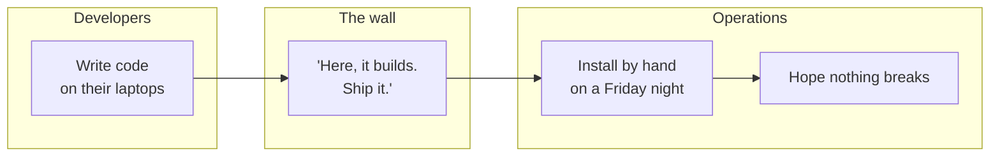

Three failures came out of this, and they all look familiar in real projects:

1. **"It works on my machine."** The developer's laptop has a different .NET version,
   a different Oracle client, different config files. The code is correct but the
   *environment* is not, and nobody can tell which.
2. **Releases are terrifying.** Updating a manually-configured server takes hours,
   needs a specific person, and is done out of hours because it requires downtime. So
   releases become rare. Rare releases mean each one bundles months of change, so
   each one is riskier. Riskier releases are more feared. **This is a death spiral.**
3. **Nobody owns the outcome.** Developers hand code over a wall; operations own
   "the system is up". When something breaks, the two teams argue about whose fault it
   is instead of fixing it together.

### 1.1 What it costs, concretely

Look at this repository and you can *see* those three failures:

| Symptom in the code | Which historical failure causes it |
|---|---|
| Database passwords, a bearer token, an API key and a JWT signing key are committed into `appsettings.Prod.json` | Nobody expected config to move between environments without a person editing a file by hand |
| Six near-identical Visual Studio publish profiles (`Dev`, `QA`, `UAT`, `PP`, `Folder`, `FolderProfile2`) each rebuilding the app for a different server | Deployment is a manual action performed from a developer's IDE |
| **Zero** test projects in `LHDN_STSDS.sln` | There was never a moment where "is this safe to ship?" had to be answered automatically |
| The pipeline copies files straight over the live site, stopping the app pool first | Releases require downtime, so the release *is* the scary event |

None of that is a moral failing by the original team. It is the default outcome when
delivery is not designed. **DevOps is the name for designing it.**

## 2. What "DevOps" actually means

DevOps is a **portmanteau of Development + Operations**, but it is not a job title and
not a tool. It is a set of principles about how software gets from an idea to a running
service, and back again. The most useful summary is the **CALMS** model:

| Letter | Meaning | What it looks like in reality |
|---|---|---|
| **C**ulture | Dev and Ops share ownership of the running system | The person who wrote the code also gets paged when it breaks |
| **A**utomation | Humans do judgement; machines do repetition | Builds, tests, deploys, migrations are all scripted, never "clicked" |
| **L**ean | Small batches, fast feedback, remove waste | Merge small changes often; don't batch 40 features into one quarterly release |
| **M**easurement | You cannot improve what you cannot see | Logs, metrics, traces, deployment frequency, failure rate |
| **S**haring | Knowledge and tooling are shared, not hoarded | The pipeline definition lives in the repo, not in one person's head |

### 2.1 The one-sentence definition

> **DevOps is the practice of making the path from a code change to a safely running
> system short, repeatable, automated and observable — and making the team that writes
> the code responsible for it running.**

Two words to underline: **repeatable** and **observable**. Almost every practice you
will learn from here is in service of one of those two.

### 2.2 What it is *not*

| Misconception | Reality |
|---|---|
| "DevOps is Docker and Kubernetes." | Containers are one *tool*. This application has no containers at all (see §11) and can still do excellent DevOps. |
| "DevOps is a team that deploys for us." | A separate "DevOps team" that owns releases recreates the original wall with a new name. |
| "DevOps means we never have downtime." | It means downtime is a *choice you made on purpose*, with a plan — not a surprise. |
| "DevOps is just CI/CD." | CI/CD is the machinery. DevOps is the whole loop, including how you handle a 2 a.m. incident. |

## 3. The software delivery lifecycle, mapped to eDS

Everything in DevOps is a stage in one loop. Learn the loop, and every tool you
encounter slots into a known place:

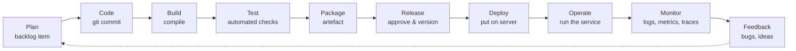

Now the same loop with this system's actual components:

| Stage | Generic meaning | In eDS today |
|---|---|---|
| Plan | Decide what to build | An Azure DevOps work item / GitLab issue |
| Code | Write it | Edit `.cs` / `.cshtml` under `LHDN_STSDS/`, commit, push to `release/dev` |
| Build | Turn source into a runnable program | `dotnet publish -c Release` → `bin\Release\net8.0\publish` |
| Test | Prove it works | ⚠️ **Nothing automatic.** Manual testing by a human |
| Package | Freeze it into a versioned bundle | ⚠️ **Nothing.** The publish output is copied to a runner-local folder |
| Release | Decide it is good and label it | ⚠️ **Nothing.** No version number, no approval step |
| Deploy | Put it where users can reach it | GitLab job: stop `TestAppPool` → copy into `C:\inetpub\eds-api` → start pool |
| Operate | Keep it running | IIS + Windows Server, restarted by hand |
| Monitor | See what it is doing | ⚠️ **Mostly `Console.WriteLine` into log files** |
| Feedback | Learn from reality | Human reports a bug |

**Read that table carefully — it is the single most important thing in this document.**
The build and deploy stages are automated. Test, package, release and monitor are not.
That asymmetry is exactly what the rest of the doc addresses, and it is why the
current pipeline, while genuinely useful, is not yet "CI/CD" in the full sense.

## 4. Core vocabulary

Read this table once now; it is used throughout. It is repeated as a lookup in §29.

| Term | Plain meaning |
|---|---|
| **Pipeline** | The scripted sequence of stages that runs automatically when you push |
| **Stage** | A phase of the pipeline (`build`, `test`, `deploy`). Stages run in order |
| **Job** | One unit of work inside a stage, running on one machine |
| **Runner** (or agent) | The machine that actually executes jobs |
| **Artefact** | The packaged, immutable output of a build — the thing you deploy |
| **Environment** | A place the app runs: Dev, QA, UAT, PreProd, Prod |
| **Promotion** | Moving the *same* artefact to the next environment |
| **CI** | Continuous Integration — everyone merges into one branch often; every merge is built and tested automatically |
| **CD** | Continuous Delivery (always deployable) or Continuous Deployment (actually deployed automatically) |
| **Configuration** | Values that differ per environment (`appsettings.QA.json`) |
| **Secret** | A configuration value that must be hidden: password, key, token |
| **IaC** | Infrastructure as Code — servers/sites/pools defined in versioned scripts, not clicked in a UI |
| **Rollback** | Returning to the previous known-good version |
| **Idempotent** | Running it twice has the same effect as running it once |
| **Observability** | Being able to answer "what is it doing right now?" from its outputs |
| **Monolith** | One deployable unit containing the whole system |
| **Microservice** | A small, independently deployable unit owning its own data |

---

# Part II — CI/CD explained

## 5. Continuous Integration (CI)

### 5.1 The core idea

**Continuous Integration** means: every developer merges their work into the shared
mainline **frequently** (at least daily), and every merge is **automatically built and
tested** so that integration problems are found in minutes, not in the week before
release.

The alternative is what most beginners naturally do — and it has a name:

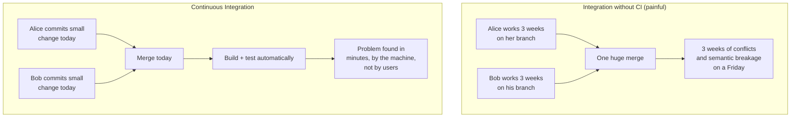

### 5.2 The contract you sign

CI is a **contract**, and both sides have obligations:

- **You commit small, frequent, working changes** — and never push code you have not
  at least built locally.
- **The pipeline keeps the mainline green.** A red mainline is an emergency, because
  it blocks everyone. Fix it or revert it, but never "leave it for later".
- **The pipeline is trustworthy.** If it passes but production breaks, the pipeline is
  lying and it needs more tests, not more optimism.

### 5.3 What CI needs to exist

| Prerequisite | Why | In eDS today |
|---|---|---|
| One shared mainline branch | Otherwise you are not integrating | ✅ `release/dev`, `eDScompoundCalculation` |
| An automated build | To prove the code compiles outside your laptop | ✅ `dotnet publish` in the pipeline |
| Automated tests | To prove the code *works*, not just compiles | ❌ **missing — no test project exists** |
| Fast feedback | If it takes 40 minutes, people work around it | ⚠️ acceptable for now; will matter more later |
| A place to run it | A runner machine | ✅ GitLab Runner, Windows shell executor |

**Honest assessment:** this repository has the *first half* of CI (build on every push)
and none of the *second half* (test on every push). That matters enormously and is
discussed in §8 and §13.

## 6. Continuous Delivery vs Continuous Deployment

These two get confused constantly. The difference is **one gate**.

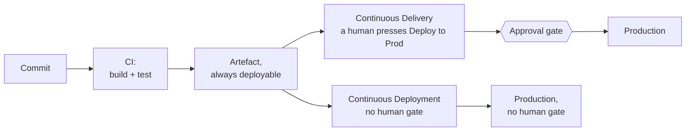

| | Continuous Delivery | Continuous Deployment |
|---|---|---|
| Every commit is production-ready? | Yes | Yes |
| Deploy happens automatically? | To Dev/QA/UAT yes; **Prod needs a human click** | Yes, all the way to Prod |
| Who decides to release? | A person | The pipeline, if tests pass |
| Risk | Low; gives a business decision point | Low *if* you have excellent tests + monitoring |
| Suitable for eDS? | ✅ **Yes — this is the right target** | ⚠️ Not for a government tax system without a long track record |

**Why the human gate is not "not-DevOps".** Continuous Deployment is only safe when
you can detect a bad release and roll back within minutes automatically. A
revenue- and legally-significant stamping system should earn that trust over time.
Continuous Delivery — *always deployable, deploy on demand* — is the professional
target, and it is what `CICD-DEVOPS.md` specifies.

## 7. Anatomy of a pipeline

Every CI/CD system (GitLab CI, GitHub Actions, Jenkins, Azure Pipelines) has the same
five parts. Learn them once, then you can read any pipeline anywhere.

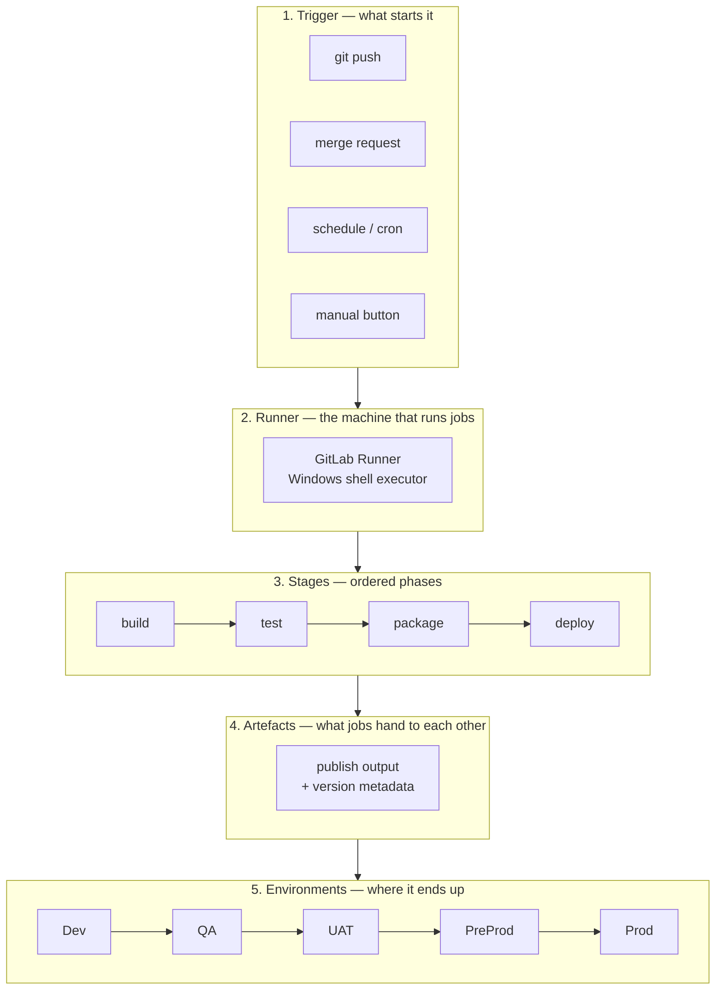

| Part | Meaning | Rule of thumb |
|---|---|---|
| **Trigger** | The event that starts the pipeline | Triggers live in the repo (`.gitlab-ci.yml`), never in a UI |
| **Runner** | The machine executing the job | Jobs must not depend on that machine's hidden state — that is how "works on my machine" returns |
| **Stage** | Ordered phase | If stage 2 fails, stage 3 never runs. Fail fast, fail cheap |
| **Job** | Unit of work, may run in parallel within a stage | A job should do one thing and be able to run on a fresh machine |
| **Artefact** | The output passed forward | **Build once, deploy that same thing everywhere** (see §21) |
| **Environment** | A running instance of the app | Same artefact + different config = different environment |

### 7.1 A minimal mental template

Almost every pipeline, whatever the tool, reads like this in plain English:

```
when:      someone pushes to a protected branch
on:        a fresh machine
do:        get the code
           restore dependencies
           compile
           run the tests            <-- if this fails, stop here
           package the output       <-- if this fails, stop here
           publish the package
           deploy to the target environment
           verify it is healthy     <-- if this fails, roll back
```

Compare that to this repository's actual pipeline in §10 — you will see it does step
1 through 6, then jumps straight to "copy over production".

## 8. Why tests are the price of admission

CI/CD is a machine that decides whether your code is safe to ship. **Tests are how you
tell the machine what "safe" means.** Without tests, the machine can only check that
your code *compiles*, which says nothing about whether it is *correct*.

### 8.1 The test pyramid

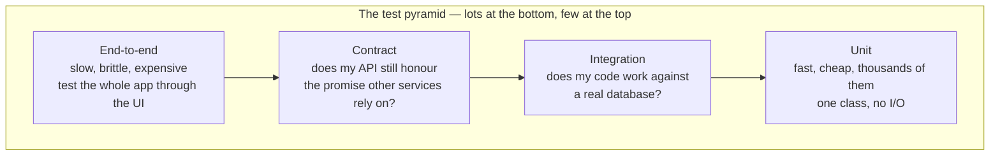

| Layer | Speed | What it proves | eDS relevance |
|---|---|---|---|
| **Unit** | milliseconds | A calculation is correct | e.g. the compound-duty calculator in `Modules/BulkProcess/_Shared/Calculation` |
| **Integration** | seconds | Code + real Oracle + real EF Core config works | ✅ critical here, because `AppDbContext` builds its schema **dynamically** from config — an in-memory fake would not reproduce it |
| **Contract** | seconds | The shape of data crossing a boundary is still agreed | matters the moment `bulk` or `integration` becomes a separate service |
| **End-to-end** | minutes | A user can actually stamp a document | a handful of these, no more |

### 8.2 Why this is a *blocker*, not a "nice to have"

This system has a **dual ORM** (EF Core *and* Dapper), a dynamically-schema'd
`AppDbContext`, and 883 broad `catch (Exception)` blocks. In that world:

- You cannot safely refactor without tests, because you cannot know what you broke.
- You cannot split into services without tests, because you would be changing the
  database boundary *and* the code at the same time, with no safety net.
- You cannot do blue/green or canary deploys meaningfully, because you cannot
  distinguish "the new version is broken" from "the user did something odd".

**So the very first DevOps investment in this repo is not a tool. It is tests.**
A single xUnit project with a few dozen tests is worth more than any fancy pipeline.
See §28, exercise 4.

## 9. Three properties of a trustworthy pipeline

Memorise these three words. Most pipeline bugs are violations of one of them.

| Property | Meaning | Violation example |
|---|---|---|
| **Reproducible** | The same commit produces the same artefact, every time, on any runner | Building with whatever SDK happens to be on the runner |
| **Idempotent** | Running the deploy twice leaves the system in the same state as running it once | A copy that appends, or a migration that runs twice |
| **Immutable** | Once an artefact is built, it is never modified — only replaced by a new version | Rebuilding the app for each environment (today's `.pubxml` approach) |

### 9.1 Why immutability is the quiet hero

If you **rebuild** for each environment, then what runs in production was never tested.
You tested Dev's build. They are *probably* the same, but "probably" is not a QA
strategy. If instead you **build once** and promote that exact binary through
Dev → QA → UAT → PreProd → Prod, then the thing you tested *is* the thing you shipped.

That is why "build once, promote the same artefact" appears in every serious DevOps
document, including `CICD-DEVOPS.md` §3.3. Today, eDS rebuilds per environment via
the Visual Studio publish profiles — see §12.

---

# Part III — This application's CI/CD, today

## 10. The current pipeline, explained

This is the complete working CI/CD configuration of the system. Read it slowly; every
line is annotated afterwards.

```yaml
stages:
  - build
  - deploy

variables:
  # Path where the app will be built
  PUBLISH_OUTPUT_DIR: bin\Release\net8.0\publish
  # The physical path of your IIS site
  IIS_SITE_PATH: "C:\\inetpub\\eds-api"
  # Name of the App Pool to restart
  APP_POOL_NAME: "TestAppPool"
  # Setting up local folder for the artifact rather than pushing it to our GitLab because we can't handle it
  LOCAL_BUILD_CACHE: "C:\\GitLab-Runner\\temp-builds\\eds"

build_job:
  stage: build
  environment: dev
  # ...restore, build and publish into PUBLISH_OUTPUT_DIR,
  #    then stage the output into LOCAL_BUILD_CACHE...

# deploy_job:
#   stage: deploy
#   environment: dev
#   script:
#     - Stop-WebAppPool  -Name $env:APP_POOL_NAME
#     - Copy-Item ...    -Destination $env:IIS_SITE_PATH   # replace the live site
#     - Start-WebAppPool -Name $env:APP_POOL_NAME
#   # `dependencies` deliberately commented out: we are not using GitLab artefacts
#   # (copying from the runner-local cache directly) because using both would clash
#   only:
#     - release/dev
```

### 10.1 Line-by-line

| Line | What it means | Beginner note |
|---|---|---|
| `stages: [build, deploy]` | Two ordered phases. `deploy` only starts if `build` succeeded | Stages are a **gate**, not just labels |
| `variables:` | Named values reused by the jobs | ⚠️ These are plain text in the repo — fine for paths, never for passwords |
| `PUBLISH_OUTPUT_DIR` | Where `dotnet publish` puts the compiled app | This is .NET's standard output folder for a Release build of a `net8.0` project |
| `IIS_SITE_PATH: C:\inetpub\eds-api` | The folder IIS serves the live site from | Deploying = overwriting files in this folder |
| `APP_POOL_NAME: TestAppPool` | The IIS worker process to stop while files are being replaced | Stopping it releases file locks so the copy can succeed — and takes the site **offline** |
| `LOCAL_BUILD_CACHE: C:\GitLab-Runner\temp-builds\eds` | The "artefact" is dumped on the **runner machine's own disk** | A real artefact store is versioned and central; this is neither |
| `build_job` | Restores, builds and publishes the solution | The only real quality gate: "does it compile?" |
| `deploy_job.only: release/dev` | The deploy runs **only** for pushes to that branch | A crude but effective protection: feature branches cannot deploy |
| commented-out `dependencies` | Normally a deploy job downloads the build's artefact; here they intentionally don't, to avoid clashing with the local-cache approach | This is a **workaround**, and the comment says so honestly |

### 10.2 What the pipeline is *good* at

Do not skip this — it is genuinely sound in places:

- ✅ **Deploy is automated.** A human does not RDP into a server to copy files.
- ✅ **Deploy is branch-gated.** `release/dev` is the only trigger, so an accidental
  push from a feature branch cannot hit a server.
- ✅ **Paths are centralised** as variables rather than scattered through the script.

### 10.3 What the pipeline is *missing*

| Missing | Consequence |
|---|---|
| Any test execution | A change that breaks stamping calculation passes the pipeline happily |
| A version number | Nobody can answer "which version is running in QA right now?" |
| A stored, immutable artefact | There is nothing to roll back *to*; the previous build is overwritten |
| Health verification after deploy | The pipeline reports "success" even if the app crashes on startup |
| A rollback path | Recovery = rebuild an older commit and redeploy, hoping it is the right one |
| Secret management | Credentials sit in `appsettings.Prod.json` in git |
| Post-deploy notification | You find out it went wrong from a user |

## 11. What actually happens when you push to `release/dev`

Trace your own change through the real system:

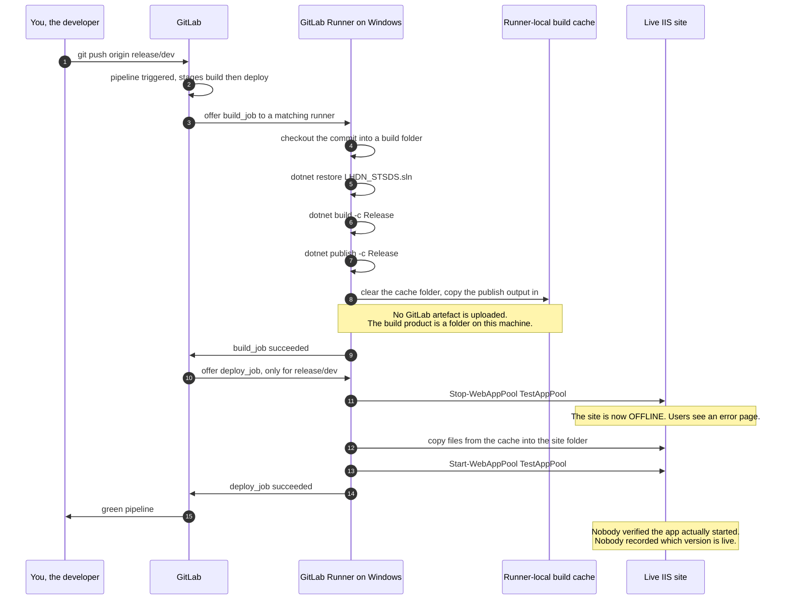

### 11.1 The three things to notice

1. **There is a downtime window.** Between `Stop-WebAppPool` and `Start-WebAppPool`
   the system is not serving requests. For a tax system used during office hours, this
   is the reason releases happen at night — which is exactly the "releases are scary"
   pattern from §1.
2. **"Success" means "the commands did not error".** Not "the application works".
3. **There is no way back.** The old file set is gone the moment the copy completes.

Each of these is solvable, and `CICD-DEVOPS.md` §7 does solve them (drain, blue/green
slots, readiness + version gate, one-command rollback). You are reading that document
later — now you know *why* it says what it says.

## 12. The second deploy path: Visual Studio + MSDeploy

The pipeline is not the only way this app reaches a server. The repository also
contains **six Visual Studio publish profiles**:

```
LHDN_STSDS/Properties/PublishProfiles/
├─ Dev Environment.pubxml
├─ QA Environment.pubxml
├─ UAT Environment.pubxml
├─ PP Environment.pubxml        # PreProd
├─ FolderProfile.pubxml
└─ FolderProfile2.pubxml
```

Each profile is a recipe such as: *build this project, then use **MSDeploy**
(Microsoft's web-deployment tool) to push the files over the network to
`172.20.185.31:8172/msdeploy.axd`, authenticating as `D1VVWSEDSSAD01\zen_admin`,
taking the app offline during the copy, and keeping a backup.*

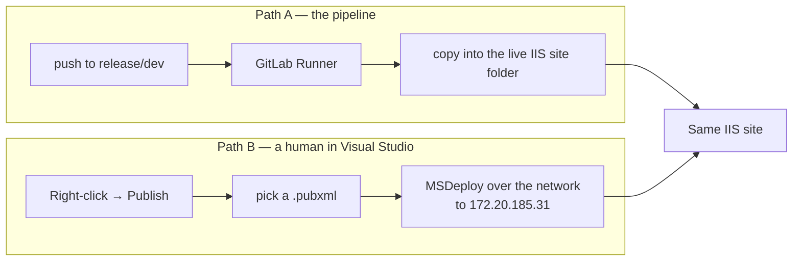

### 12.1 Why having two paths is a problem (even though both work)

| Issue | Explanation |
|---|---|
| **Two explanations of "what deployed"** | If QA breaks, did the pipeline do it or a person's publish? Unknowable |
| **Rebuild per environment** | Each profile builds its own copy → breaks immutability (§9.1) |
| **Credentials in the repo/IDE** | The publishing user and MSDeploy settings travel with the project |
| **Not repeatable by a new joiner** | It lives in someone's Visual Studio, not in a script |

**The fix is not to delete MSDeploy** — it is to keep *one* automated path and use
the manual path only as a documented emergency. Interestingly, MSDeploy *is* the right
tool for the target design; `CICD-DEVOPS.md` §7.4 uses it inside a proper blue/green
script instead of from a developer's laptop. Good tools, wrong controller.

## 13. Honest gap analysis

Everything below is verifiable in the repository. The "why it matters" column is the
part you should internalise — it is the difference between memorising facts and
understanding DevOps.

| Finding | Evidence | Why it matters |
|---|---|---|
| No test project at all | `LHDN_STSDS.sln` lists exactly one project | CI cannot verify correctness; every change is a leap of faith |
| No versioned artefact | `LOCAL_BUILD_CACHE` on the runner's disk | No rollback target, no audit trail, no "what is deployed?" |
| One hard-coded deploy target | `IIS_SITE_PATH`, `APP_POOL_NAME` | You cannot promote one build through 5 environments |
| Secrets in git | `appsettings.Prod.json` (Oracle password, `Security:apiKey`, `Hits:BearerToken`, `Jwt:SigningKey`) | Anyone with repo access has production credentials; rotating them means a code change |
| Prod config points at non-prod hosts | `appsettings.Prod.json` references `hitspre2` and UAT OASIS/MyTax hosts | Production has never been independently verified — a serious finding |
| Deploy requires downtime | `Stop-WebAppPool` → copy → start | Releases must be scheduled out of hours; risk is concentrated |
| No health endpoint | none exists in `Program.cs` | Nothing can automatically tell whether the app is alive — a prerequisite for both load balancers and canary deploys |
| Logs, not telemetry | 145 `Console.WriteLine` calls | You cannot ask "how many stampings failed in the last hour?" |
| Secrets/keys are node-local | `App_Data/DataProtection-Keys` | Two servers would issue incompatible login cookies → you cannot scale out even if you wanted to |

**Notice the shape of that list.** Almost none of it is about microservices. It is
about the *fundamentals*: tests, artefacts, versions, config, health, observability.
That is the point of Part III — and it is why Part IV comes with a large warning label.

---

# Part IV — Monoliths and microservices

## 14. What a monolith is (and is not)

A **monolith** is a system where the whole application is built and deployed as one
unit. This system is a textbook monolith:

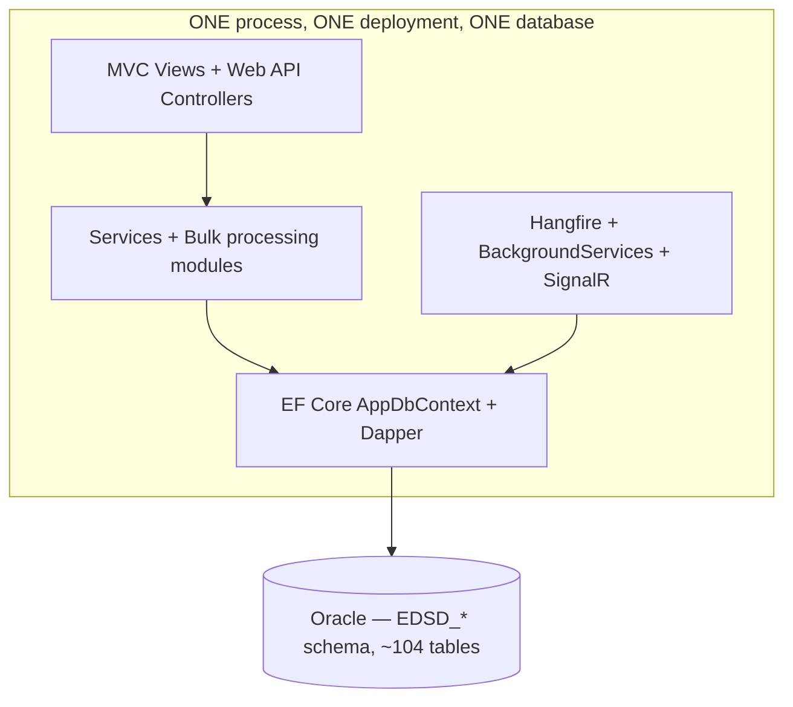

### 14.1 Monolith is not a dirty word

Beginners often hear "microservices" and conclude monolith = legacy = bad. That is
wrong, and believing it leads to ruined projects.

| Monolith advantage | Why it is real |
|---|---|
| **One transaction** | Stamping a document can insert rows across many tables, commit once, and be *guaranteed* consistent. With services, the same operation needs a saga (§23.3) |
| **One debugger** | Stack traces stay inside one process. `F5` works |
| **One deploy** | One pipeline, one version, one rollback |
| **No network between modules** | A method call cannot time out, cannot be rate-limited, cannot be partially applied |
| **Refactoring is cheap** | Renaming a class across the whole system is one commit |

Everything in this repository that is a *problem* (883 `catch(Exception)`, no tests,
one 1,751-line `AppDbContext`, 65 controllers) is a **code-organisation** problem, not
a "monolith" problem. Splitting the deployment without fixing the organisation makes
all of it worse.

## 15. What microservices actually are

A **microservice** is not "a small piece of code". It is a *deployment and ownership
unit* with four defining properties:

| Property | Meaning |
|---|---|
| **Independently deployable** | You can ship it without shipping anything else |
| **Owns its data** | It has its own database/schema; nobody else writes to its tables |
| **Communicates over the network** | Via HTTP or messaging — never by sharing memory or tables |
| **Owned by a team** | One team can change it end to end without coordinating a release train |

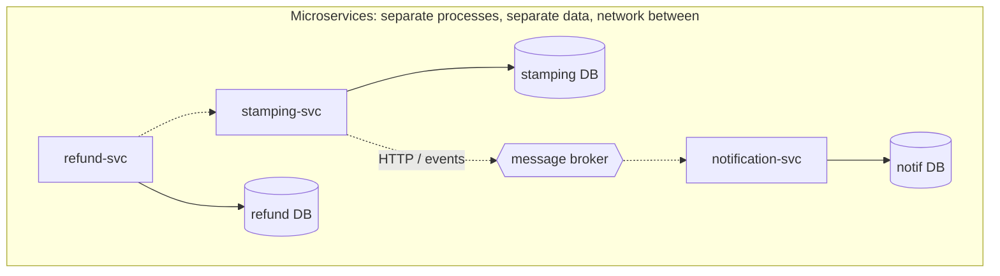

### 15.1 What you pay for it

Every property above converts a cheap thing into an expensive one:

| In a monolith | In microservices |
|---|---|
| A method call | A network call that can time out, retry, or fail halfway |
| A database transaction | A saga with compensations (because you cannot have one transaction across services) |
| A stack trace | A distributed trace across 5 services you must stitch together |
| A class rename | A versioned API change with a deprecation period |
| One deploy | Seven pipelines, seven versions, seven rollbacks |
| Local debugging | Running a broker and six services on your laptop, or a shared dev cluster |

This is not a reason to never do it. It is a reason to do it **only when the benefit is
specific and measurable.**

## 16. The middle path: modular monolith + satellite services

The professionally honest answer for this system is neither "stay as we are" nor
"become microservices". It is:

> **Keep one deployable application — but organise it into modules with enforced
> boundaries, and extract only the few capabilities that genuinely benefit from
> running separately into 4–6 satellite services.**

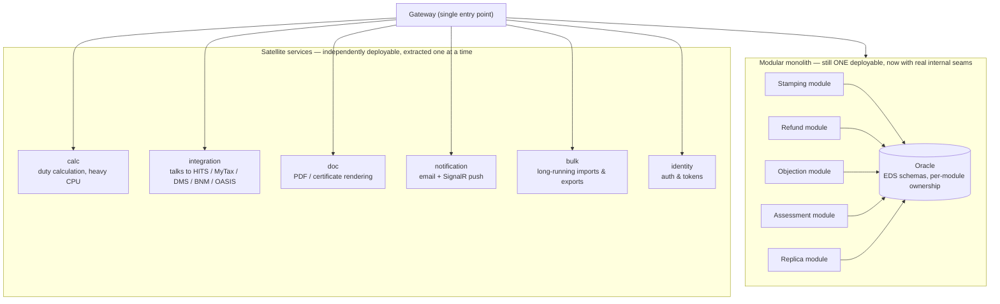

### 16.1 Why those six, specifically

Each satellite is chosen because it has a *concrete* property that a monolith serves badly:

| Satellite | Why it earns its own deployment |
|---|---|
| **calc** | Pure, CPU-heavy, testable, stateless — you want to scale it independently and reuse it from anywhere |
| **integration** | All outbound fragility (timeouts, rate limits, retries, corporate proxy) lives in one place; a HITS outage must not destabilise stamping |
| **doc** | Needs an odd runtime (local Chromium for PDF). Isolating it keeps that oddity out of the app servers |
| **notification** | Should never block a user transaction; failures here are tolerable and retryable |
| **bulk** | Long-running, memory-hungry, restart-sensitive — needs draining, not restarting, during a deploy |
| **identity** | A security boundary. Different release cadence, different audit requirements, shared by everything |

### 16.2 Why the rest stays together

Stamping, refund, objection, assessment and replica are **transactional, tightly
interlinked, and share the same data**. Their most important operations must stay
atomic (§14.1). Splitting them would convert a guaranteed database commit into a
best-effort saga, buying nothing except a distributed-system problem.

### 16.3 The benefit, quantified honestly

| | Effort | Benefit |
|---|---|---|
| Modular monolith + 6 satellites | ~30% | ~80% of the practical wins available |
| Full per-domain decomposition (~12 services) | 100% | ~100%, and only if you genuinely need independent team ownership and independent scaling |

`MICROSERVICES-MIGRATION.md` builds the full case, wave by wave, including the
strangler-fig sequencing (leaf services first, the transactional heart last) and
the sections on data ownership, sagas, outbox and dead-letter queues.

## 17. What "modular" actually means inside the monolith

This is the part beginners skip, and it is the most important part. Splitting into
satellites is worthless if the monolith is still a ball of mud, because the boundary
you extract will be wrong and you will end up with a distributed ball of mud.

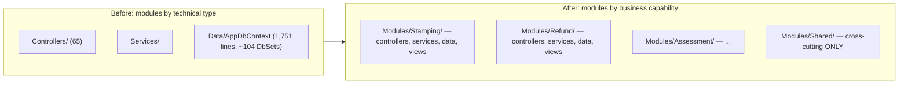

Concretely, for this codebase:

| Current shape | Modular target |
|---|---|
| One `Data/AppDbContext.cs` with ~104 `DbSet`s | One `DbContext` per module, or at minimum a hard rule: modules never query another module's sets directly |
| Cross-module calls by injecting each other's services | Calls go through a module's **public interface** (e.g. `IRefundModule`) |
| `Modules/BulkProcess/_Shared/Calculation` already used by several callers | Becomes the `calc` satellite's interface — it is *already* the cleanest seam in the repo |
| Business logic inside 65 controllers | Controllers orchestrate; modules own logic |
| Transactions spanning anything, anywhere | Transactions stay **inside** a module boundary |

The **rule that makes it real:** a module may only reach another module through its
published interface. That single rule is enforceable in code review and, later, in an
automated architecture test. Without it, "modular monolith" is a slogan.

## 18. When microservices are a bad idea

Say this out loud to yourself; it will save you from a bad year:

> **Microservices do not fix a badly organised codebase. They multiply its problems
> by the number of services.**

Do not split when:

| Situation | Because |
|---|---|
| You have no automated tests | You cannot safely change boundaries, and a distributed system is harder to verify |
| One team owns everything | You pay full distribution cost and get none of the autonomy benefit |
| Your "services" share a database | You have a distributed monolith — all the pain, none of the benefit |
| You cannot yet deploy the monolith safely | You will not be able to deploy 7 things safely |
| You have no tracing/logging | A cross-service bug becomes unsolvable |
| Domain boundaries are unclear | You will draw the wrong lines, and now they are expensive to move |

Every line in this repository's "risky spots" list — no tests, no health endpoint, no
tracing, secrets in git, in-memory Hangfire, node-local files — is a **prerequisite**
for splitting, not a consequence of it. That is why `CICD-DEVOPS.md` puts them in
Phase 0.

## 19. How you find a service boundary

You will be asked to help decide where to cut. Here is the checklist professional
architects actually use, in plain words:

| Question | Good sign | Bad sign |
|---|---|---|
| Does it own a distinct business capability? | "We issue certificates" | "All the controllers" |
| Does it change for a different reason to its neighbours? | Change approval process ≠ change duty rates | Every feature touches it |
| Could a different team own it end to end? | Yes | No, everyone owns it |
| Is its transaction self-contained? | Its operation commits on its own | It must commit together with a neighbour |
| Can it fail without taking everything down? | Yes, degrade gracefully | No, it is on the critical path of everything |
| Does it need different scaling? | Yes — heavy CPU, or long-running | No, same shape as everyone else |
| Can you name its data? | "Certificate rows it alone writes" | "It reads 40 tables from everywhere" |

If you cannot answer "**which data does it own?**", you have found a *module*, not a
service. That is a perfectly good answer — modules are the right step, and they are
how `MICROSERVICES-MIGRATION.md` sequences the work.

---

# Part V — DevOps for the target shape

Everything so far described the world as it is, or as it should be. This part answers:
**if we do move to a modular monolith + 6 satellites, what does the delivery system
have to do differently?**

## 20. What changes when you have seven deployables

| Concern | One app (today) | Modular monolith + 6 satellites |
|---|---|---|
| Repositories | One | One **monorepo**, or several — the repo choice is a strategy, not a detail |
| Pipelines | One | One pipeline per unit, triggered only when *that unit's* files change |
| Versioning | One version | One version **per unit** — plus a manifest recording which versions go together |
| Local development | `F5` | You cannot run all 7 + a broker locally. You need a shared dev environment |
| Debugging | One stack trace | A distributed trace with a correlation ID across services |
| Deployment | Stop pool, copy, start | Gateway + per-unit strategy: blue/green, rolling, drain-first |
| Data | One schema | One schema **owner** per unit; no cross-owner writes |
| Consistency | A transaction | Outbox + saga + compensations for the flows that cross a boundary |
| Failure | An exception | A timeout, a partial failure, a dead-lettered message |
| Ops burden | 1 site, 1 pool | 7 sites, 7 pools, 7 logs, 7 dashboards |

### 20.1 The gateway

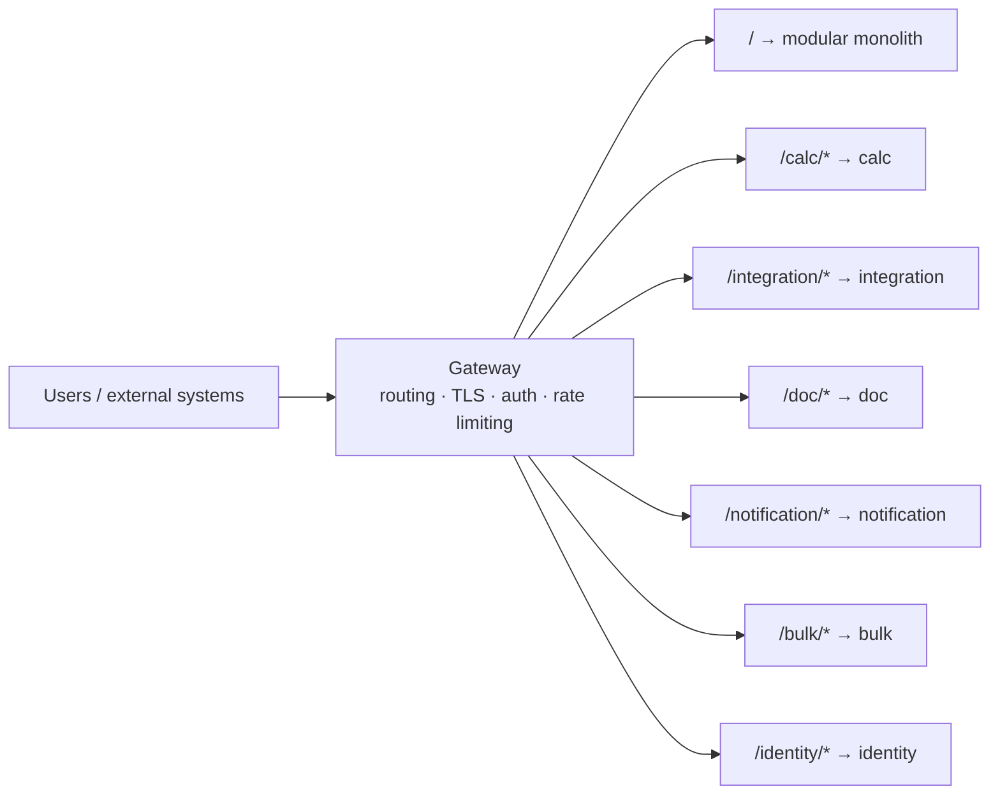

The gateway gives you one public entry point while internally routing to seven
services — so **the outside world still sees one application**, and users' bookmarks
keep working during the whole migration. Changing the gateway's route table is also
how you roll back a single service without touching the others.

### 20.2 Version manifests: answering "what is live?"

With seven units you cannot ask "what version are we on?" — you have to ask *per unit*.
The answer is a manifest, exposed by each service:

```json
{
  "unit": "calc",
  "version": "1.7.2",
  "commit": "af4ff4b5b",
  "builtAt": "2026-02-11T09:14:03Z",
  "configDigest": "sha256:3f9c…"
}
```

Then `GET /health/version` on each service tells you exactly what is running, and the
pipeline can *refuse to deploy* if the version it expects is not the version running.
That gate is what makes rollback verifiable rather than hopeful.

## 21. Build once, promote everywhere

This is the single most valuable habit in CI/CD, and it is worth its own section.

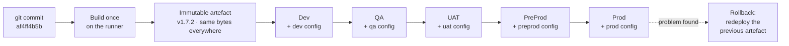

| Rule | Reasoning |
|---|---|
| Build exactly once | What you test is what you ship |
| The artefact never changes | Hashing it proves the deployment is the tested code |
| Only **configuration** changes per environment | Config is data, not code; it can be injected at deploy time |
| Promotion is the same action each time | QA → UAT → Prod differ only in *target* and *config*, so the process is boring and trustworthy |
| Rollback = deploy the previous artefact | Fast, safe, and does not require rebuilding old code |

**Today eDS violates this**: `FolderProfile`, `QA Environment.pubxml`, `UAT
Environment.pubxml` etc. each rebuild. The fix is a pipeline that publishes once,
stores the artefact, and promotes it — which is exactly what `CICD-DEVOPS.md` §3.3
and §4 specify.

### 21.1 Where environments differ, and where they must not

| Varies per environment | Must never vary |
|---|---|
| Connection strings, API endpoints | The compiled code |
| Feature flags on/off | The test suite that certified the build |
| Scale (instances, pool size) | The set of files in the artefact |
| Secrets | The version number |

## 22. Deployment strategies, in plain terms

How do you replace a running version without hurting users? There are four answers.

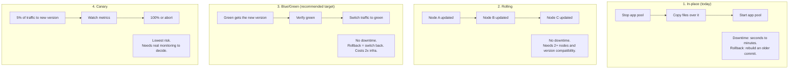

| Strategy | Downtime | Rollback speed | Requires | Fit for eDS |
|---|---|---|---|---|
| In-place | Yes | Slow (rebuild) | Nothing | Today — should be replaced |
| Rolling | No | Medium | ≥2 nodes, sticky-session-safe app | Only after node-local state (keys, files) is shared |
| **Blue/Green** | **No** | **Instant (a routing flip)** | **2 slots, a gateway/ARR switch, health endpoint** | ✅ **the target** — see `CICD-DEVOPS.md` §7.4 |
| Canary | No | Instant | Real traffic metrics + automated judgement | Later, for high-traffic units such as `calc` |

### 22.1 Why blue/green is the right target here

Because the deployment shape is IIS on Windows, there is no Kubernetes, and the app is
one big unit today. Blue/green is achievable with **two IIS slots and one ARR rewrite
rule**, and it turns the scariest part of DevOps — "we are live, and we just replaced
the running system" — into a **routing change that is undone with the same script**.
`CICD-DEVOPS.md` §7.4 contains the full working script, and §8.1 the infrastructure
definition that creates the two slots.

### 22.2 The one thing that makes blue/green work in this codebase

The app has state that lives on the node, not in the database:

| Node-local state | Consequence for blue/green |
|---|---|
| `App_Data/DataProtection-Keys` | Two slots would issue incompatible auth cookies → users logged out randomly |
| Uploaded attachments (`E:\`, `wwwroot/ReplicaUpload`) | A file uploaded via blue is invisible to green |
| Local Chromium for PDF rendering | Every slot needs its own install |
| **Hangfire with in-memory storage** | Job state dies on restart; two slots would each have their own queue |

**So before blue/green is possible, these four must move to shared resources**
(a shared key ring, an object store or shared volume, a documented Chromium install,
and persistent Hangfire storage). This is a perfect illustration of the DevOps rule:
*infrastructure determines what delivery strategies are even possible.* No amount of
pipeline cleverness allows a stateless swap around node-local state.

## 23. Configuration and secrets

### 23.1 Configuration vs secrets

| | Configuration | Secret |
|---|---|---|
| Example | `Hits:BaseUrl`, log level, feature flags | Oracle password, `Security:apiKey`, JWT signing key |
| Fine in git? | ✅ Yes | ❌ **Never** |
| Changes how often? | Rarely | On rotation, and immediately on any leak |

### 23.2 Why committed secrets are serious, not merely untidy

`appsettings.Prod.json` in this repository contains real-looking credentials. Understand
the full consequence:

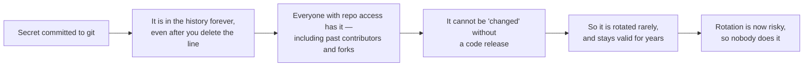

The fix has three parts:

1. **Rotate everything committed, now.** It must be assumed compromised. Changing the
   code is not enough because the values are in git history.
2. **Move secrets out of the repo** into a vault (Azure Key Vault, HashiCorp Vault) or
   your CI system's secret store, and inject them at runtime — never at build time.
3. **Make the app fail fast** if a required secret is missing, instead of silently
   falling back to a committed default. Silent fallbacks are how a production system
   accidentally connects to a test database.

`CICD-DEVOPS.md` §5.4 works through all of this concretely — including how the app's
identity authenticates to the vault without storing a credential.

### 23.3 Configuration hierarchy (how .NET resolves values)

.NET Core's configuration system is a **stack**, later layers winning:

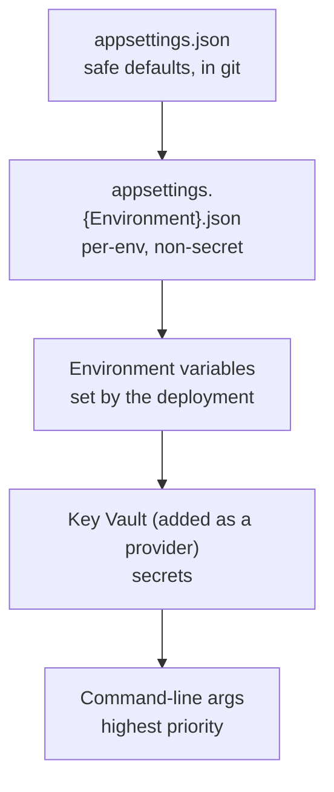

This is why "same artefact, different config" works: the code is identical, only the
layers above it change.

### 23.4 Secrets in the pipeline

The CI system itself also needs credentials — to reach a server, to read a vault. Rule:
**no long-lived credentials in CI.** Use short-lived, automatically issued tokens
(GitLab's `id_tokens` → federated cloud identity). If you must store something, store it
in the CI secret store, mark it masked and protected, and scope it to protected
branches only.

## 24. Database migrations and why order matters

Changing a database schema while old and new versions of the app are both running is
the classic way to cause an outage. The technique that prevents it is
**expand → migrate → contract**, sometimes called "parallel change":

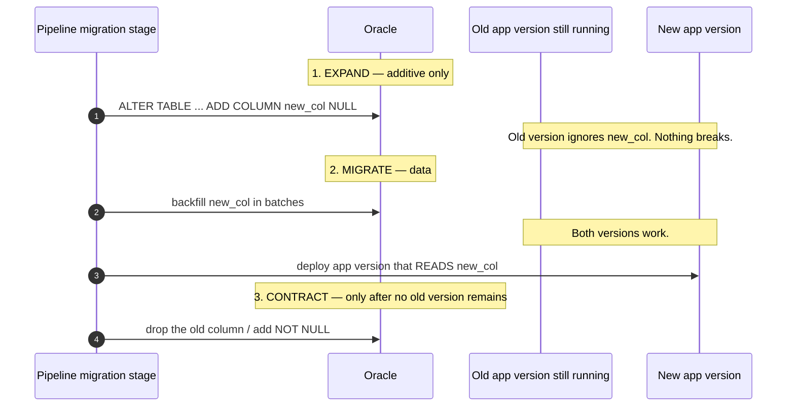

| Rule | Reason |
|---|---|
| Migrations are **additive** first | The old app version must keep working during the overlap |
| Migrations run as their **own pipeline stage**, before the app deploy | Never let app startup alter schema |
| Migrations are **idempotent** | A retried deploy must not fail or double-apply |
| Destructive changes are **separate, later releases** | So a rollback is still possible in between |
| In a split system, a unit may only migrate **its own** schema | Otherwise you have not actually split |

This matters for eDS specifically because there is at least one `DbSet` per business
concept and the schema string is resolved dynamically from configuration — a single
mispointed config value could point the app at the wrong schema. Migration stages plus
a static ownership check are what prevent that.

## 25. Observability: you cannot operate what you cannot see

Three pillars, one goal: answer questions about a running system without guessing.

| Pillar | Question it answers | eDS today |
|---|---|---|
| **Logs** | "What happened at 14:03 in this specific request?" | ⚠️ Files via 145 `Console.WriteLine` calls |
| **Metrics** | "How many stamping attempts failed in the last hour, and is that normal?" | ❌ None |
| **Traces** | "This submission took 9 seconds — which of the 6 services was slow?" | ❌ None |

### 25.1 Correlation IDs: the one thing to learn first

In a monolith, a stack trace tells you the story. Across services, you need to *carry*
the story. A **correlation ID** is a unique ID generated at the edge and passed into
every downstream call and log line.

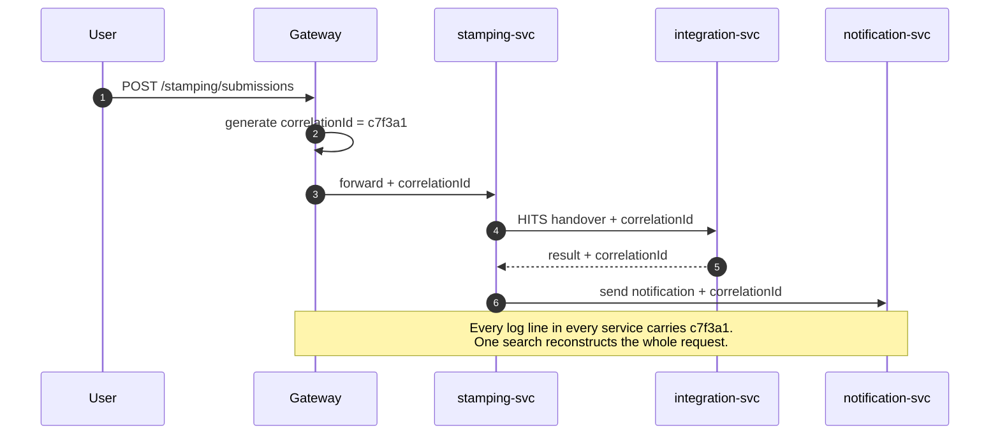

If you learn one distributed-systems operational skill, learn this one. Without it, a
failure that crosses three services is effectively undebuggable, and people start
adding `Console.WriteLine` to production code — which is, in a sense, exactly what
happened in this codebase.

### 25.2 The health endpoint

A **health endpoint** is a URL the infrastructure can call to ask "are you alive and
ready for traffic?" It is the foundation of every automated deployment strategy.

| Endpoint | Meaning | Used by |
|---|---|---|
| `/health/live` | The process is up | Restart logic |
| `/health/ready` | Dependencies (DB, broker) are reachable | Load balancer / gateway |
| `/health/version` | Which version is running | Deployment verification and rollback gates |

This repository has **none of them**, which is why the current deploy cannot verify
anything and why blue/green is not yet possible. Adding them is a small change with a
disproportionately large payoff — it is exercise 5 in §28.

## 26. Runbooks and incidents

DevOps does not end at deployment. The final loop is what happens when things break.

| Term | Meaning |
|---|---|
| **Runbook** | A written, step-by-step procedure for a specific operation or failure ("how to roll back `calc`") |
| **Playbook** | Broader: how the team responds to a class of incident |
| **Incident** | Something is broken for users right now |
| **Post-incident review (blameless)** | What happened, why, and what we change — focused on systems, not people |

A runbook is *executable knowledge*. A good test of your team's maturity: can a new
joiner roll back a release at 2 a.m. by following a document? If not, the rollback
does not really exist — it exists in one person's head.

The minimal set this system needs, and where each is described:

| Runbook | Documented in |
|---|---|
| Roll back the monolith | `CICD-DEVOPS.md` §7.4.4 |
| Roll back a single satellite | `CICD-DEVOPS.md` §7 (per-unit strategy) |
| Replay a dead-lettered message | `MICROSERVICES-MIGRATION.md` §5.6 (DLQ policy) |
| Rotate a leaked secret | `CICD-DEVOPS.md` §5.4.7 |
| A node is unhealthy / re-provision it | `CICD-DEVOPS.md` §8 (IaC) |

---

# Part VI — Your learning path

## 27. An eight-week plan

You do not need to learn all of DevOps before being useful. Learn it in dependency
order — each week's topic is usable immediately.

| Week | Topic | You can then… |
|---|---|---|
| 1 | Git properly: branches, merge vs rebase, merge requests, conflicts | Work without fear of losing work |
| 2 | The build: `dotnet restore/build/publish`, `.csproj`, `net8.0`, Release vs Debug | Reproduce the pipeline's build locally |
| 3 | Configuration & environments: `appsettings.*`, environment variables, what a secret is | Explain why committed credentials are dangerous |
| 4 | Testing: xUnit basics, arrange/act/assert, why integration tests differ | Write your first tests against this system |
| 5 | CI: read `.gitlab-ci.yml`, stages/jobs/runners/artefacts, add a build stage | Extend the pipeline safely |
| 6 | Deploy & IIS: app pools, bindings, site paths, what MSDeploy does | Follow a deployment end to end |
| 7 | Deployment strategies: in-place vs blue/green vs canary, rollback, health endpoints | Argue for the right strategy |
| 8 | Observability & distributed concepts: correlation IDs, metrics, tracing, sagas, outbox | Discuss microservices without hand-waving |

**Suggested reading order in this repo:** this document → `ARCHITECTURE.md` (to see
the real shape) → `CICD-DEVOPS.md` §2 (today) and §3–§5 (target) →
`MICROSERVICES-MIGRATION.md` §2–§5 (only after you can read the pipeline).

## 28. Hands-on exercises (all safe)

Do them in order. Each one teaches a real skill against the real system.

| # | Exercise | Teaches | Risk |
|---|---|---|---|
| 1 | Clone the repo; run `dotnet restore` and `dotnet publish -c Release` locally | The build stage, `net8.0`, publish output | none |
| 2 | Read `.gitlab-ci.yml` and write, in your own words, what each line does | Reading a pipeline | none |
| 3 | Draw, on paper, the path from `git push` to a user seeing the change | The whole lifecycle | none |
| 4 | Create an `LHDN_STSDS.Tests` xUnit project; add 5 tests for the compound-duty calculation | Unit testing, the missing half of CI | none — new project, not referenced by the app |
| 5 | Add a `/health/live` endpoint to `Program.cs` returning `{ "status": "ok" }` | Health checks, pipeline verification | low |
| 6 | Add a `build-and-test` stage to the pipeline that runs `dotnet test` | Making tests a gate | low (branch, not `release/dev`) |
| 7 | Write a `rollback.md` runbook for the current in-place deploy | Runbooks, thinking about failure | none |
| 8 | Pick one `catch (Exception)` block and rewrite it as specific exception types with a logged correlation ID | Error handling, observability thinking | low |

Exercise 4 and exercise 6 together are the most valuable hours you can spend in this
repository right now.

## 29. Glossary

| Term | Meaning |
|---|---|
| **Artefact** | The immutable, versioned output of a build |
| **ANCM** | ASP.NET Core Module — the IIS component that hosts the ASP.NET Core process behind IIS |
| **ARR** | IIS Application Request Routing — the component that lets IIS act as a reverse proxy (used by the blue/green target) |
| **Blue/green** | Two identical environments; traffic switches from one to the other |
| **Build** | Turning source code into runnable binaries |
| **Canary** | Releasing to a small percentage of traffic first |
| **CD** | Continuous Delivery (always deployable, human gate) / Continuous Deployment (fully automatic) |
| **CI** | Continuous Integration — frequent merges, automatic build + test |
| **Correlation ID** | A unique ID carried through all calls to trace one request |
| **Dead-letter queue** | Where messages go after retries are exhausted, preserved for inspection and replay |
| **DSC** | PowerShell Desired State Configuration — Microsoft's IaC tooling for Windows |
| **Environment** | A running instance: Dev, QA, UAT, PreProd, Prod |
| **Expand/contract** | The safe way to change a schema while old and new code both run |
| **Gateway** | The single entry point that routes to services |
| **Hangfire** | A .NET background-job library; in this app its storage is currently in-memory |
| **IaC** | Infrastructure as Code |
| **Idempotent** | Running twice = running once |
| **IIS** | Microsoft's web server for Windows |
| **Job (CI)** | One unit of work inside a pipeline stage |
| **Kestrel** | The ASP.NET Core web server, hosted behind IIS here via ANCM |
| **MSDeploy** | Microsoft's web deployment tool |
| **Metrics** | Numeric measurements over time (counts, latencies, rates) |
| **Migration** | A versioned, scripted change to a database schema |
| **Monolith** | One deployable unit containing the whole system |
| **Modular monolith** | One deployable, internally split into enforced modules |
| **Outbox** | Writing an event into the same transaction as your data, then publishing it reliably |
| **Pipeline** | The automated sequence of stages triggered by a push |
| **Promotion** | Moving the same artefact to the next environment |
| **Readiness** | Whether an instance can accept traffic |
| **Rollback** | Restoring the previous known-good version |
| **Runner / Agent** | The machine that executes pipeline jobs |
| **Saga** | A long-running, multi-step business process spanning services, with compensations |
| **Secret** | A credential that must never be in version control |
| **SLI / SLO / SLA** | Indicator (measure) / Objective (target) / Agreement (contract) |
| **Smoke test** | A quick check after deploy that the essentials work |
| **Stage (CI)** | An ordered phase of a pipeline |
| **Strangler fig** | Migrating by growing the new system around the old, then removing the old |
| **Test pyramid** | Many unit tests, fewer integration, fewest end-to-end |
| **Tracing** | Following one request across services |
| **Vault / Key Vault** | A secret manager |
| **YARP** | Yet Another Reverse Proxy — the .NET gateway library referenced in the migration doc |
| **Zero-downtime** | Deploying without users noticing |

## 30. Common misconceptions

| You might think… | Actually… |
|---|---|
| "I need Docker/Kubernetes to do DevOps." | This system has neither and can do excellent DevOps. Tools follow strategy, not the reverse |
| "CI/CD means the pipeline deploys for me." | That is only the *deploy* stage. CI is about integr*ation*; CD is about always being deployable |
| "Microservices are more modern, so better." | They trade local complexity for distributed complexity. Use them when the trade is worth it — §18 |
| "The pipeline is green, so it's safe." | Green means "nothing detected a problem", which is only as strong as the tests |
| "Deployment is the risky part." | *Unverifiable* deployment is the risky part. A verified, reversible deploy is routine |
| "Rollback means restoring a database backup." | Usually it means redeploying the previous artefact. Restoring data is a much bigger, rarer operation |
| "Secrets in git are fine because the repo is private." | History is permanent and access is broad. §23.2 |
| "We'll add tests later." | Tests are the safety net that makes every later change possible. "Later" means "after the first unrecoverable outage" |
| "DevOps is one person's job." | That recreates the wall from §1 with a new job title |

## 31. Where to go next

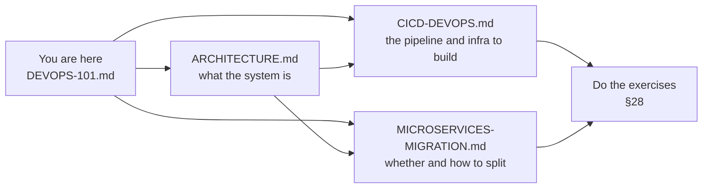

| If you want to… | Read |
|---|---|
| Understand the system's shape | [`ARCHITECTURE.md`](./ARCHITECTURE.md) |
| See the exact pipeline, IaC and deploy scripts to build | [`CICD-DEVOPS.md`](./CICD-DEVOPS.md), especially §2 (today), §3–§5 (target), §5.4 (secrets), §7.4 (blue/green), §8.1 (slot infrastructure) |
| Understand the microservices case and sequencing | [`MICROSERVICES-MIGRATION.md`](./MICROSERVICES-MIGRATION.md), especially §2–§4 (why and how) and §5 (data, saga, outbox, DLQ) |

## 32. TL;DR

- **DevOps** is making the path from commit to safely running system short, repeatable,
  automated and observable — and keeping the people who write the code responsible for it.
- **CI** = merge often, build and **test** automatically. This repo has the build half
  and none of the test half, which is its single biggest delivery weakness.
- **CD** = always deployable. Continuous *Delivery* with a human Prod gate is the right
  target here, not Continuous *Deployment*.
- Today: a two-stage pipeline that builds, then copies files over the live site with
  downtime, no artefact, no version, no verification, no rollback.
- The gaps are **fundamentals** — tests, artefacts, versions, config/secrets, health
  endpoints, observability — **not** microservices.
- **Monolith ≠ bad.** This system's problems are code-organisation problems.
- The right target is a **modular monolith (enforced internal boundaries) + 4–6
  satellites** (calc, integration, doc, notification, bulk, identity) — ~80% of the
  benefit for ~30% of the cost.
- **Never split before you can deploy the monolith safely**, and never let "services"
  share a database.
- The strategy that makes zero-downtime possible is **blue/green** — but only after the
  node-local state (key ring, attachments, Chromium, in-memory Hangfire) becomes shared.
- **Build once, promote the same artefact.** Configuration changes per environment;
  the binary never does.
- Start with §28, exercise 4. A test project is worth more than any pipeline redesign.
