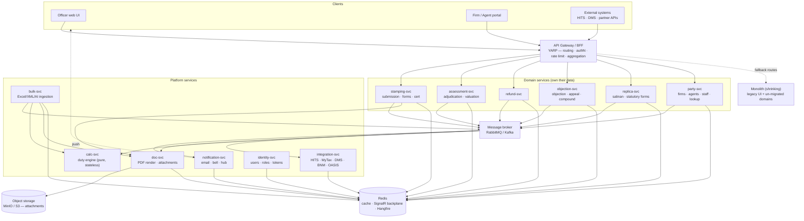
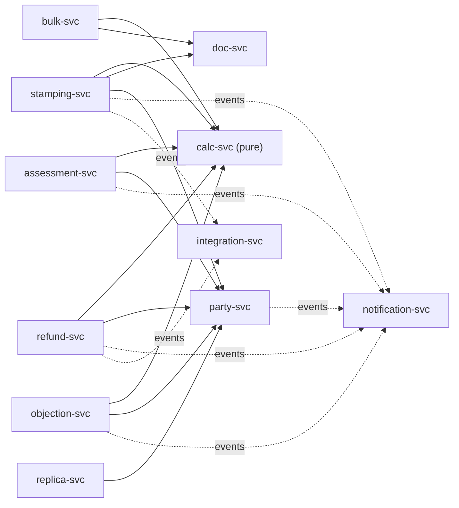
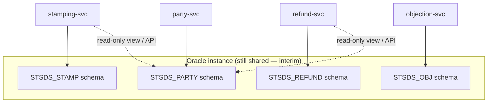
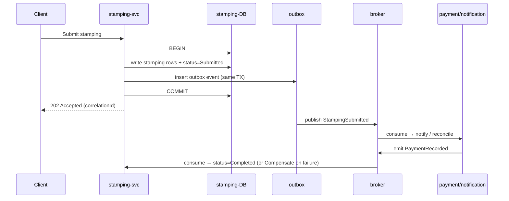
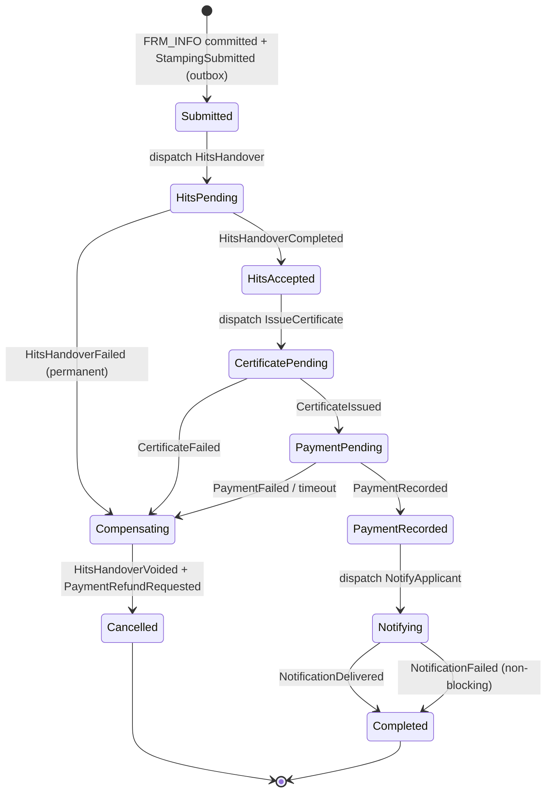
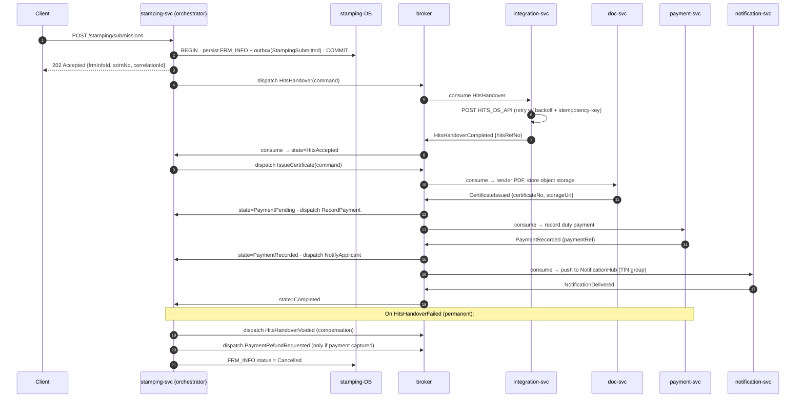
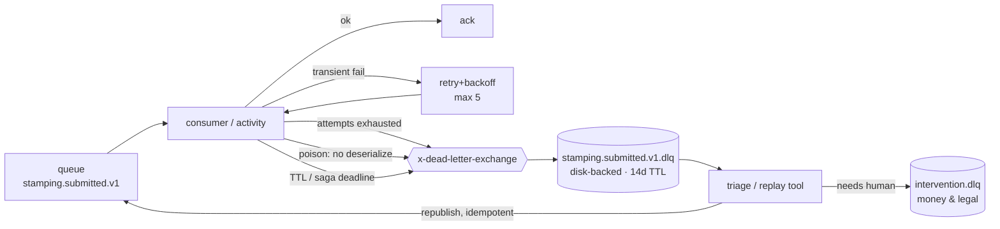
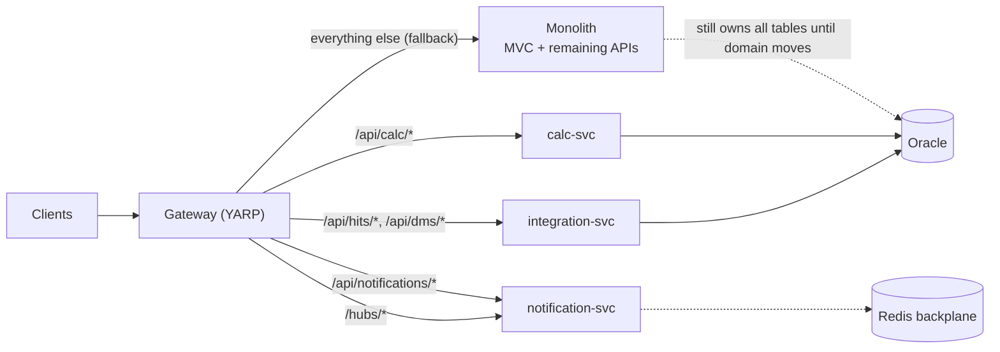
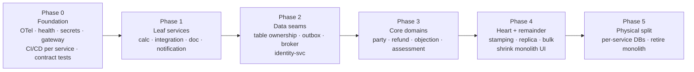

# STSDS / eDS — Monolith → Microservices Migration Guide

**Companion to** `docs/architecture/ARCHITECTURE.md` (current state).
**Scope:** how to evolve the single ASP.NET Core 8 process into a service-oriented / microservices architecture **without a big-bang rewrite**.
**Audience:** architects, tech leads, platform engineers.

> Diagrams use Mermaid. Render in any Mermaid-aware viewer (GitLab, VS Code, GitHub).
>
> **New to this topic?** Read [`DEVOPS-101.md`](./DEVOPS-101.md) first — it explains what a
> monolith, a service, a saga and a pipeline are, from first principles, before this
> document argues about where the boundaries should go.
>
> **Building the delivery system for the target shape?** See [`CICD-DEVOPS.md`](./CICD-DEVOPS.md).

---

## 1. Executive summary

The eDS system is a **single deployable ASP.NET Core 8 process** (`LHDN_STSDS`, ~685 `.cs`, ~65 controllers, ~104 `DbSet`s, one Oracle schema `STSDS_EDS`) with everything in-process: MVC UI, Web API, Razor, SignalR, Hangfire, 10 hosted `BackgroundService`s, and all integrations.

**Recommendation: do NOT rewrite. Use the Strangler Fig pattern** — grow a service layer around the monolith, move one bounded context at a time behind a routing gateway, and shrink the monolith until the low-value remainder is retired.

Ranked drivers that justify the migration (and what each one buys):

| Driver | Today | After extraction |
|---|---|---|
| Scale | One process; bulk/AI/PDF work competes with officer UI | Scale the hot service only (Bulk, Calc, Integration) |
| Release speed | 65 controllers = one blast radius, one app-pool recycle | Independent deploy per service |
| Reliability | In-memory Hangfire + unpooled DbContext; a restart loses jobs | Persistent queues, retries, isolated failures |
| Coupling | Direct cross-domain DB reads/writes on shared tables | Own-your-data, no shared-write DB |
| Security | One cookie/API-key chain for all callers | Per-service authZ scopes, external APIs isolated |

**Reality check:** this is a 4-year, ~685-file monolith on a **single Oracle instance**. Microservices are a *tax* — distributed transactions, eventual consistency, ops overhead. Adopt them only where a driver above is real, and stop when the cost exceeds the benefit (see §11 "When to stop").

---

## 2. Why a big-bang rewrite fails here

Concrete coupling that a "split the repo" approach would break:

1. **One database, shared writes.** ~104 `DbSet`s map to one Oracle schema; domains read *and write* each other's tables (e.g. stamping writes payment + notification + cert rows in one transaction). Any split needs a data strategy first (§5).
2. **In-process transactions.** 34 `BeginTransaction` sites assume a single `DbContext` can commit stamping + payment + audit atomically. Across services this becomes a saga (§6.4).
3. **Dynamic schema + dual ORM.** `AppDbContext` reads its Oracle schema from config in its constructor; Dapper uses a global `TypeMapProvider` honouring `[Column]`. Both are process-wide assumptions that must be preserved per service.
4. **In-process real-time.** `NotificationHub` (grouped by TIN claim) and `BulkProcessingHub` are pushed to from controllers via `IHubContext`. Split services must publish events, not call a hub directly.
5. **In-memory jobs.** Hangfire storage is in-memory — a second node has no shared queue. Distribution requires persistent Hangfire storage or a broker.
6. **Local node state.** DataProtection keys in `App_Data`, attachments on `E:\` (`LampiranBasePath`), and a **locally-installed Chromium** for PDF. None of this is shared across nodes today.

**Conclusion:** sequence the work as *strangler + data decoupling first*, service extraction second.

---

## 3. Target architecture



---

## 4. Service decomposition

Bounded contexts derived from the controller/domain clusters, `DbSet` ownership, and module folders.

### 4.1 Service catalog

| # | Service | Owns (today's controllers / tables) | Data owner | Extract order |
|---|---|---|---|---|
| 1 | **calc-svc** | Duty/compound calculation engine (`Modules/BulkProcess/_Shared/Calculation`) | **Stateless** (pure) | 1st |
| 2 | **integration-svc** | HITS, MyTax SPeF, DMS/APIM, BNM FX, OASIS AI clients | integration log only | 2nd |
| 3 | **doc-svc** | Chromium PDF render, attachments, `LampiranBasePath` | object store | 3rd |
| 4 | **notification-svc** | `NotificationHub`, BulkNotification, Senders/Receivers, email | notification tables | 4th |
| 5 | **party-svc** | Firms, Agents, Staffs, Branches, PartyUserProfile, lookup/reference tables | party + lookup | 5th |
| 6 | **stamping-svc** | Stamping submission, forms, DS-series, StampCertificate, PaymentDuty | stamping group | 6th |
| 7 | **assessment-svc** | Adjudication, valuation, assessment | assessment group | 7th |
| 8 | **refund-svc** | Refund forms, logs, status, bank accounts | refund group | 8th |
| 9 | **objection-svc** | Objection/Appeal, Compound duty, Cancellation, Amendment | objection group | 9th |
| 10 | **replica-svc** | Salinan/Replica, statutory forms, Penyata/statement | replica group | 10th |
| 11 | **bulk-svc** | `Modules/BulkUpload`, `BulkProcess`, `ImportData` orchestration | job metadata | 11th |
| 12 | **identity-svc** | AppUsers, Roles, ApiTokens, ApiLogs, auth conventions | security tables | late |

> **Sequencing principle:** extract the *stateless and leaf-coupled* services first (calc, integration, doc, notification). They have the fewest inbound data dependencies and prove the platform (gateway, broker, discovery, observability) with low risk. Extract the **transactional heart** (stamping) last, only after the data seams exist.

### 4.2 Dependency direction



Rules: **no service reads another service's tables**; synchronous calls only for queries (`calc`, `party` lookups), everything state-changing is **event-driven** via the broker.

---

## 5. Data decomposition strategy

This is the hard part — 104 tables in one schema with cross-domain writes.

### 5.1 Stage 1 — Logical ownership on the shared DB (no physical split yet)

Keep one Oracle instance, but assign every table an **owning service** and forbid cross-owner writes at the application layer (then at the DB layer via grants/views).



- Each service gets its **own Oracle user/schema**; cross-service reads go through **views or APIs**, never direct table grants.
- This alone removes most hidden coupling and is reversible if the migration stalls.

### 5.2 Stage 2 — Per-service database

Give each service its own database (Oracle pluggable DB, or move reporting-only tables to a read model). Choose store per service: relational for stamping/refund (ACID), document/object storage for attachments, cache for lookup.

### 5.3 Transactional consistency — Transactional Outbox + Saga

In-process `BeginTransaction` blocks that span "stamping + payment + notification" become:



Patterns:
- **Transactional Outbox** — write domain row + event in one local transaction; a relay publishes it. Guarantees no lost events without 2PC.
- **Saga / process manager** — orchestrate multi-service flows with compensations (e.g. refund saga: reserve → bank validation → disburse → notify; compensate on rejection).
- **Idempotent consumers** — every event handler keyed by `correlationId`/`MessageId` (essential: HITS/DMS retries already happen today).

### 5.4 Shared reference data

`COUNTRY`, `STATE`, instrument titles, DuitNow/Bank types are read-mostly. Publish as a **lookup cache** (Redis) refreshed by `party-svc` events — do not remote-call per request.

### 5.5 Worked example — the stamping submission saga

The current submission flow is **already a two-phase pipeline**, and the seam between the phases is exactly where a saga belongs. In `Services/StampingService/Submission/CreateStampingSubmissionUseCase.cs` the use case:

1. opens **one** `Database.BeginTransactionAsync()`;
2. runs every registered **persist step** in order, then `CommitAsync()`;
3. runs every registered **finalize step** — with **no transaction** around them.

| Phase | `Order` | Step (real class) | Effect |
|---|---|---|---|
| Persist (in TX) | 10 | `NormalizeSubmissionRequestStep` | Normalize posted request |
| Persist (in TX) | 20 | `InitializeSubmissionRunStep` | Initialize run-scoped values |
| Persist (in TX) | 30 | `ResolveSubmissionFormTypeStep` | Resolve form type (DS1…DS9) |
| Persist (in TX) | 40 | `PersistNewSubmissionStep` | **Insert `FRM_INFO`** → yields `FrmInfoId` |
| Persist (in TX) | 50 | `PersistExistingSubmissionStep` | Update existing submission |
| — | — | **`CommitAsync()`** | — |
| Finalize (no TX) | 10 | `EnsureStaffCaseStep` | Ensure staff case record |
| Finalize (no TX) | 20 | `HitsSubmissionStep` | **Hand over to HITS** (remote) |
| Finalize (no TX) | 30 | `SubmissionNotificationStep` | Notify applicant via `NotificationHub` |
| Finalize (no TX) | 40 | `PersistPaymentDetailStep` | Persist payment detail |
| Finalize (no TX) | 50 | `SandboxSubmissionCountStep` | Increment sandbox counter |

Because finalize runs **after commit**, today HITS can accept while the payment-detail write or the notification fails — leaving a half-finished submission that only the retry/reaper `BackgroundService`s clean up. That is precisely the gap the saga closes: **the persist phase stays a local ACID transaction; the finalize phase becomes an orchestrated, compensatable saga.**

#### Orchestration saga — state machine



#### Happy path + compensation



#### Event envelope (every message)

```json
{
  "eventId": "6f1c2a54-9b3e-4a71-9d2f-0c7e5b1a8e33",
  "eventType": "stamping.submission.submitted.v1",
  "eventVersion": 1,
  "occurredAt": "2025-01-16T08:31:07.123Z",
  "correlationId": "b7a1f0e2-4c5d-4e6f-8a90-1234567890ab",
  "causationId": "b7a1f0e2-4c5d-4e6f-8a90-1234567890ab",
  "producer": "stamping-svc",
  "tenant": "eDS",
  "payload": { }
}
```

> `correlationId` is the saga instance id; `causationId` is the `eventId` of the message that triggered this one. Both are persisted on the outbox row so a trace can be rebuilt end-to-end (see §6.4).

#### 1 · `stamping.submission.submitted.v1` — emitted by `stamping-svc`

Maps to the committed persist phase (`PersistNewSubmissionStep` / `FRM_INFO`).

```json
{
  "frmInfoId": 4820193,
  "sdrnNo": "eDS/2025/01/KL/000482",
  "formType": "DS1",
  "submissionMode": "New",
  "tin": "123456789012",
  "applicant": {
    "name": "ABC Holdings Sdn Bhd",
    "identificationNo": "202301012345",
    "email": "ops@abc-holdings.example",
    "phone": "+60123456789"
  },
  "instrument": { "code": "PROP_TRANSFER", "title": "Memorandum of Transfer" },
  "assessmentRef": "LA/2025/000771",
  "duty": { "stampDuty": 2400.00, "lateDuty": 0.00, "total": 2400.00, "currency": "MYR" },
  "attachments": [
    { "documentId": "doc_7c1a", "kind": "INSTRUMENT", "sha256": "9f2b…" },
    { "documentId": "doc_7c1b", "kind": "LAMPIRAN",   "sha256": "3a10…" }
  ],
  "submittedByUserId": "u_88213"
}
```

#### 2 · `integration.hits.handover.completed.v1` / `.failed.v1` — `integration-svc`

Replaces `HitsSubmissionStep`. Wraps the call to `HITS_DS_API`.

```json
{
  "frmInfoId": 4820193,
  "sdrnNo": "eDS/2025/01/KL/000482",
  "hitsEnvironment": "DEV",
  "hitsReferenceNo": "HITS-2025-884213",
  "httpStatus": 200,
  "retryCount": 0
}
```

```json
{
  "frmInfoId": 4820193,
  "sdrnNo": "eDS/2025/01/KL/000482",
  "hitsEnvironment": "DEV",
  "httpStatus": 503,
  "errorCode": "HITS_UNAVAILABLE",
  "message": "Upstream gateway timeout",
  "retryCount": 3,
  "permanent": true
}
```

#### 3 · `document.certificate.issued.v1` — `doc-svc`

Replaces the certificate/`StampCertificateDataModel` write and the local-Chromium PDF render.

```json
{
  "frmInfoId": 4820193,
  "sdrnNo": "eDS/2025/01/KL/000482",
  "certificateNo": "eDS-CERT-2025-000482",
  "storageUri": "s3://eds-docs/certificates/2025/01/4820193.pdf",
  "sha256": "c41d9a…",
  "issuedAt": "2025-01-16T08:32:14.001Z",
  "validFrom": "2025-01-16T00:00:00Z"
}
```

#### 4 · `payment.duty.recorded.v1` / `.failed.v1` — `payment-svc`

Replaces `PersistPaymentDetailStep`.

```json
{
  "frmInfoId": 4820193,
  "sdrnNo": "eDS/2025/01/KL/000482",
  "paymentRef": "PAY-2025-556120",
  "method": "DuitNow",
  "amount": 2400.00,
  "currency": "MYR",
  "bankRef": "MBB-77-0092",
  "status": "Recorded",
  "paidAt": "2025-01-16T08:33:02.556Z"
}
```

#### 5 · Saga commands (orchestrator → workers)

```json
{
  "commandType": "stamping.commands.hits-handover.v1",
  "frmInfoId": 4820193,
  "sdrnNo": "eDS/2025/01/KL/000482",
  "formType": "DS1",
  "attempt": 1,
  "idempotencyKey": "hits-handover:4820193"
}
```

```json
{ "commandType": "stamping.commands.notify-applicant.v1",
  "frmInfoId": 4820193, "sdrnNo": "eDS/2025/01/KL/000482",
  "tin": "123456789012", "channel": "SignalR",
  "templateKey": "STAMPING_SUBMITTED", "deepLink": "/stamping/4820193" }
```

#### 6 · Compensation events

| On failure | Compensation event | Who reverses |
|---|---|---|
| HITS permanent reject | `integration.hits.handover.voided.v1` | `integration-svc` |
| Certificate render fails | `document.certificate.voided.v1` | `doc-svc` |
| Payment fails / times out | `payment.duty.refund.requested.v1` (only if captured) | `payment-svc` |
| Saga gives up | `stamping.submission.cancelled.v1` → `FRM_INFO.status = Cancelled` | `stamping-svc` |

#### Mapping: legacy finalize step → saga activity

| Legacy step (post-commit, no TX) | Saga activity | Owner | Failure handling |
|---|---|---|---|
| `EnsureStaffCaseStep` | fold into persist phase | `stamping-svc` | transactional (no saga) |
| `HitsSubmissionStep` | `dispatch HitsHandover` | `integration-svc` | retry → compensate |
| `SubmissionNotificationStep` | `NotifyApplicant` | `notification-svc` | retry → dead-letter (non-blocking) |
| `PersistPaymentDetailStep` | `RecordPayment` | `payment-svc` | retry → compensate/refund |
| `SandboxSubmissionCountStep` | local counter (keep in `stamping-svc`) | `stamping-svc` | best-effort |

#### Correctness rules

- **Idempotency** — each worker dedupes on `idempotencyKey` (e.g. `hits-handover:{frmInfoId}`); HITS/DMS already retry, so this is mandatory, not optional.
- **Ordering** — the orchestrator gates each step on the previous reply, so cross-service ordering is explicit; within a topic, key messages by `frmInfoId` to keep per-submission order.
- **Timeouts** — `HitsPending`/`PaymentPending` have a deadline; on expiry the saga emits the same compensation path as a permanent failure.
- **No distributed TX** — the only ACID transaction is the local `FRM_INFO` + outbox write. Everything after is eventually consistent by design.

#### Interim step: adopt the outbox **before** extracting any service

The seam above exists **today** — no service has to be split first. Wrapping the five finalize steps as outbox rows:

1. is behaviour-preserving (they already run post-commit, untransacted);
2. makes the finalize phase **observable and replayable** immediately;
3. lets HITS/notification/payment start as **in-process consumers** of the monolith's own events, then move out to `integration-svc`/`notification-svc`/`payment-svc` later **without changing the contract**.

This is the concrete first cut of Wave 1 in §7 — the event schemas above are the target contract that survives the whole migration.

```csharp
// stamping-svc — persist phase stays one local transaction; outbox closes the gap
await using var tx = await _db.Database.BeginTransactionAsync(ct);

var frmInfo = await PersistNewSubmissionStepAsync(request, ct);   // FRM_INFO insert
await _outbox.AddAsync(new OutboxMessage
{
    EventType     = "stamping.submission.submitted.v1",
    CorrelationId = sagaId,
    Payload       = JsonSerializer.Serialize(StampingSubmitted.From(frmInfo))
}, ct);                                                            // same TX → no lost events

await tx.CommitAsync(ct);
return Accepted(new { frmInfo.FrmInfoId, frmInfo.Sdrn_No, correlationId = sagaId });
// finalize steps are now driven by the saga, not by an untransacted loop
```

---

### 5.6 Retry, compensation & dead-letter policy

The saga in §5.5 is only safe if *failure* is handled as explicitly as success. Delivering a message "at-least-once" without a policy turns any hiccup into either **silent data loss** (dropped after a bare `catch`) or an **infinite retry loop** (requeueing a poison message). Today the monolith already has an implicit, inconsistent version of this policy — Hangfire's automatic retries plus the reaper `BackgroundService`s (stale bulk upload, replica/amendment draft expiry, pending-HITS retry notification). This section makes that policy **explicit, uniform, and per-activity**, so it survives the split unchanged.

> **Rule of thumb:** retry is *per activity*, not per saga. The orchestrator never re-runs the whole submission; it re-runs the single failed step, and only that step's compensation is allowed to run after the retry budget is spent.

#### 5.6.1 Failure taxonomy — classify before you retry

Retrying the wrong class of failure is the most common bug in this domain. Every failed activity is first classified:

| Class | Concrete eDS example | Retry? | Reaction |
|---|---|---|---|
| **Transient / infra** | Oracle `ORA-12541` (no listener), `ORA-00060` (deadlock), APIM `503`, corporate-proxy connect timeout, DNS blip | ✅ yes, backoff | retry → DLQ |
| **Rate-limit / throttle** | HITS `429`, MyTax SPeF `429` | ✅ yes, longer backoff, honour `Retry-After` | retry → DLQ |
| **Timeout — unknown outcome** | `HttpClient` timeout mid-way through a DMS document handover | ⚠️ yes, **only if idempotent** | retry with dedupe key → DLQ |
| **Permanent integration reject** | HITS `400` business validation, MyTax `422` | ❌ no | compensate + notify |
| **Business reject** | duty mismatch, duplicate SDRN, invalid TIN, closed case | ❌ no | compensate + user-facing reason |
| **Poison / malformed** | JSON deserialisation failure, `v1` schema mismatch, missing `frmInfoId` | ❌ no | DLQ **immediately** (never requeue) |
| **Render / asset (node-local)** | local Chromium crash, `E:\` (`LampiranBasePath`) full, missing template | ⚠️ small budget | retry ×2 → DLQ + alert |

Distinguishing *transient* from *permanent* is a property of the **integration client**, not of the worker: `integration-svc` maps HTTP status / Oracle error number to one of the classes above and returns a typed failure (`RetryableFailure` vs `PermanentFailure`). Workers never inspect raw status codes themselves — 35 ad-hoc `new HttpClient` call sites today are exactly what this centralises.

#### 5.6.2 Where retries live

- **One retry budget per activity**, owned by the activity itself (Polly/MassTransit pipeline), never by the saga.
- **Exponential backoff with full jitter** — base `2s`, factor `2`, cap `60s`, **max 5 attempts**. Jitter is mandatory: without it, a HITS blip releases every parallel submission at the same instant and re-creates the overload.
- **Per-step timeout** `30s`; **overall saga deadline** `15 min` (see §5.6.5).
- **Idempotency is a precondition for retry.** Every retryable activity must be safe to run twice with the same `idempotencyKey` (§5.5 correctness rules) — HITS and DMS already retry internally, so a naive worker retry produces duplicate handovers. Dedupe store: `frmInfoId + activity + attempt-agnostic key`.

#### 5.6.3 Retry budget per saga activity

| Activity (§5.5) | Owning svc | Retryable | Max attempts | Backoff | On budget exhausted |
|---|---|---|---|---|---|
| `hits-handover` | `integration-svc` | transient / rate-limit / timeout only | 5 | 2s → 60s | emit `integration.hits.handover.voided.v1` **then** DLQ |
| `issue-certificate` | `doc-svc` | yes (render is flaky, node-local) | 3 | 2s → 30s | park in DLQ, saga → **InDoubt**, human review (never silently void a issued certificate) |
| `record-payment` | `payment-svc` | yes | 5 | 2s → 60s | DLQ **+ page** (money at stake) |
| `notify-applicant` | `notification-svc` | yes (retries cheap) | 5 | 1s → 30s | DLQ, **saga still advances** — notification is best-effort, falls back to queued email; never blocks duty flow |
| `persist-submission` (persist phase) | `stamping-svc` | — none — | 1 | n/a | local ACID TX fails → `500` to caller, no event emitted (see §5.5) |

Notification is deliberately non-blocking: SignalR (the `NotificationHub`) is ephemeral, so a push is always **persisted first** and the hub delivery retried independently — a missed push must never leave a legal submission un-finalised.

#### 5.6.4 Circuit breakers & bulkheads per dependency

Wrap each external dependency in its own circuit breaker + concurrency bulkhead, inside `integration-svc`:

- **Circuit per dependency** — `hits`, `mytax`, `dms`, `bnm`, `oasis` (half-open probe after cool-down). When HITS is down, stop hammering it and fail fast to the DLQ/compensation path rather than exhausting the retry budget on every saga.
- **Bulkhead** — capped concurrent calls + dedicated connection pools per dependency, so a slow DMS cannot starve HITS traffic (today all share one process and one connection set).
- **Rationale** — the monolith has no breaker and no pool separation; one degraded upstream currently stalls unrelated stamping work.

#### 5.6.5 Timeouts, deadlines & the two clocks

Two independent clocks, because a saga must not hang forever behind a step that never replies:

- **Per-step timeout** (30s) → treated as an unknown-outcome failure → retry rule above.
- **Overall saga deadline** (15 min) → enforced by a **delayed message** (RabbitMQ `x-delayed-message` / delayed exchange, or a TTL queue). On breach: emit `stamping.saga.timed-out.v1`, run the compensation path, and move to **InDoubt** if compensation cannot complete.
- Deadlines are **absolute, not per-attempt** — five retries of 60s backoff cannot push a submission past the SLA unnoticed.

#### 5.6.6 Compensation policy

- **Semantic undo, not rollback.** The persist phase is committed by design (§5.5) — `FRM_INFO` and the legal record **stay**. Compensation *voids* (`integration.hits.handover.voided.v1`, `document.certificate.voided.v1`) or *marks*, it never deletes.
- **Compensation steps are themselves retried.** A compensation is an ordinary activity with its own budget (`5 attempts`, same backoff). Do **not** assume it succeeds first time.
- **A failed compensation is the worst state** — it goes to the **intervention queue** (§5.6.7), never a bare `catch` and never silently dropped. This is the one place the system stops and asks a human.
- **Best-effort-forward** — a later authoritative event (`payment.duty.recorded.v1` after a `hits.voided.v1`) supersedes; consumers must tolerate out-of-order compensation, keyed by `frmInfoId`.
- **Non-compensable steps go last.** Steps with no undo API (e.g. a public certificate already downloaded) are ordered at the end of the saga, or made idempotent-safe, so the compensating branch never has to reverse them.

#### 5.6.7 Dead-letter policy

Every queue is declared with a dead-letter exchange (`x-dead-letter-exchange`) — a DLQ per source queue, disk-backed, never in-memory (contrast: Hangfire storage is **in-memory** today, so job state is lost on restart).



**A message lands in the DLQ when:** its retry budget is exhausted, it is classified **poison** (deserialisation / schema failure — requeueing these is an infinite loop), its TTL expires, or the saga deadline fires.

**DLQ message envelope** — the original payload plus a failure header block, so triage needs no log archaeology:

```json
{
  "x-original-queue":    "stamping.submitted.v1",
  "x-original-topic":    "stamping.submission.submitted.v1",
  "x-attempts":          5,
  "x-first-failure-utc": "2025-01-16T08:31:02Z",
  "x-last-failure-utc":  "2025-01-16T08:33:44Z",
  "x-failure-class":     "Transient",   // Transient | RateLimit | Timeout | Permanent | Business | Poison
  "x-failure-reason":    "ORA-12541: TNS:no listener (HITS handover)",
  "x-saga-id":           "8f1c...saga",
  "x-correlation-id":    "b27e...",
  "x-frmInfoId":         4820193,
  "x-idempotencyKey":    "hits-handover:4820193"
}
```

**Replay tooling** — a DLQ consumer that inspects, fixes if needed, and republishes to the origin queue with a `x-replayed-at` marker, or discards with an audit entry. Replay **must be idempotent** (same `idempotencyKey`), so replaying twice is always safe.

**Retention & alarms** — DLQ TTL `14 days`; alert if `dlq_depth > 0` on the payment or stamping queues, or if any message is older than its SLA. Silent DLQ growth is a legal-risk signal in a stamp-duty system.

#### 5.6.8 Policy matrix (one line per activity)

| Activity | poison → DLQ | transient → max | compensation | on exhaust |
|---|---|---|---|---|
| `hits-handover` | immediate | 5 | `hits.handover.voided` | void → DLQ |
| `issue-certificate` | immediate | 3 | `certificate.voided` | InDoubt → intervention |
| `record-payment` | immediate | 5 | mark failed | DLQ + page |
| `notify-applicant` | immediate | 5 | — (non-blocking) | DLQ, saga advances |

#### 5.6.9 Broker & worker configuration (illustrative)

```csharp
// integration-svc — MassTransit endpoint policy (RabbitMQ + Polly)
cfg.ReceiveEndpoint("stamping.submitted.v1", e =>
{
    e.UseMessageRetry(r => r.Exponential(
        retryLimit: 5, minInterval: TimeSpan.FromSeconds(2),
        maxInterval: TimeSpan.FromSeconds(60), intervalDelta: TimeSpan.FromSeconds(2)));
    e.UseDelayedRedelivery(r => r.Intervals(        // second-chance, longer horizon
        TimeSpan.FromMinutes(1), TimeSpan.FromMinutes(5), TimeSpan.FromMinutes(15)));
    e.UseCircuitBreaker(cb => { cb.TrackingPeriod = TimeSpan.FromMinutes(1);
        cb.TripThreshold = 15; cb.ActiveThreshold = 10; cb.ResetInterval = TimeSpan.FromMinutes(5); });

    e.ConfigureDeadLetterQueue("stamping.submitted.v1.dlq");   // x-dead-letter-exchange
    e.ConfigureDeadLetterQueueErrorTransport();               // poison → DLQ, no requeue
});
```

A classifier sits in front of the retry filter and throws **non-retryable** exceptions (`PermanentFailureException`, `PoisonMessageException`) for the classes in §5.6.1, so the retry budget is spent only on transient faults.

#### 5.6.10 Observability & alarms

Emit per activity: `retries_total{class}`, `activity_attempts`, `dlq_depth{queue}`, `compensation_total{result}`, `circuit_state{dependency}`, `saga_timeouts_total`. Trace every attempt under the saga's `correlationId` (§5.5 envelope) plus a per-attempt span, so a retried handover and its ultimate DLQ landing are one trace. **Alarms:** `dlq_depth > 0` on payment/stamping, `compensation_failures > 0`, `saga_timeouts` rate, any open circuit on HITS/DMS.

#### 5.6.11 Same policy *today* — inside the monolith

This policy is adoptable **before any service split** and is behaviour-preserving:

- **Hangfire** — replace implicit retries with an explicit attribute: `[AutomaticRetry(Attempts = 5, DelaysInSeconds = new[] { 2, 4, 8, 16, 60 }, OnAttemptsExceeded = AttemptsExceededAction.Fail)]`, and treat Hangfire's **failed** set as today's DLQ.
- **Reapers → uniform policy** — the draft-expiry / stale-upload / pending-HITS-retry `BackgroundService`s adopt the same taxonomy and backoff, rather than each inventing its own.
- **Introduce the DLQ now** — persist a `SAGA_DLQ` row (the §5.6.7 envelope as columns) whenever a finalize-phase step exhausts retries, before the reaper discards it. This gives replay tooling and a real audit trail **before** the broker exists, and the row shape becomes the `v1` DLQ contract after extraction.
- **Secrets & proxy** — move the committed credentials and runtime-resolved proxy config out of `appsettings*.json` into configuration providers first; a distributed retry path amplifies any misconfigured dependency.

---

## 6. Cross-cutting concerns

### 6.1 Identity & authorization
- Today: cookie + `X-Api-Key` + JWT (registered, unused) unified by `ControllerAuthConvention`. Move to **identity-svc** issuing short-lived JWTs + refresh tokens (or OIDC via an IdP).
- Gateway validates the token once; downstream services consume claims. Replace the shared cookie with a token-carrying BFF for the officer UI.
- **Fix before splitting:** stop committing secrets in `appsettings*.json` — move to a secret store (HashiCorp Vault / Azure Key Vault). Worked implementation: [`CICD-DEVOPS.md` §5.4](./CICD-DEVOPS.md#54-worked-example--secrets-management-with-key-vault).

### 6.2 Real-time notifications
- `NotificationHub` (TIN-scoped groups) and `BulkProcessingHub` become **notification-svc**.
- Add a **SignalR backplane** (Redis) so multiple replicas share groups; services publish events rather than calling `IHubContext` directly.

### 6.3 Background jobs
- Hangfire in-memory → **persistent Hangfire storage (Postgres/Redis) *or* move scheduled work onto the broker** (MassTransit/RabbitMQ + a scheduler). Never run in-memory storage with >1 replica.
- The 10 `BackgroundService`s (reapers, draft expiry, retry notifications, bulk) become **worker services** consuming queues — independently scalable.

### 6.4 Documents & PDF
- Local Chromium + `E:\` + `wwwroot/ReplicaUpload` → **doc-svc** with a **containerized headless Chromium** and **object storage** (MinIO/S3). Attachments become content-addressed, not path-addressed.

### 6.5 Observability (do this FIRST, before any split)
- Add **OpenTelemetry** traces + metrics + structured logging (Serilog). Today there are 145 `Console.WriteLine` and 883 `catch (Exception)` — distributed tracing and correlation IDs are non-negotiable once calls cross a network.
- Add **health/readiness endpoints** (currently the only liveness signal is an app-pool restart).

---

## 7. Strangler Fig migration mechanics

Route new/refactored endpoints to services; keep everything else on the monolith. The gateway is the seam.



Each iteration:
1. Pick one bounded context.
2. Stand up the service; **back it with the same tables** (Stage 1 ownership) so no data migration is needed yet.
3. Add a **strangler facade / anti-corruption layer** so the monolith calls the new service's API instead of its own logic.
4. Flip gateway routes; verify with contract tests + shadow traffic.
5. Delete the monolith code path.
6. Only then physically split the schema (Stage 2).

### 7.1 Suggested phases



| Phase | Goal | Exit criteria |
|---|---|---|
| **0 Foundation** | Make distribution debuggable & deployable | OTel traces end-to-end, every env has health checks, secrets externalised, gateway live, per-service pipeline |
| **1 Leaf services** | Prove the platform on low-risk components | calc/integration/doc/notification deployed & routed; monolith calls them via facade |
| **2 Data seams** | Remove shared-write coupling | Every table has an owner; outbox+broker in use; identity-svc issuing tokens; no in-memory Hangfire |
| **3 Core domains** | Move transactional domains | party/refund/objection/assessment own their data; sagas replace cross-domain transactions |
| **4 Heart + remainder** | Move stamping/replica/bulk | Stamping saga live; monolith reduced to thin legacy UI |
| **5 Physical split** | Independent data stores | Per-service DBs; monolith retired or reduced to a static shell |

> The build/ship side of Phase 0 onward (versioned artefacts, path-filtered pipelines,
> contract gates, expand/contract migrations, per-unit app pools, rollback) is specified
> in [`CICD-DEVOPS.md`](./CICD-DEVOPS.md).

---

## 8. Technology enablers

| Concern | Recommendation | Notes vs today |
|---|---|---|
| Gateway | **YARP** (in-proc .NET) | Same runtime, easy team ramp-up |
| Messaging | **RabbitMQ + MassTransit** (or Kafka if event log needed) | Replaces in-memory Hangfire job flow |
| Scheduling | Hangfire with **persistent storage** (Postgres/Redis) | Fixes lost-jobs-on-restart |
| Real-time | SignalR + **Redis backplane** | Enables multi-replica hubs |
| Cache / lookup | Redis | Kills per-request reference-data reads |
| Attachments | **MinIO / S3** | Replaces `E:\` + `wwwroot/ReplicaUpload` |
| PDF | Headless Chromium in a **container** | Replaces node-local install |
| Secrets | HashiCorp Vault / Azure Key Vault ([worked example](./CICD-DEVOPS.md#54-worked-example--secrets-management-with-key-vault)) | Removes committed `appsettings` secrets |
| Observability | **OpenTelemetry** + Serilog + Prometheus/Grafana | Correlation IDs across services |
| Contracts | OpenAPI + consumer-driven contract tests (Pact) | Guards the strangler facade |
| Local dev | Docker Compose (Oracle XE + RabbitMQ + Redis + MinIO) | Consistent environments |

> Avoid a service mesh / Kubernetes on day one. Start with **VMs/containers + gateway + broker**; adopt K8s only when replica counts and scheduling demand it.

---

## 9. Risks & anti-patterns to avoid

1. **Distributed monolith** — services that still share a DB and must deploy together. The Stage-1 table-ownership rule exists to prevent this.
2. **Nano-services** — splitting per controller. Keep **one service per bounded context**, not per endpoint.
3. **Skipping observability** — with 883 blanket `catch (Exception)` and 145 `Console.WriteLine`, you cannot debug a distributed flow without tracing. Phase 0 is mandatory.
4. **2PC / synchronous chains** — a submission calling 5 services synchronously. Use events + saga.
5. **Big-bang data migration** — split schema only after ownership + outbox are proven.
6. **Ignoring the team** — a 4-year, small team on a single Oracle instance has real operational limits. Microservices add on-call surface; plan staffing, runbooks, and ownership per service.
7. **Rewriting the UI early** — the Razor MVC UI (24 areas) can keep talking to the monolith facade while backends are extracted. Don't rewrite the front-end first.

---

## 10. Non-negotiables / prerequisites

- [ ] End-to-end tracing + correlation IDs (Phase 0).
- [ ] Health & readiness endpoints on every service.
- [ ] Secrets removed from source control.
- [ ] Persistent job storage (no in-memory Hangfire in multi-node).
- [ ] Shared DataProtection key ring **or** an identity-token model that removes cookie affinity.
- [ ] Centralised attachment storage (no `E:\` node-local writes).
- [ ] Gateway in place **before** the first extraction.
- [ ] Contract tests around every strangler facade.

---

## 11. When to stop (and not go further)

Microservices are justified for: **bulk/AI/PDF workloads** (scale + isolation), **external integration** (volatility, failure isolation), **calculation** (reuse, statelessness). They are **not** justified for the long tail of low-traffic CRUD (lookup maintenance, admin screens). 

**Pragmatic target:** a **"modular monolith + 4–6 satellite services"** (calc, integration, doc, notification, bulk, identity) captures ~80% of the benefit at ~30% of the cost. Full per-domain decomposition (Phases 3–5) is optional and should be driven by an actual scaling or team-autonomy need — not by the architecture diagram looking nicer.

---

## 12. One-paragraph TL;DR

Keep the monolith running; put a **YARP gateway** in front; extract **calc → integration → doc → notification** first (stateless, low-coupling); fix the platform in **Phase 0** (tracing, health, secrets, persistent jobs, shared file store); then give every table an **owner** and replace cross-domain transactions with **outbox + saga**; only then extract the transactional cores (**party, refund, objection, assessment**) and finally **stamping/replica/bulk**; physically split databases last. **Stop at a modular-monolith-plus-satellites if the scaling/autonomy drivers don't materialise** — that is a legitimate end state, not a failure.
