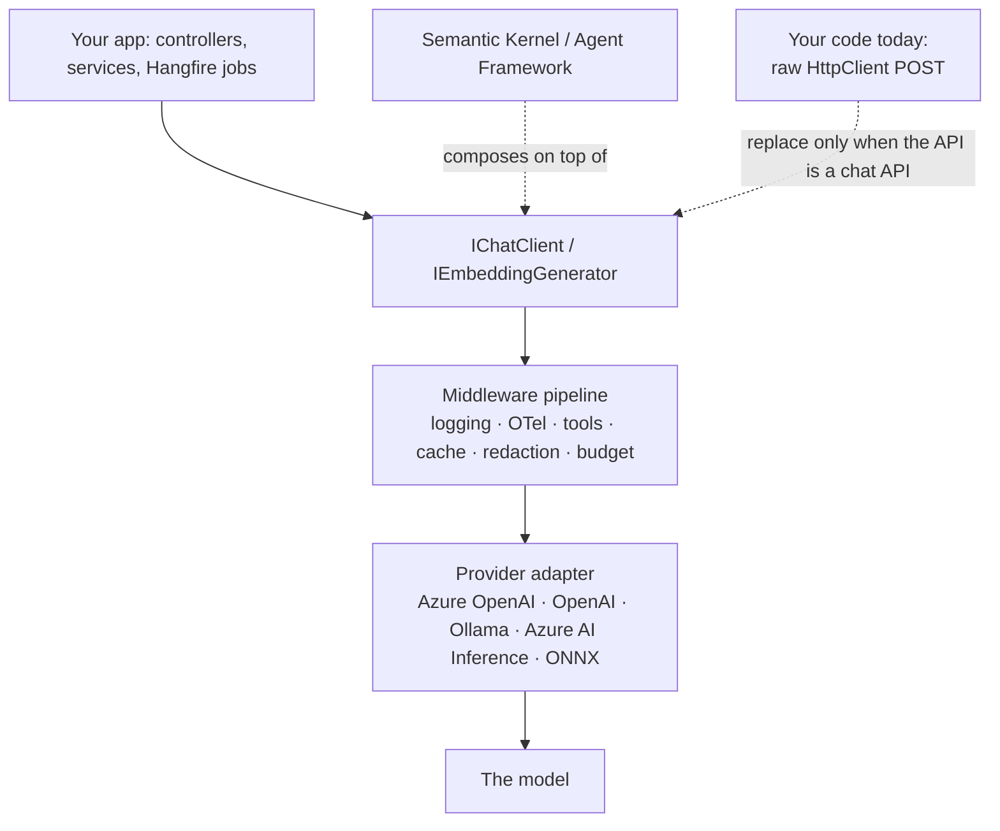
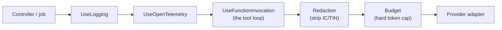
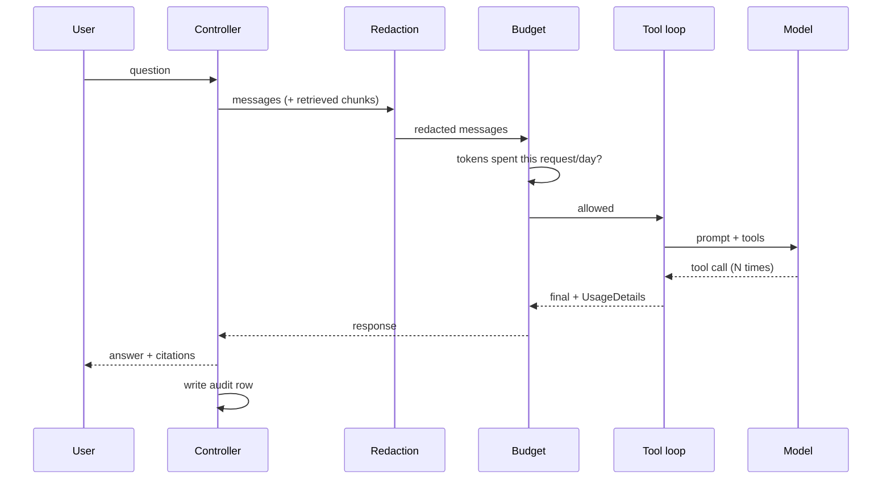

# 14 — Microsoft.Extensions.AI in an ASP.NET Core web app

**Goal of this doc:** understand what `Microsoft.Extensions.AI` actually is, and take an ASP.NET Core
app from "no AI" to "AI features in production" in **ten concrete steps** — chat, structured
extraction, embeddings/RAG, tool calling, streaming, tests, safety middleware and deployment.

> This doc is written against **this repo** (`LHDN_STSDS`, `net8.0`, ASP.NET Core MVC + Razor,
> Oracle EF Core, Hangfire, SignalR, deployed to IIS). Every step shows the *real* insertion point.
> Doc 12 = build your own agent tool. Doc 13 = the toolchain + VS Code extension.
> **This doc = the AI library you use *inside* the product.**

---

## Part A — What it is, and where it fits

### 0. How to use this doc

**Prerequisites**

| You need | Why | Check |
|---|---|---|
| .NET 8 SDK (not only runtime 10) | The solution targets `net8.0` | `dotnet --list-sdks` |
| An Azure OpenAI (or Azure AI Foundry) resource **in-tenant** | LHDN data must not leave the tenant | Portal → keys + endpoint |
| `/docs/architecture/CICD-DEVOPS.md` §5.4 open | Key Vault + secret handling is already solved there | — |
| Doc 13 §1.6 read | The install list for the AI stack | — |

**Acceptance criteria for the reader**

1. You can explain, without notes, the difference between *a model*, *an AI SDK*, `Microsoft.Extensions.AI`,
   and *an agent framework*.
2. You can wire an `IChatClient` into `Program.cs` of this app and call it from a controller.
3. You can get **typed JSON out** of a model into an existing DTO (`DS05ResponseModel`-style) and
   validate it.
4. You can add a **tool** the model is allowed to call, and a **guardrail** that redacts LHDN
   identifiers before they leave the process.
5. You can write a test that exercises the whole flow **with zero network calls**.
6. You can deploy it to IIS with no secret in `appsettings.json`.

> **Honesty rule for this doc:** `Microsoft.Extensions.AI` moves fast. Where an API name or package
> name may have drifted, it is marked **[verify]**. Trust the compiler over this document.

---

### 1. What Microsoft.Extensions.AI is

One sentence:

> **`Microsoft.Extensions.AI` (M.E.AI) is a provider-agnostic abstraction layer — interfaces +
> DTOs + DI registration + a middleware pipeline — for calling chat models, embedding models and
> tools from .NET code.**

It is the `ILogger` / `HttpClient` / `IConfiguration` pattern applied to AI: **you code against the
interface, you swap the provider in configuration.**

The mental model:



#### 1.1 The core vocabulary (learn these six, the rest is detail)

| Type | Namespace / package | What it is | Where you'd use it here |
|---|---|---|---|
| `IChatClient` | `Microsoft.Extensions.AI.Abstractions` | One method for chat: `GetResponseAsync(messages, options)` + a streaming twin | The AI call itself |
| `ChatMessage` / `ChatRole` | same | Provider-neutral message list (`System`, `User`, `Assistant`, `Tool`) | Conversation state |
| `ChatOptions` | same | Model, temperature, max tokens, **tools**, response format, seed | Per-call control |
| `ChatResponse` / `ChatResponseUpdate` | same | Non-streaming result / streaming delta. `.Text`, `.Messages`, `.Usage` | Return value |
| `IEmbeddingGenerator<TInput, TEmbedding>` | same | Turns text into vectors | RAG, similarity, clustering |
| `AIFunction` + `AIFunctionFactory` | `Microsoft.Extensions.AI` | Wraps one of **your C# methods** so the model can call it | Agentic behaviour |

#### 1.2 What M.E.AI is *not* — the four confusions that cost people weeks

| Not this | It is actually | Consequence |
|---|---|---|
| A model or a hosted service | A client library. It calls a model you host elsewhere | You still need an Azure OpenAI deployment / Ollama / etc. |
| An agent framework | It gives you *primitives* (`AIFunction`, tool loop). Orchestration, planning, multi-agent = Semantic Kernel / Microsoft Agent Framework / LangGraph | Don't expect a `RunAgent()` method |
| A vector database | It generates embeddings. Storage = pgvector / Qdrant / Azure AI Search / `sqlite-vec` | RAG is storage + chunking + eval, 70% of the work |
| A prompt library or a magic quality boost | A transport + abstraction layer | Model choice and prompt/eval work still decide quality |

#### 1.3 The four things you actually gain

1. **Provider swap without a rewrite.** Azure OpenAI today, on-prem/Ollama for a demo, a different
   deployment for extraction vs chat — all one interface. For a government project this is the
   single most valuable property: if the approved model changes, your business code doesn't.
2. **Cross-cutting concerns as middleware.** Logging, telemetry, caching, retries, retry-on-bad-JSON,
   token budgeting and **redaction of LHDN identifiers** are all `DelegatingChatClient`s — written
   once, applied to every call, impossible to forget.
3. **Testability.** A fake `IChatClient` makes the whole feature testable in CI with no network, no
   key, no cost. **This repo has no test project at all** — §9 creates the first one for AI.
4. **Runtime-agnostic plumbing.** The same `IChatClient` works in an MVC request, a Hangfire job, a
   console batch tool and a VS Code extension's host process. You don't build two integrations.

#### 1.4 Relationship to the neighbours — which one do I install?

| Library | Role | Install when |
|---|---|---|
| **`Microsoft.Extensions.AI`** | The abstractions + middleware | **Default choice.** Any app that calls a model |
| `Microsoft.Extensions.AI.OpenAI` / `.AzureAIInference` | **Adapters**: make an existing SDK client implement `IChatClient` | Always with the above, one adapter |
| **Semantic Kernel** | Higher-level: plugins, planners, memory, multi-step orchestration — **built on M.E.AI** | You need planning/orchestration, not just calls |
| **Microsoft Agent Framework** **[verify]** | The newer Microsoft agent stack (merges SK + AutoGen concepts); also built on M.E.AI | You are building *agents* as the product |
| `Microsoft.Extensions.AI.Evaluation.*` **[verify, preview]** | Eval harness + reporting | You want measured quality, not vibes |
| Your in-house wrapper | Almost always a mistake now | Rarely |

> **Rule of thumb:** start at M.E.AI. Reach for Semantic Kernel/Agent Framework only when you can
> name the orchestration need M.E.AI can't express. Most "we need an agent framework" projects need
> one chat call, two tools and a JSON schema.

#### 1.5 Package map

```bash
dotnet add package Microsoft.Extensions.AI
dotnet add package Microsoft.Extensions.AI.OpenAI
dotnet add package Azure.AI.OpenAI          # Azure OpenAI adapter path
# optional
dotnet add package Microsoft.Extensions.AI.Evaluation          # quality evals  [verify, preview]
dotnet add package Microsoft.Extensions.AI.Evaluation.Quality  # ready-made metrics
```

| Package | Contains | Notes |
|---|---|---|
| `Microsoft.Extensions.AI.Abstractions` | `IChatClient`, `ChatMessage`, `ChatOptions`, `AIFunction`, `IEmbeddingGenerator` | Comes transitively. Small, dependency-light — safe to expose in your domain layer |
| `Microsoft.Extensions.AI` | `ChatClientBuilder`, `FunctionInvokingChatClient`, DI extensions, typed helpers | The pipeline |
| `Microsoft.Extensions.AI.OpenAI` | `.AsIChatClient()`, `.AsIEmbeddingGenerator()` over the official OpenAI SDK | Works for Azure OpenAI through `AzureOpenAIClient` |
| `Microsoft.Extensions.AI.AzureAIInference` | Adapter for the Azure AI Inference SDK (model catalog / Foundry) | Useful if the resource is not "Azure OpenAI"-shaped |
| Ollama adapter (from `OllamaSharp`) **[verify]** | `OllamaApiClient` implements `IChatClient` | Local dev only on this machine — see §1.6 |

**Target-framework reality for this repo [verify]:** the `9.x` line of `Microsoft.Extensions.AI`
supports `net8.0` and `netstandard2.0`, so this `net8.0` app can consume it today. The `10.x` line
pairs with `net10`. Before you bump, open the NuGet page and read **Frameworks** — do not upgrade a
working `net8.0` app into a runtime problem.

**How to check what you actually got:**

```bash
dotnet list package --include-transitive
dotnet list package --outdated
```

#### 1.6 Local-model reality on *this* machine

Doc 13 §1.6 audited the box: AMD Radeon 610M integrated GPU (~2 GB shared), 13.8 GB RAM, 8 cores,
no CUDA, no Ollama installed. So:

| Option | Verdict here |
|---|---|
| Azure OpenAI (in-tenant) | **The dev loop.** Fast, no GPU, approved-for-LHDN in the tenant |
| Ollama + a 3B model | Acceptable only for smoke tests / embeddings. Not for a 30-call agent loop |
| A 7B local model as your daily driver | No. It will swap and crawl and you will blame M.E.AI |

---

### 2. Where this fits in *this* repo — the honest audit

Before adding a library, know what is already there. The repo has a **real, working AI integration**:

| Fact (verified in the repo) | Location | So what |
|---|---|---|
| An AI document pipeline exists: upload → files → AI → typed extraction inserted into the DB | `LHDN_STSDS/Modules/BulkProcess/AI/Processors/AiBulkUploadProcessor.cs` (1,092 lines), `AiBulkDataInsertProcessor.cs` | You are not starting from zero — you are **refactoring a live integration** |
| The AI call is a **multipart HTTP POST with an `x-api-key` header**, plus a custom CA cert validated via `ServerCertificateCustomValidationCallback` | `AiBulkUploadProcessor.cs` (~line 700+) | It is **not a chat API**. See the verdict below |
| Config lives at `AiService:*` — `BaseUrl`, `ApiKey`, `WorkspaceId`, `CertPath` | `LHDN_STSDS/appsettings.json` | `CertPath` is required or the call bails |
| An `IHttpClientFactory` named client (`"oasis"`) is **commented out**; the live code news up a client per call | `AiBulkUploadProcessor.cs` | Latent socket-exhaustion / handler churn |
| Extraction DTOs already exist: `DS05ResponseModel`, `DS06…`, `DS08…` : `BaseDocumentResponseModel`, plus tenancy-agreement / property-address / rental-period models | `Modules/BulkProcess/AI/Models/` | Your **output contracts are already defined** — perfect for §5 |
| Messy JSON is already tolerated by hand (e.g. a flexible int converter) | AI/Models | Proof that untyped model output hurts. §5 fixes this properly |
| Progress is pushed over SignalR (`BulkProcessingHub`: `BulkProcessError`, `FolderCompleted`), work runs in **Hangfire** background jobs | `Hubs/`, `Modules/BulkUpload/Background/` | §8 reuses this instead of inventing streaming |
| A feature flag `ShowAiJsonButton` already gates AI UI | config | Roll-out pattern for §11 |
| `AiAttach.ActiveInd == 1` means "being processed by AI" | data layer | Your observability hook |
| **No test project exists** | repo root | §9 is net-new value |
| **No AI SDK referenced at all** — 24 package references, none of them AI/OpenAI/Semantic Kernel | `LHDN_STSDS.csproj` | All AI code is hand-rolled HTTP + hand-rolled JSON |

#### 2.1 The verdict table — what to leave alone

| Piece of the AI feature | Verdict | Why |
|---|---|---|
| The OASIS **case-upload multipart POST** | **Leave as-is (fix the HttpClient)** | It is a document-ingestion endpoint, not chat/completions. `IChatClient` models *messages*, not file bundles. Forcing it in is the classic "wrong abstraction" mistake |
| Its `x-api-key` + custom CA cert handling | Leave, but move the secret out | §3.2 / §11 |
| The `AiAttach` state machine, Hangfire jobs, SignalR progress | Leave | Already correct for long jobs |
| The extraction **DTOs** | **Reuse** | They become your JSON-schema contracts in §5 |
| Any **new** AI feature: summarise a file, classify, ask-questions-over-the-manual, duty lookup, an assistant that calls app services | **Build on M.E.AI** | This is exactly what the abstraction is for |
| Cross-cutting: logging, token cost, redaction, audit, caching, retry | **Build as middleware** | §10 — applies to *both* the old and new paths |

> **The one-line summary:** adopt M.E.AI as the **chat / embeddings / tools** layer; keep the raw
> `IHttpClientFactory` call for the **document-upload** integration; share the middleware between them.

#### 2.2 Two real defects to fix while you're in there

These are not hypothetical — they are in the current code/config:

| # | Finding | Why it matters | Fix |
|---|---|---|---|
| 1 | A live API key sits in `appsettings.json` at `AiService:ApiKey`, **and** a literal fallback default is compiled into the processor (`x-api-key` header value) | A credential in source = a credential in git history. Rotating it doesn't remove the old one | Rotate the key; move it to user-secrets (dev) / env vars / Key Vault (CI + prod); delete the in-code default. See `CICD-DEVOPS.md` §5.4 |
| 2 | `new HttpClient(handler)` per call instead of the (already commented-out) named factory client | Handler/socket exhaustion under load; no central resilience policy | Use the intended `IHttpClientFactory` named client + `AddStandardResilienceHandler()` |

While you are there, note the pattern the existing code gets **right** and keep it: failures are
caught per-folder, recorded as a result row, and never abort the batch. That is the correct blast
radius for a background job. Everything below copies it.

---

## Part B — Build it, step by step

Each step has: **Goal → Do → Done when → Trap.** Do them in order; each one ships something.

### Step 0 — Verify the toolchain (5 minutes, prevents the whole day)

```powershell
dotnet --list-sdks          # need an 8.0.x SDK to build net8.0 comfortably
dotnet --list-runtimes
az account show             # needed for the keyless credential path
```

**Grounded trap (from doc 13's audit of this machine):** `dotnet --list-sdks` returned **only
`10.0.401`**, while the solution targets `net8.0` — runtimes 8.0.31/10.0.12 were present but the 8.0
**SDK** was not. And **`az` is not installed**, which silently breaks the keyless
`DefaultAzureCredential` path this doc recommends. Install `az` (or use a key in dev).

**Done when:** `dotnet build LHDN_STSDS.sln` is green *before* you change anything. Never debug an AI
problem on top of a broken build.

---

### Step 1 — Add the packages

```bash
cd LHDN_STSDS
dotnet add package Microsoft.Extensions.AI
dotnet add package Microsoft.Extensions.AI.OpenAI
dotnet add package Azure.AI.OpenAI
```

Put them next to the existing 24 references, and **pin exact versions** like the rest of the repo
(`Version="x.y.z"`) — this solution pins everything, don't be the one who adds a floating version.

**Done when:** `dotnet restore` succeeds and `dotnet list package` shows the three new references.

**Trap:** don't add Semantic Kernel "for later". Every package you add today is one you have to keep
fed, patched and security-reviewed in a government repo. Add it when a step *needs* it.

---

### Step 2 — Configuration: options object, zero secrets in the file

**Goal:** one typed settings object, secrets outside source control.

Create `LHDN_STSDS/Modules/Ai/AiOptions.cs` (new `Ai` module folder — it will hold everything new):

```csharp
namespace LHDN_STSDS.Modules.Ai;

public sealed class AiOptions
{
    public const string SectionName = "Ai";

    /// <summary>e.g. https://my-foundry.openai.azure.com/</summary>
    public string Endpoint { get; set; } = string.Empty;

    /// <summary>Model *deployment* name, not the model family name.</summary>
    public string ChatDeployment { get; set; } = string.Empty;

    /// <summary>Deployment used for embeddings (Step 6).</summary>
    public string EmbeddingDeployment { get; set; } = string.Empty;

    /// <summary>hard ceiling per HTTP request, in tokens. Enforced by middleware (Step 10).</summary>
    public int MaxTokensPerRequest { get; set; } = 8_000;

    /// <summary>Master switch. Keep the FeatureFlags pattern the repo already uses.</summary>
    public bool Enabled { get; set; }
}
```

`appsettings.json` — **shape only, no secrets**:

```jsonc
"Ai": {
  "Enabled": false,                                  // ship dark, flip per environment
  "Endpoint": "https://<resource>.openai.azure.com/",
  "ChatDeployment": "gpt-4o-mini",                   // deployment name in your resource
  "EmbeddingDeployment": "text-embedding-3-small",
  "MaxTokensPerRequest": 8000
}
```

Dev secrets (never committed):

```bash
cd LHDN_STSDS
dotnet user-secrets init
dotnet user-secrets set "Ai:ApiKey" "<rotated-key>"     # only if you must use a key
```

**Done when:** `appsettings.json` contains **no** `ApiKey` for the new AI section, and
`dotnet user-secrets list` shows it locally.

**Trap:** the keyless path (`DefaultAzureCredential` → Entra ID → `Cognitive Services OpenAI User`
role) is the right answer for prod, and it needs `az login` in dev. If `az` is missing you'll get a
confusing `AuthenticationFailed` — that is the missing CLI, not a bad role.

---

### Step 3 — Register it in `Program.cs`

**Goal:** one registration block, with the middleware pipeline in the right order.

`Program.cs` is long and consistent — every dependency is a `builder.Services.Add…` line. Add a
labelled block near the other service registrations:

```csharp
using Azure.Identity;
using Microsoft.Extensions.AI;
using LHDN_STSDS.Modules.Ai;

// ---------------- AI ----------------
builder.Services.Configure<AiOptions>(builder.Configuration.GetSection(AiOptions.SectionName));
builder.Services.AddSingleton(sp =>
    sp.GetRequiredService<IOptions<AiOptions>>().Value);

builder.Services.AddChatClient(sp =>
    {
        var ai = sp.GetRequiredService<AiOptions>();

        // Keyless, in-tenant. Requires: az login (dev) / managed identity (prod)
        // + the "Cognitive Services OpenAI User" role on the resource.
        var azureClient = new AzureOpenAIClient(
            new Uri(ai.Endpoint),
            new DefaultAzureCredential());

        return azureClient.GetChatClient(ai.ChatDeployment).AsIChatClient();
    })
    .UseLogging()                 // structured logs: model, latency, tokens
    .UseOpenTelemetry()           // GenAI spans -> App Insights (Step 10)
    .UseFunctionInvocation()      // runs the tool loop for Step 7
    .Use(sp => new RedactionChatClient(sp.GetRequiredService<ILogger<RedactionChatClient>>()))
    .Use(sp => new BudgetChatClient(
        sp.GetRequiredService<IOptions<AiOptions>>().Value.MaxTokensPerRequest,
        sp.GetRequiredService<ILogger<BudgetChatClient>>()));

// Embeddings, for Step 6
builder.Services.AddEmbeddingGenerator(sp =>
{
    var ai = sp.GetRequiredService<AiOptions>();
    var azureClient = new AzureOpenAIClient(new Uri(ai.Endpoint), new DefaultAzureCredential());
    return azureClient.GetEmbeddingClient(ai.EmbeddingDeployment).AsIEmbeddingGenerator();
});

// Keyed client: a cheaper/smaller model for bulk extraction (Step 5)
builder.Services.AddKeyedChatClient("extraction", sp => /* …same shape, other deployment… */);
// ---------------- /AI ----------------
```

**Done when:** the app still starts and `IChatClient` resolves (add a temporary endpoint or log line
to prove it).

**Pipeline order matters — think of it as an onion:**



- Anything you place **outside** `UseFunctionInvocation` runs **once per user request**.
- Anything **inside** it runs **once per model round-trip**, including each tool-loop iteration.

Put **redaction outside the tool loop** so every iteration is redacted (safe default), and **budget
outside** so the *total* is capped, not each call.

**Trap:** implement only `GetResponseAsync` in a custom `DelegatingChatClient` and streaming calls
bypass your guardrail entirely. Override **both** methods (Step 10 shows the pattern).

---

### Step 4 — The first call: a minimal AI endpoint in the existing MVC app

**Goal:** prove the wiring end-to-end through a real HTTP route.

The repo uses controllers with **primary constructors** and explicit `readonly` fields — match that
style. `LHDN_STSDS/Controllers/AiAssistantController.cs`:

```csharp
using Microsoft.Extensions.AI;

namespace LHDN_STSDS.Controllers;

//[Authorize]  // <-- uncomment. See the trap below.
public sealed class AiAssistantController : Controller
{
    private readonly IChatClient _chat;
    private readonly IOptions<AiOptions> _options;
    private readonly ILogger<AiAssistantController> _logger;

    public AiAssistantController(
        IChatClient chat,
        IOptions<AiOptions> options,
        ILogger<AiAssistantController> logger)
    {
        _chat = chat;
        _options = options;
        _logger = logger;
    }

    [HttpPost]
    [ValidateAntiForgeryToken]
    public async Task<IActionResult> Ask([FromBody] AskRequest request, CancellationToken ct)
    {
        if (!_options.Value.Enabled)
        {
            return StatusCode(StatusCodes.Status503ServiceUnavailable,
                new { error = "AI features are disabled." });
        }

        if (string.IsNullOrWhiteSpace(request?.Question))
        {
            return BadRequest(new { error = "Question is required." });
        }

        var messages = new List<ChatMessage>
        {
            new(ChatRole.System,
                "You are an assistant for an LHDN stamping system. " +
                "Answer only from the supplied context. If the context does not contain " +
                "the answer, say so. Never give tax advice."),
            new(ChatRole.User, request.Question)
        };

        ChatResponse response = await _chat.GetResponseAsync(
            messages,
            new ChatOptions { Temperature = 0.2f, MaxOutputTokens = 800 },
            ct);

        // tokens are on the response — log them, they are money
        _logger.LogInformation(
            "AI ask completed. InputTokens={In} OutputTokens={Out} Model={Model}",
            response.Usage?.InputTokenCount,
            response.Usage?.OutputTokenCount,
            response.ModelId);

        return Json(new
        {
            answer = response.Text,
            usage = new
            {
                input = response.Usage?.InputTokenCount,
                output = response.Usage?.OutputTokenCount
            }
        });
    }

    public sealed record AskRequest(string Question);
}
```

Call it:

```powershell
curl -X POST https://localhost:5001/AiAssistant/Ask `
  -H "Content-Type: application/json" `
  -d '{ "question": "What is the stamping turnaround time?" }'
```

**Done when:** you get an answer, and the log shows real token counts. If tokens are `null`, your
deployment isn't reporting usage — don't move on until you can see cost.

**Traps (both are live in this repo's style):**
1. **Authorization.** Several controllers in this solution have `[Authorize]` commented out. An
   unauthenticated endpoint that spends money per call is an incident waiting to happen. Uncomment it.
2. **Cancellation.** Pass the `CancellationToken` through — every layer. A model call that keeps
   running after the browser disconnects is pure waste.

---

### Step 5 — Typed, schema-constrained extraction (your `DS05`/`DS06` story)

**Goal:** stop parsing model prose. Make the model fill **your** DTO.

This is the highest-value step for this repo, because the existing pipeline already fights messy
JSON by hand (see the flexible-int converter) and already owns the output contracts
(`BaseDocumentResponseModel`, `DS05ResponseModel`, …). Reuse them:

```csharp
public sealed class TenancyStampDutyModel
{
    public string? AgreementDate { get; set; }
    public int? RentalPerAnnum { get; set; }
    public string? PropertyAddress { get; set; }
    public string? TenantName { get; set; }
    public double? Confidence { get; set; }          // let the model self-report
    public List<string>? MissingFields { get; set; } // and tell you what it couldn't find
}
```

Request a schema, not a vibe:

```csharp
var options = new ChatOptions
{
    Temperature = 0f,                                  // extraction wants determinism
    ResponseFormat = ChatResponseFormat.ForJsonSchema<TenancyStampDutyModel>()  // [verify] name
    // fallback on older packages: ChatResponseFormat.CreateJsonSchemaFormat(...)
};

ChatResponse<TenancyStampDutyModel> typed =
    await _chat.GetResponseAsync<TenancyStampDutyModel>(
        [
            new(ChatRole.System, Prompts.ExtractTenancyDuty),
            new(ChatRole.User, $"Extract fields from this document:\n\n{documentText}")
        ],
        options,
        ct);

TenancyStampDutyModel model = typed.Result;
```

Then **validate like it's user input** (it is untrusted, LLM-generated text):

```csharp
private static IReadOnlyList<string> Validate(TenancyStampDutyModel m)
{
    var errors = new List<string>();
    if (m.RentalPerAnnum is null or <= 0) errors.Add("RentalPerAnnum");
    if (string.IsNullOrWhiteSpace(m.PropertyAddress)) errors.Add("PropertyAddress");
    return errors;
}
```

And a **bounded** repair loop — the pattern that makes extraction production-safe:

```csharp
for (var attempt = 1; attempt <= 3; attempt++)
{
    var result = await CallAsync(documentText, ct);
    var errors = Validate(result);

    if (errors.Count == 0) return result;

    // feed the structured failure back — this is the highest-signal retry there is
    documentText = $"""
        Your previous JSON was rejected. Invalid or missing fields: {string.Join(", ", errors)}.
        Return corrected JSON for the same document. Do not invent values; use null.
        """;
}

throw new AiExtractionException("Extraction failed validation after 3 attempts.");
```

**Done when:** you get a populated `TenancyStampDutyModel` for a real document and a
deterministic failure for a garbage one (no exception escaping as a 500 in a Hangfire job).

**Traps:**
- Keep the repo's tolerant converters (`FlexibleIntConverter` et al.) in the `JsonSerializerOptions`
  you pass to the typed helper — models still return `"1,200"` and `"RM 1,200.00"`.
- `Confidence` self-reports are **poorly calibrated**. Use them to route to human review, never as
  an auth decision.
- Never let a wrong extraction write to the filing DB. Extraction → validation → *human or rule
  confirmation* → write. That boundary is the whole reason this feature is safe.

---

### Step 6 — Embeddings + RAG: "ask the user manual"

**Goal:** answer from **your** documents, with citations.

The repo already exposes exactly the corpora you want to index — config keys `FaqPath`,
`UserManualPath` and `EnquiryPath` under the API settings. Index those, plus `docs/`, instead of
inventing content.

```csharp
public sealed class ManualSearchService
{
    private readonly IEmbeddingGenerator<string, Embedding<float>> _embedder;
    private readonly AppDbContext _db;

    // 1) index once (offline / job): chunk -> embed -> store vector + source
    public async Task IndexAsync(IEnumerable<DocChunk> chunks, CancellationToken ct)
    {
        var texts = chunks.Select(c => c.Text).ToList();
        var vectors = await _embedder.GenerateAsync(texts, cancellationToken: ct);

        for (var i = 0; i < chunks.Count; i++)
        {
            chunks[i].Embedding = vectors[i].Vector.ToArray();   // ReadOnlyMemory<float>
        }
        await _db.SaveChunksAsync(chunks, ct);
    }

    // 2) query: embed the question, top-k, hand *text + id* to the model
    public async Task<SearchHit[]> SearchAsync(string question, int k, CancellationToken ct)
    {
        var q = await _embedder.GenerateAsync([question], cancellationToken: ct);
        return await _db.VectorSearchAsync(q[0].Vector.ToArray(), k, ct);
    }
}
```

Store the vectors wherever the infrastructure allows (from doc 13 §1.6.4):

| Store | Use when | Note for this repo |
|---|---|---|
| `sqlite-vec` / in-proc | Prototype, small corpus | Zero infra — start here |
| **Oracle 23ai `VECTOR` column** | You want it in the existing DB | Natural fit: no new datastore, DBA already owns backups. **[verify]** feature availability on `AI Database` |
| pgvector / Qdrant / Chroma | Bigger corpus, filters, hybrid search | Needs Docker — **not installed** on this machine |
| Azure AI Search | Enterprise, hybrid + semantic ranker, RBAC | Best "no ops" answer for gov |

**Non-negotiables for RAG in a regulated system:**

1. **Always return the source** (`documentId`, `page`, `chunkId`) and put it in the UI. An answer
   without a citation is unusable for a regulated workflow.
2. **Never embed only the question.** Embed question *and* context; answer only from retrieved text.
3. **Chunk deliberately** — 300–800 tokens, 10–20% overlap, never split a table from its header.
4. **Evaluate retrieval separately from generation.** If the right chunk wasn't in the top-k, no
   prompt can save you.

**Done when:** you ask a question answerable only by the user manual, and the answer names the
document and page it came from.

**Trap:** embedding a whole 200-page PDF as one chunk. You'll retrieve 200 pages and burn the context
window on every question.

---

### Step 7 — Tools: let the model call *your* services

**Goal:** move from "answer questions" to "do things" — safely.

```csharp
public sealed class StampingTools
{
    private readonly IStampingQueryService _stamping;

    [Description("Get the current status of a stamping submission by its reference number.")]
    public async Task<string> GetStampingStatusAsync(
        [Description("The reference number, e.g. SRn-2024-000123")] string refNo,
        CancellationToken ct)
    {
        var s = await _stamping.GetStatusAsync(refNo, ct);

        // Return a SMALL DTO. Never return an EF entity. (see the trap)
        return JsonSerializer.Serialize(new
        {
            refNo = s.RefNo,
            status = s.StatusName,
            submittedUtc = s.SubmittedUtc,
            pendingReason = s.PendingReason
        });
    }

    [Description("Look up the stamping duty rate table for an instrument type.")]
    public string GetDutyRate(
        [Description("Instrument type, e.g. 'Tenancy Agreement'")] string instrumentType) => /* … */;
}
```

Wire them per request:

```csharp
var tools = new[] { AIFunctionFactory.Create(_tools.GetStampingStatusAsync),
                    AIFunctionFactory.Create(_tools.GetDutyRate) };

var response = await _chat.GetResponseAsync(
    messages,
    new ChatOptions { Tools = [.. tools] },
    ct);
```

The tool loop itself is `UseFunctionInvocation()` from Step 3 — the model asks, M.E.AI invokes your
method, feeds the result back, and repeats until it answers. You never write that loop.

**Tool risk tiers — apply this to every tool you add:**

| Tier | Examples | Policy |
|---|---|---|
| **Read-only, low sensitivity** | duty rates, instrument types, FAQ lookup | Auto-allow |
| **Read-only, sensitive** | submission status, taxpayer record | Allow, but log who asked + which record, and redact identifiers on the way out (§10) |
| **Write / irreversible** | submit a filing, cancel a submission, send an email | **Never** from a model turn. Require an explicit human confirmation step and a normal audited service call |
| **Arbitrary execution** | shell, SQL, file write | **Never.** Non-negotiable |

**Done when:** "what's the status of SRn-2024-000123?" triggers exactly one tool call, the answer
contains the real status, and the log shows the tool name and arguments.

**Traps (three, all common):**
1. **Never return EF entities.** Navigation properties serialise into cycles and leak internal data.
   Return a hand-written DTO. Every time.
2. **Descriptions are the API contract.** The model only knows what `[Description]` tells it — vague
   text produces confident wrong calls. Treat the attribute as public API documentation.
3. **Tool result size.** A tool that returns 500 rows blows the context window and the budget cap.
   Paginate, cap, and summarise inside the tool.

---

### Step 8 — Streaming, and the request-vs-job decision

**Goal:** good UX without holding an IIS request open for two minutes.

```csharp
[HttpPost]
public async Task Stream([FromBody] AskRequest request, CancellationToken ct)
{
    Response.Headers.ContentType = "text/event-stream";
    Response.Headers.CacheControl = "no-cache";
    Response.BufferOutput = false;                 // IIS/proxy will buffer otherwise

    await foreach (var update in _chat.GetStreamingResponseAsync(messages, options, ct))
    {
        if (!string.IsNullOrEmpty(update.Text))
        {
            await Response.WriteAsync($"data: {update.Text}\n\n", ct);
            await Response.Body.FlushAsync(ct);
        }
    }
}
```

**But choose deliberately** — this repo already has the better pattern for anything slow:

| Shape | Use for | Mechanism | Why |
|---|---|---|---|
| **SSE / streaming** | A chat turn a human is watching | `GetStreamingResponseAsync` + `Response.BufferOutput = false` | Latency perception |
| **Background job + progress push** | Document extraction, batches, anything > ~15 s | **Hangfire** job + `IHubContext<BulkProcessingHub>` | Survives IIS recycle; no 30-min request; matches the existing `AiAttach`/`BulkProcessError`/`FolderCompleted` flow |

**Reuse what exists.** Long AI work should look exactly like the current AI pipeline: enqueue, set
the status row, push progress to the hub, complete or record a per-item failure. Don't invent a
second mechanism.

**Done when:** tokens appear progressively in the browser; and your batch extraction behaves like
the existing bulk flow (progress events, no lost work on recycle).

**Traps:** IIS **and** any reverse proxy compress/buffer responses — you must disable buffering at
both layers or "streaming" arrives in one lump. And a Hangfire job needs its **own scope**
(`IServiceScopeFactory`) — do not inject a scoped `IChatClient` into a job and hope.

---

### Step 9 — Test it with no network, no key, no cost

**Goal:** CI-safe tests. This repo currently has **no test project**, so this section creates the
first one — and it must not need an Azure resource to run.

```bash
dotnet new xunit -n LHDN_STSDS.Tests
dotnet add LHDN_STSDS.Tests reference LHDN_STSDS
dotnet sln add LHDN_STSDS.Tests
```

Fake client — scripted replies, records what it was asked:

```csharp
public sealed class FakeChatClient : IChatClient
{
    private readonly Queue<string> _replies;
    public List<IList<ChatMessage>> Requests { get; } = new();

    public FakeChatClient(params string[] replies) => _replies = new(replies);

    public Task<ChatResponse> GetResponseAsync(
        IEnumerable<ChatMessage> messages,
        ChatOptions? options = null,
        CancellationToken ct = default)
    {
        var list = messages.ToList();
        Requests.Add(list);

        var text = _replies.Count > 0 ? _replies.Dequeue() : "{}";
        return Task.FromResult(new ChatResponse(new ChatMessage(ChatRole.Assistant, text))
        {
            ModelId = "fake",
            Usage = new UsageDetails { InputTokenCount = 10, OutputTokenCount = 5 }
        });
    }

    public IAsyncEnumerable<ChatResponseUpdate> GetStreamingResponseAsync(
        IEnumerable<ChatMessage> messages, ChatOptions? options = null, CancellationToken ct = default)
        => throw new NotSupportedException();

    public object? GetService(Type serviceType, object? serviceKey = null) => null;

    public void Dispose() { }
}
```

What to assert — the assertions that actually catch regressions:

| Assertion | Catches |
|---|---|
| The user question **and** the retrieved chunks are in the prompt | RAG silently not wired |
| The system prompt says "answer only from the context" | Someone rewrote the prompt loosely |
| The right tool appears in `options.Tools` | Tool dropped by a refactor |
| Only **one** model call for the happy path | Accidental extra round-trips = accidental 2× cost |
| Retry loop stops at 3 on persistent invalid JSON | Infinite/expensive retry loops |
| The identifier was redacted before the call | Guardrail bypass (the highest-severity bug class here) |

Wire it into CI: add a `test` stage **before** `deploy` in `.gitlab-ci.yml`, running
`dotnet test LHDN_STSDS.Tests --collect:"XPlat Code Coverage"` on the same Windows runner.

**Done when:** `dotnet test` is green with the network unplugged.

**Trap:** don't "test" by calling the real model and asserting the text matches. It's flaky, it costs
money, and it fails on a model upgrade for no real reason. Assert **structure and behaviour**
(prompt contents, tool list, call counts, redaction), and keep a separate small *evaluation* set
(20 golden inputs + expected fields) for quality — a scheduled job, not a unit test.

---

### Step 10 — Safety, audit and cost as middleware

**Goal:** the guardrails stop being "things we remember to do".

This repo's data is taxpayer data. Four middlewares belong in the Step 3 pipeline.

**A. Redaction — strip identifiers before egress**

```csharp
public sealed class RedactionChatClient : DelegatingChatClient
{
    private readonly ILogger<RedactionChatClient> _logger;
    public RedactionChatClient(ILogger<RedactionChatClient> logger) : base(/* inner */) { }

    public override async Task<ChatResponse> GetResponseAsync(
        IEnumerable<ChatMessage> messages, ChatOptions? options = null, CancellationToken ct = default)
    {
        var safe = Redact(messages);
        var response = await base.GetResponseAsync(safe, options, ct);
        return UnredactIfNeeded(response);       // map placeholders back for the UI only
    }

    public override async IAsyncEnumerable<ChatResponseUpdate> GetStreamingResponseAsync(
        IEnumerable<ChatMessage> messages, ChatOptions? options = null,
        [EnumeratorCancellation] CancellationToken ct = default)
    {
        var safe = Redact(messages);
        await foreach (var u in base.GetStreamingResponseAsync(safe, options, ct))
        {
            yield return u;
        }
    }

    private List<ChatMessage> Redact(IEnumerable<ChatMessage> messages) { /* IC/TIN/NRIC/refNo -> tokens */ }
    private ChatResponse UnredactIfNeeded(ChatResponse r) { /* token -> original */ }
}
```

**B. Budget — a hard ceiling per request and per day.** Count `UsageDetails` and throw (or downgrade
to a cheaper deployment) when exceeded. An agent loop that "just keeps going" is how a weekend
produces a four-figure bill.

**C. Audit — append-only.** For every call record: who, when, deployment/model, prompt hash, which
source documents were retrieved, tokens, cost, and the decision the human made afterwards. In a
regulated system this *is* the feature; the answer text is the by-product. It's also what lets you
answer "why did the system say that?" six months later.

**D. Grounding policy — refuse out-of-scope.** If retrieval returns nothing above a similarity
threshold, the correct response is "I don't have that information", not a fluent guess.



**Done when:** you can prove (by test, not by reading code) that an NRIC number in the input never
reaches the provider, and that a runaway loop cannot exceed the cap.

**Honest note:** redaction reduces, but does not eliminate, egress risk. The **structural** control is
using an **in-tenant Azure OpenAI resource** where your data is not used for training and stays in
the compliance boundary. Redaction is defence in depth, not the primary control.

---

### Step 11 — Deploy: IIS, Key Vault, and shipping dark

**Goal:** production without secrets in files and without a surprise bill.

| Concern | Action | Matches existing practice |
|---|---|---|
| Secrets | Key Vault; **managed identity** for the AppPool; nothing in `appsettings*.json` | `CICD-DEVOPS.md` §5.4 |
| Config precedence | `appsettings.json` → `appsettings.{Env}.json` → env vars → Key Vault | default builder behaviour |
| Rollout | Ship with `"Ai": { "Enabled": false }`, flip per environment; keep the existing `ShowAiJsonButton`-style flag for UI surfaces | repo already does this |
| Identity | AppPool identity needs **Cognitive Services OpenAI User** on the resource (and Key Vault *get* on the vault) | — |
| Egress | Firewall allowlist for `*.openai.azure.com`; keep the existing custom-CA handling for the government OASIS endpoint | existing `AiService:CertPath` pattern |
| Health | `/healthz` that checks config presence **without** calling the model per probe | — |
| Cost | Set a hard quota + alert on the deployment; log tokens per request (Step 4) so you can attribute spend to a feature | new |
| Latency | Streaming needs buffering off at IIS **and** any proxy; sticky sessions if the stream is long | IIS + ARR already in the topology |

Deployment order that avoids a bad day: **deploy dark → verify config + identity → enable for one
test account → watch tokens/errors for a day → enable for the module → enable for everyone.**

**Done when:** `grep -ri "apikey" appsettings*.json` returns nothing for AI, and the feature can be
switched off without a redeploy.

---

## Part C — Operate it

### 12. Failure modes you will actually hit

| Symptom | Likely cause | Fix |
|---|---|---|
| `AuthenticationFailedException` on first call | `DefaultAzureCredential` with no `az login` / no managed identity | `az login`, or grant the role; **`az` isn't installed on this machine** |
| `401` despite valid key | Wrong endpoint shape, or the key is for a different resource | Endpoint must be `https://<resource>.openai.azure.com/` |
| `404 Resource not found` | You passed the **model family** name instead of the **deployment** name | Use the deployment name from the portal |
| JSON deserialisation blows up on `"1,200"` | Missing the repo's tolerant converters in the serializer options | Reuse `FlexibleIntConverter`-style converters |
| Model answers but `Usage` is null | Deployment/API version doesn't report usage | Fix before you scale — you're blind to cost |
| Tool called repeatedly / loop never ends | Tool result too large, or returns an error the model retries | Cap and shape tool output; add a max-iteration guard |
| Tool never called | Vague `[Description]`; or `ChatOptions` overwritten downstream | Rewrite descriptions; make sure `Tools` isn't replaced by a later `ConfigureOptions` |
| Streaming arrives all at once | Response buffering on (IIS/proxy) | `Response.BufferOutput = false` + disable proxy buffering |
| Works in controller, throws in Hangfire job | Scoped services in a singleton job | `IServiceScopeFactory` per job execution |
| Guardrail "not applied" on some calls | Only one of the two methods overridden in the delegating client | Override **both** `GetResponseAsync` and `GetStreamingResponseAsync` |
| Build fails on `net8.0` after adding packages | SDK mismatch (only 10.0.401 installed) | Install the 8.0 SDK; check package target frameworks |
| Answers are confidently wrong | No retrieval / no grounding rule / no eval | Threshold + "I don't know" + golden set |

### 13. Definition of done

- [ ] `IChatClient` + `IEmbeddingGenerator` registered, provider swappable by configuration alone
- [ ] No secret in `appsettings*.json`; the old `AiService:ApiKey` is **rotated** and out of source
- [ ] The pre-existing per-call `new HttpClient` uses the intended factory client
- [ ] One working feature: chat **and** one schema-constrained extraction into an existing DTO
- [ ] RAG over the FAQ/user-manual corpus with **citations** shown
- [ ] At least two read-only tools, with a risk tier recorded for each
- [ ] Redaction + budget + audit middleware, **proven by tests**
- [ ] Test project with a fake `IChatClient`, running in a new `test` CI stage
- [ ] Failure mode is a useful message, not a 500 — per item, like the existing bulk flow
- [ ] Token/cost logging per feature; a quota alert configured
- [ ] Ships **dark**, behind a flag, with a roll-back that needs no redeploy

**Effort:** ~2 weekends for §4–§7 + §9 (the working feature and its tests), then ~2 evenings for
§10–§11 (hardening and deployment). Fits inside one program week-and-a-bit — i.e. this is a realistic
**W20 portfolio deliverable** alongside doc 12's agent.

### 14. Interview framing

> "How would you introduce AI into an existing regulated .NET application?"

A strong answer that this doc lets you give, from experience rather than theory:

1. **Separate the transport from the product.** `Microsoft.Extensions.AI` gives one chat/embedding
   interface and a middleware pipeline; the model stays swappable, which is what a government
   project actually needs when the approved model changes.
2. **Know which API you're talking to.** Our existing document ingestion is a multipart case-upload
   endpoint — that's not a chat API, so it keeps `IHttpClientFactory`, and the abstraction goes on
   the *new* chat/extraction/tools surface. Putting a chat library on a file-upload endpoint is a
   wrong-abstraction mistake.
3. **Typed output, validated like user input.** JSON-schema-constrained responses into existing DTOs,
   then a bounded repair loop, then a human/rule gate before anything writes to the filing system.
4. **Tools are the API surface.** Read-only tools auto-allowed, sensitive reads logged, writes never
   from a model turn, execution never. `[Description]` treated as public documentation.
5. **Guardrails as middleware, proven by tests.** Redaction, token budget, audit trail — implemented
   in the pipeline and asserted in CI with a fake client, so they can't be forgotten.
6. **Ship dark, measure, then widen.** Flag off, one account, tokens logged, then rollout — with the
   in-tenant resource as the real residency control and redaction as defence in depth.

### 15. Resources

- `Microsoft.Extensions.AI` — the abstractions and middleware overview: <https://learn.microsoft.com/dotnet/ai/microsoft-extensions-ai>
- Azure OpenAI in .NET / keyless auth: <https://learn.microsoft.com/dotnet/ai/azure-openai>
- **Semantic Kernel** (when you need orchestration beyond M.E.AI): <https://learn.microsoft.com/semantic-kernel>
- **Microsoft Agent Framework** **[verify current name/status]**: <https://learn.microsoft.com/agent-framework>
- Structured output / JSON schema guidance: <https://learn.microsoft.com/azure/ai-services/openai/how-to/structured-outputs>
- Embeddings + vector search options: <https://learn.microsoft.com/azure/ai-services/openai/concepts/understand-embeddings>
- Evaluation for .NET: `Microsoft.Extensions.AI.Evaluation.*` **[preview, verify]**
- OWASP Top 10 for LLM Applications — prompt injection, insecure output handling, excessive agency
- Internal: `docs/architecture/CICD-DEVOPS.md` §5.4 (secrets), `docs/architecture/ARCHITECTURE.md` §7
  (risky spots), doc 12 (build the agent), doc 13 (the toolchain + VS Code extension)
- Prompts that drive all of the above: `15-prompting-an-ai-agent.md` — generating `AGENTS.md`, auditing git, comprehending the code, and the answer protocol the model follows on every turn
- One portable bootstrap prompt for *any* repo: `16-any-repo-agent-prompt.md` — discovery-first, `UNKNOWN` as a legal answer, stack adapter table for 15 ecosystems. If the agent is the feature, this shapes the system prompt and the `REPO-BRIEF.md` corpus your RAG reads.
- **Then learn it for free:** `17-free-learning-path-certifications.md` — the sequenced learning track for everything above: 6 tiers (LLM literacy → structured output → agentic patterns → evals → ship), one free primary source per tier, which certificates are genuinely free vs paid, a 12-week schedule, and the 5 artefacts that beat a certificate.

---

*Next: doc 12 §3 shows how an agent uses exactly these tools to turn a work item into a PR; doc 13
§1.6 shows the machine-level install list. Together: install → build → ship.*
