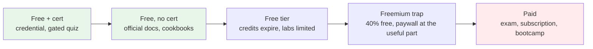

# 17. Free Learning Path & Certifications — Agentic AI Development

> **What this doc is:** the *learning* track that pairs with the *building* docs. Docs 12–16 tell you how to build an agent, a plug-in, a .NET AI service and the prompts that drive them. This doc tells you **where to learn each skill for free, what actually issues a certificate, and in what order** — mapped onto the existing 26-week program (`W20 = AI in dev + RAG`) so you do not bolt on a second, competing plan.
>
> **What this doc is not:** a list of everything on the internet. `11-resources.md` already warns "don't collect — finish". This is one primary free source per tier, chosen so that **every tier ends in a runnable artefact**.

---

## §0 How to use this document

### §0.1 Pick your reader row

| You are… | Read | Skip |
|---|---|---|
| A complete beginner to LLMs | §1 → §2 all tiers → §6 schedule | §4 (certs are premature), §9 |
| A working .NET dev who has called an LLM API once | §2 Tier 3–5 → §5 → §6 compressed track → §7 | §2 Tier 0–1 (you have it) |
| A Technical Lead who needs to introduce this **into a regulated codebase** | §1.2 → §4.4 → §7 → §8 → §11 | §2 Tier 0 |
| Someone whose employer will pay | §9 first, then §4 | §6 |

### §0.2 Honesty box — read before trusting any row

I wrote this without live web access. That has three consequences you must plan for:

1. **Free offers rot fastest.** "Free certificate" promotions, exam-voucher events and free tiers change monthly. Every row below is written as an **exact search phrase + provider**, not a deep URL, so it survives a link change. Anything that could plausibly have changed carries **`[verify]`**.
2. **Priority is my judgement, not a fact.** "Recommended" means *given your situation* (4 yrs .NET, LHDN repo, 8 h/week, no GPU, no Docker — see doc 13 §A audit).
3. **A certificate is evidence of attendance, not competence.** I say this in §1.2 with numbers rather than as a platitude, because collecting certificates is the single most common way engineers burn 100 hours on this topic and learn nothing measurable.

**Verification legend used throughout:**

| Tag | Meaning |
|---|---|
| `Free + cert` | No payment required and a certificate/credential is issued |
| `Free, no cert` | Content is free; no credential (often *better* content — see §1.1) |
| `Free tier` | Free but capped (credits, labs, seats) |
| `Paid` | Costs money; §4.2 lists the legitimate ways to make this zero |
| `[verify]` | Could plausibly have changed — confirm before building a plan on it |

### §0.3 Acceptance criteria for *you*

You are done with this doc when:

- [ ] You can name the tier you are on **and** the artefact that proves you finished it.
- [ ] You have **one** free source per tier in progress — not five bookmarked.
- [ ] You have decided, in writing, **whether you are pursuing a certification**, and why. ("Because it was free" is not a why.)
- [ ] You can state the cost and the pass mark of the one exam you chose, or state that you chose none.
- [ ] You have a dated entry in §10's tracking table.

---

## §1 The honest landscape of "free"

### §1.1 Five kinds of free — and which one you actually want

| Kind | Best for | Weakness | Example shape |
|---|---|---|---|
| **Free + cert** | Motivation, a line on a CV, proving baseline literacy to a non-technical manager | The quiz is often trivial; the cert proves you watched | Vendor fundamentals paths |
| **Free, no cert** | **The actual skill** — official docs, specs, cookbooks, reference implementations | No structure; you must sequence it yourself (that's what §6 is for) | Provider API docs, spec repos, "beginners" GitHub curricula |
| **Free tier** | Hands-on work against a real model/cloud | Credits expire mid-project; card required | Cloud AI sandboxes, trial credits |
| **Freemium trap** | Nothing | Exactly the module you need ("tool calling", "evals") is the paid one | Long "specializations" with the agent module last |
| **Paid** | Exam credential, or structure you will not build yourself | Cost, and courses age faster than docs | Bootcamps, subscriptions |

**The uncomfortable ranking:** for *agentic* AI specifically, the highest-signal free material is almost all in the **Free, no cert** row — provider docs, the MCP spec, reference agent implementations, and eval tool docs. Vendor course platforms systematically lag this field by 6–18 months because agents are still moving. So:

> **Use courses for Tier 1 (literacy). Use docs + specs + a build for Tiers 3–5. Do not expect a course to teach you to build an agent well; no course currently can, because the API surface changes faster than course production.**

### §1.2 What a certificate is actually worth (with the mechanism)

| Audience | What a cert does | What it does not do |
|---|---|---|
| Recruiter keyword filter | Passes "AI" screening | Survive a technical interview |
| Hiring manager (technical) | Weak positive — shows initiative | Substitute for a portfolio with numbers |
| Your current manager (budget) | **Justifies training spend** — this is the real use | Prove the team should adopt the tech |
| You | Forces a deadline; fills gaps you'd skip | Teach you the gaps it skipped |

**The mechanism to internalise:** a certificate records *completion*. A lead is hired on *judgement*, which is only visible in artefacts that carry numbers. Two candidates with `AI-900` each are identical; a candidate who says *"my extraction endpoint holds 94 % schema-valid output across 50 documents at 1.2 s p95 and $0.004/doc, and here's the eval harness that proves it"* is not comparable to anyone.

**Therefore:** spend at most **15 % of your total hours** on credentialed material, and 100 % of your *visible output* on the five artefacts in §7. If a certificate falls out of the Tier 1 material anyway — take it, it's free. Don't detour for it.

### §1.3 The only three things that make you hireable here

1. **You can build a working loop** (tool call → result → next step → stop condition) and you know why it loops forever when it does.
2. **You can measure it** — a 20-task eval with a pass rate, a cost per run, and a latency, that runs in CI and catches a regression.
3. **You can ship it** — inside a real app or editor, behind the org's security rules, with the failures from doc 14 §C handled.

None of the three is taught end-to-end by any single free course. All three are covered by docs 12–16. That gap *is* your edge — see §5.2.

---

## §2 The ladder — six tiers

Each tier: **goal → free source → the artefact → done when → which doc finishes it.** Do them in order once; afterwards you only ever revisit Tier 3 (the field moves there).

### Tier 0 — Prerequisites (skip if you have 3+ years of .NET)

| Field | Value |
|---|---|
| **Goal** | Git beyond `commit`/`push`; HTTP + JSON fluency; `async`/`await` correctness; one language deeply |
| **Free source** | **Pro Git** (free book, git-scm.com) ch. 2–3 + 7 · **Microsoft Learn** C# and ASP.NET Core paths · **MDN** HTTP docs · David Fowler's *Async Guidance* (one page — in `11-resources.md`) |
| **Artefact** | You can explain `git worktree` vs `git clone` and why doc 12 §3.6 isolates each agent run in a worktree |
| **Done when** | You can rebase a branch, read a diff, and write a `Program.cs` without a `async void` |
| **Finishes in** | Nothing to chase here — you already pass or you don't |

> **Why this is Tier 0 and not skipped:** every agent-tool failure in doc 15 §9 that looks like "the model is dumb" is usually a *diff* problem or an *async* problem in the harness. Agents amplify weak foundations rather than filling them.

### Tier 1 — LLM literacy (the 20 hours that stop you guessing)

| Field | Value |
|---|---|
| **Goal** | Tokens, context window, sampling (temperature/top-p), embeddings, why hallucination is structural, cost arithmetic, prompt vs fine-tune vs RAG |
| **Free source (pick ONE primary)** | **Microsoft Learn** — the "AI concepts" / "Introduction to AI" fundamentals path (`Free + cert` for the path; the *exam* is separate, see §4) |
| **Free source (secondary, high signal)** | **DAIR.AI Prompt Engineering Guide** (free, open) · **Hugging Face LLM Course** ch. 1–2 (`Free, no cert`) · **Karpathy** "Intro to LLMs" / "Let's build GPT" talks (free video) · **Google Machine Learning Crash Course** (free) |
| **Artefact** | A one-page **token-budget note** for *your* repo: bytes ÷ 4 ≈ tokens, `AmendmentServices.cs` = 715,917 B ≈ 179 k tokens ≈ an entire context window (the numbers are already measured in doc 16 §6.1 — reproduce them yourself) |
| **Done when** | You can explain to a non-engineer why "just put the whole repo in the prompt" fails, with arithmetic |
| **Finishes in** | Doc 16 §6 (token budget), doc 13 §1.6.2 (model runtime choice) |

### Tier 2 — Call a model API properly

| Field | Value |
|---|---|
| **Goal** | One call → streaming → **structured output** → retries/timeouts → cost + latency measurement → secrets handling |
| **Free source** | **Provider docs + cookbooks** (`Free, no cert`): Azure OpenAI / OpenAI cookbook / Anthropic docs · **Microsoft Learn: "AI for .NET developers"** and the `Microsoft.Extensions.AI` docs · **`.NET AI` samples** in the `dotnet/` org |
| **Artefact** | A console app: send a prompt, get **schema-valid JSON** back, fail loudly on invalid, log tokens + cost |
| **Done when** | It survives a malformed response without crashing, and you can quote cost per 1,000 calls |
| **Finishes in** | **Doc 14 §B steps 1–7** — this is exactly what the ASP.NET walkthrough does, in your stack |

> **Order matters here.** Almost everyone learns RAG before structured output because RAG demos are more impressive. Structured output is the skill you will use 10× more often, and it is the prerequisite for tool calling (a tool call *is* schema-constrained output).

### Tier 3 — Agentic patterns (the tier that never stops moving)

| Field | Value |
|---|---|
| **Goal** | Function/tool calling · the agent loop and its stop conditions · memory/state · planning vs reacting · **MCP** · guardrails · single-agent before multi-agent |
| **Free source (primary)** | **Hugging Face Agents Course** (`Free + cert` `[verify]`) — the most current free structured treatment of tool-using agents |
| **Free source (secondary)** | **`microsoft/ai-agents-for-beginners`** (free GitHub curriculum) · **`microsoft/mcp-for-beginners`** + the **MCP specification** (free) · **Anthropic's "Building effective agents"** essay (free — the best short text on *when not to build an agent*) · **Semantic Kernel / `Microsoft.Extensions.AI`** docs + samples |
| **Artefact** | A CLI agent with **exactly three tools** (`read_file`, `search`, `run_tests`) that answers one question about this repo and **stops** — plus a transcript showing its turn count and cost |
| **Done when** | It terminates reliably in ≤ N turns, and you can name the stop conditions you implemented |
| **Finishes in** | **Doc 12 §3** (the loop, tools, budgets) · **Doc 15 §7** (the per-request answer protocol) |

> **The single most valuable free text in this tier** is the "when to build an agent vs a workflow" argument. Most production "agents" should be a fixed pipeline with one LLM step (doc 14 §B step 7). Knowing that distinction is lead-level judgement; course platforms rarely teach it.

### Tier 4 — Measure and operate (where 90 % of attempts stop)

| Field | Value |
|---|---|
| **Goal** | Eval sets, pass rates, LLM-as-judge and its failure modes, tracing, red-teaming, prompt-injection defence, cost/latency budgets, CI gates |
| **Free source** | **Tool docs are the curriculum** (`Free, no cert`): **promptfoo** (evals/red-team), **Ragas** (RAG metrics: faithfulness, relevance), **DeepEval**, **Langfuse** / **Phoenix** (tracing), **OpenTelemetry GenAI semantic conventions** |
| **Artefact** | A 20-task eval file with expected outcomes, wired to a runner, printing **pass rate + cost + latency** — and a demonstrated regression (break a prompt, watch the score drop) |
| **Done when** | The gate fails CI on a deliberate regression, and you can explain why "the demo looked good" is not evidence |
| **Finishes in** | **Doc 16 §10** (3-repo × 12-check eval design) · **Doc 15 §10** (20-task set incl. refusal tasks) · **Doc 14 §B step 10** (network-free tests) |

> **This tier is the entire difference between a demo and a system**, and it is the tier no certification assesses. If you only have spare hours for one tier beyond Tier 2, spend them here.

### Tier 5 — Ship it

| Field | Value |
|---|---|
| **Goal** | Put the agent where people work: an editor plug-in, or inside the ASP.NET app, behind the org's security rules |
| **Free source** | **VS Code extension docs** (activation, contributions, `vscode.lm`, testing, packaging) · **`vsce`/`@vscode/vsce` docs** · **Open VSX** publishing docs · your own docs 13/14 |
| **Artefact** | Either a `.vsix` that installs on a clean VS Code (doc 13), **or** an ASP.NET endpoint with redaction + budget + audit middleware (doc 14) |
| **Done when** | Someone who is not you installs/uses it without your help |
| **Finishes in** | **Doc 13 §B steps 0–10** · **Doc 14 §B steps 8–11** |

---

## §3 Master free-resource table

One row per source. `Tier` refers to §2. "Best for" is the *specific* thing it is better at than the alternatives — if a row has no unique "best for", it is not in this table.

### §3.1 Platforms that issue genuinely free certificates

| Resource (search phrase) | Provider | Tag | Tier | Best for | Notes |
|---|---|---|---|---|---|
| Microsoft Learn — learning paths + modules | Microsoft Learn | `Free + cert` | 0–2 | **Depth on the stack you already use**; completion is per-module | Modules free; **exams are paid** (§4) |
| "Career Essentials in Generative AI" | Microsoft + LinkedIn Learning | `Free + cert` `[verify]` | 1 | A **CV-visible** generative-AI credential for near-zero effort | Was free; confirm current access |
| Microsoft **Virtual Training Days** → exam voucher | Microsoft Learn | `Free tier` `[verify]` | 4 | The legitimate route to a **free exam seat** — see §4.2 | Fundamentals exams only, historically; seats limited |
| Hugging Face **Agents Course** | Hugging Face Learn | `Free + cert` `[verify]` | 3 | **The most current free agent course** — tool use, observability, final project | Coursework, not a toy quiz |
| Hugging Face **LLM Course** | Hugging Face Learn | `Free, no cert` | 1 | Transformers/tokenisation mechanics when you want the *why* | Deepest free explanation of tokens |
| **Kaggle Learn** micro-courses | Kaggle | `Free + cert` | 1 | Short, certificate-bearing intros (ML, Python, feature engineering) | Certificates are auto-issued on completion |
| **freeCodeCamp** — "Machine Learning with Python" (+ YouTube curricula) | freeCodeCamp | `Free + cert` | 0–1 | A genuinely free *certification* with real projects | Their long-form agent/LLM videos are free and current-ish |
| **IBM SkillsBuild** / **Cognitive Class** | IBM | `Free + cert` | 1 | Digital credentials + an enterprise-AI flavour | Badge-based |
| **Cisco Networking Academy** — AI/Data Science intro | Cisco NetAcad | `Free + cert` | 1 | Free structured course with a completion certificate | Slower pace than needed for you |
| **AWS Skill Builder** free digital courses | AWS | `Free tier` | 1–2 | AWS-side AI vocabulary (Bedrock, SageMaker) if your org is AWS | Free tier excludes labs; exam paid |
| **NVIDIA DLI** self-paced free courses | NVIDIA | `Free tier` `[verify]` | 1 | GPU/LLM fundamentals from the hardware vendor | Some are free with certificate; GPU access not required |
| **LangChain Academy** — "Introduction to LangGraph" | LangChain | `Free, no cert` `[verify]` | 3 | Graphs/state as an agent mental model | Useful even though you'll build on M.E.AI |
| **n8n** free courses (Level 1/2) | n8n | `Free + cert` `[verify]` | 3 | Workflow-automation mental model; low-code agents | Optional, but free and fast |

### §3.2 Free content, no certificate — *the rows that matter most*

| Resource | Provider | Tag | Tier | Best for |
|---|---|---|---|---|
| **`microsoft/generative-ai-for-beginners`** (21 lessons) | GitHub / Microsoft | `Free, no cert` | 1–2 | A free, sequenced alternative to a paid "specialization" — lessons + code |
| **`microsoft/ai-agents-for-beginners`** | GitHub / Microsoft | `Free, no cert` | 3 | Agent patterns from the vendor whose stack you'll ship on |
| **`microsoft/mcp-for-beginners`** + **MCP spec** | GitHub / Anthropic | `Free, no cert` | 3 | The one integration standard your tool *and* your plug-in will consume (doc 13 §1.4) |
| **Anthropic — "Building effective agents"** | Anthropic | `Free, no cert` | 3 | **When *not* to build an agent** — the judgement layer |
| **OpenAI Cookbook** | OpenAI | `Free, no cert` | 2–3 | Copy-paste patterns: structured output, tools, evals, streaming |
| **Azure OpenAI / `.NET AI` docs** | Microsoft Learn | `Free, no cert` | 2 | The exact SDK surface for doc 14 — always newer than any course |
| **DAIR.AI Prompt Engineering Guide** | DAIR.AI | `Free, no cert` | 1 | A free, citable taxonomy of prompting techniques |
| **Google "Machine Learning Crash Course"** | Google | `Free, no cert` | 1 | Classical ML vocabulary you need to read eval metrics |
| **fast.ai — Practical Deep Learning** | fast.ai | `Free, no cert` | (opt) | If you want model-level depth; **not** a prerequisite |
| **Made With ML** (Goku Mohandas) | madewithml.com | `Free, no cert` | 4 (opt) | MLOps discipline, if you want the ops half |
| **promptfoo / Ragas / DeepEval / Langfuse docs** | respective projects | `Free, no cert` | 4 | **Evals and tracing** — your Tier 4 curriculum |
| **OpenTelemetry GenAI semantic conventions** | OTel | `Free, no cert` | 4 | The naming standard your traces should follow |
| **VS Code Extension API docs** | Microsoft | `Free, no cert` | 5 | Doc 13's authoritative source (its tool API moves fastest — check first) |
| **`dotnet/` AI samples + Semantic Kernel samples** | GitHub | `Free, no cert` | 2–3 | Working code for M.E.AI wiring |

### §3.3 Free books and long-form worth more than a paid course

| Resource | Why it beats a course |
|---|---|
| **Pro Git** (free book) | The only text you need for Tier 0; doc 15 §5's git repairs assume it |
| **Google SRE Book** (free) | Budgets/SLO thinking transfers directly to token and cost budgets |
| **Microsoft Cloud Design Patterns** (free) | Retry/circuit-breaker/outbox — the resilience layer under any agent call |
| **The `eShop` reference app** (free) | A whole deployed .NET architecture to compare against |
| **`11-resources.md`** | Already curated for the rest of the program — do not re-collect |

### §3.4 The freemium traps (named, so you can recognise them)

| Trap pattern | How it feels | The tell |
|---|---|---|
| "Complete AI Specialization — 8 courses" with **the agent module last** | Progress, weekly quiz emails | You finish the interesting part exactly where the paywall starts |
| "Certificate of completion" on a 45-minute video | Accomplishment | No assessment, or a 5-question quiz |
| "Learn [framework] in 2023" | Safe, structured | Every code sample will not compile — the API moved |
| Bootcamp that monetises **the same free docs** in §3.2 | Investment | Check the syllabus against the docs' table of contents |
| "No-code agent" platform course | Speed | You learn *one vendor's builder*, not agentic engineering; zero transfer |

### §3.5 Ten-minute test before you commit to any course

1. What is the **newest artefact** in it (date on a code sample, changelog, release)?
2. Does it end in **something deployed** or something run in a notebook?
3. Does it teach **evals** at all? (No → it's Tier 1 material at Tier 3 prices.)
4. Does it show **cost and latency**? (No → it's a demo course.)
5. Is the **agent loop** shown as code you write, or a black box logo? (Black box → you will not learn the loop.)
6. Can you skip to the outline and see **stop conditions / guardrails / injection** anywhere?
7. Is the certificate assessed (proctored / project-based) or auto-issued?
8. Does it cover the **failure modes**, or only the happy path?
9. Can you finish it in ≤ 10 hours? (Longer → you will abandon it.)
10. If it vanished tomorrow, would §3.2 cover it? (Usually yes.)

---

## §4 Certifications — free to *study*, most cost money to *sit*

### §4.1 The honest cost table

| Certification | Provider | Study materials | Exam | Signal for **agentic AI** | Verdict for you |
|---|---|---|---|---|---|
| **AI-900 Azure AI Fundamentals** | Microsoft | Free (Microsoft Learn) | `Paid` ~US$99 `[verify]` | Low (vocabulary) | Only if free via §4.2 |
| **AI-102 Azure AI Engineer Associate** | Microsoft | Free (Microsoft Learn path) | `Paid` ~US$165 `[verify]` | **Medium-high** — building AI on Azure, includes agents/vision/language | **Best single employer-funded choice** for this stack |
| **AZ-204 Azure Developer Associate** | Microsoft | Free | `Paid` | Medium — .NET on Azure, not AI-specific | Complements AI-102; don't do both at once |
| **DP-100 Azure Data Scientist** | Microsoft | Free | `Paid` | Low for agents (ML training/eval) | Skip unless data science is on your path |
| **GitHub Foundations** | GitHub | Free study guides | `Paid` ~US$99 `[verify]` | Low-medium | Cheap, quick, CV-friendly |
| **GitHub Copilot** | GitHub | Free study guide | `Paid` ~US$99 `[verify]` | **Medium** — AI-assisted development, topical and new | Good value; pairs with §7 artefacts |
| **AWS Certified AI Practitioner** | AWS | Free (Skill Builder) | `Paid` ~US$100 `[verify]` | Low-medium | Only if your org is AWS-first |
| **AWS ML Engineer – Associate** | AWS | Free tiers | `Paid` | Medium | Only if AWS-first |
| **Google Cloud Generative AI Leader** | Google Cloud | Free intro paths | `Paid` | Low (business-level) | Skip for a hands-on lead |
| **NVIDIA NCA-GENL** (GenAI LLM Associate) | NVIDIA | Free-ish courses | `Paid` ~US$135 `[verify]` | Medium — LLM specifics | Niche; only if GPU work is coming |
| **Databricks GenAI Engineer Associate** | Databricks | Free courses `[verify]` | `Paid` | Medium | Only if you're a Databricks shop |
| **Microsoft Applied Skills** (scenario assessments) | Microsoft | Free learn paths | `Free tier` `[verify]` | **Medium** — task-based, more honest than a multiple choice | Worth doing *if* free |

**Rule of thumb:** an *associate-level, vendor-native, hands-on* cert is worth employer money. A *fundamentals* cert is worth your time only when the exam seat is free.

### §4.2 How to make the exam genuinely free

| Route | How it works | Caveat |
|---|---|---|
| **Microsoft Virtual Training Days** | Attend a free multi-day event → historically receive a **100 % exam discount** for a fundamentals exam `[verify]` | Seats limited; usually fundamentals only; must sit within a window |
| **Cloud/AI Skills Challenges** | Free time-boxed challenge → completion often unlocks a voucher `[verify]` | Requires actual lab completion |
| **Employer-funded + HRD Corp** | In Malaysia, registered employers can claim approved training against HRD Corp levy — makes the course **effectively free to the employer** `[verify course registration]` | The *exam* may or may not be claimable; the training usually is |
| **Student/educator pricing** | Discounted or free vouchers via academic programmes | Requires eligibility |
| **Exam retake bundles / employer study policy** | Many orgs reimburse on pass | Get it in writing first |

### §4.3 What to skip, and the reason to say out loud

| Skip | Why (say this if asked) |
|---|---|
| Stacking fundamentals certs (AI-900 + DP-900 + AZ-900) | They certify vocabulary three times. One is enough. |
| Certifications in frameworks that churn (specific agent frameworks) | The cert will describe an API that no longer exists; docs 12–16 already age this way |
| A "Prompt Engineering" certificate | It is a §3.2 free guide, not a discipline with a body of knowledge |
| Multi-agent/academy programmes before you've shipped one tool | Credential theatre over competence |
| Anything requiring you to buy a GPU/cloud lab tier you can't run (see doc 13 §A: no Docker, no GPU on this machine) | You will not finish the labs |

### §4.4 For a regulated-enterprise context (your actual situation)

This is the part no public course tells you, and it is the part your lead role will be judged on:

| Reality | Consequence for learning |
|---|---|
| Code and documents are **LHDN-confidential**; the org's AI calls must go to an **in-tenant** endpoint (doc 14 §2.1) | Do your practice on **public/scratch** repos and a **personal or sandbox** subscription — never on the work repo with a public model |
| Live API keys have already leaked into `appsettings.json` **and** a compiled fallback (doc 14 §2.2 defect 1) | Any course that teaches "paste your key in the code" teaches a defect. Prefer material that shows **managed identity / Key Vault** |
| Change control exists — no silent pushes to `dev`/`master` | The agent must write through a **worktree → PR** (doc 12 §3.6), which is also why the eval must prove a *refusal* path (doc 15 §10) |
| Model choice may need approval | Learn **provider abstraction** (`IChatClient`, M.E.AI) rather than one vendor's SDK — the skill survives a vendor decision reversal |

**So:** the highest-value certification for you is **AI-102** (or **Copilot** if you want something small now), and the highest-value *learning* is the in-tenant deployment and governance material in doc 14 §B steps 2, 8, 11 — which no certificate covers.

---

## §5 The agentic-specific curriculum no generic course gives you

### §5.1 Twelve topics → where the free material actually is

| # | Topic | Free source that genuinely teaches it | Your doc |
|---|---|---|---|
| 1 | Tokens, context, cost arithmetic | HF LLM Course + measured numbers | doc 16 §6 |
| 2 | Structured output / JSON schema | Provider cookbooks; M.E.AI docs | doc 14 §B step 6 |
| 3 | Tool/function calling mechanics | HF Agents Course; `ai-agents-for-beginners` | doc 12 §3 |
| 4 | The agent loop + **stop conditions** | Read a reference implementation end-to-end | doc 12 §3.4 |
| 5 | Isolation (worktrees, read-only vs write) | Git docs + your CI constraints | doc 12 §3.6 |
| 6 | **Verification ladder** (level 0–4) | Nothing teaches this well — this is your docs' contribution | doc 12 §3.7 |
| 7 | MCP (tools as a protocol) | MCP spec + `mcp-for-beginners` | doc 13 §1.4 |
| 8 | Evals & LLM-as-judge failure modes | promptfoo/Ragas/DeepEval docs | doc 16 §10 |
| 9 | Tracing/observability | Langfuse/Phoenix + OTel GenAI | doc 13 §1.6.5 |
| 10 | Prompt injection & repo text as **data** | OWASP LLM Top 10 | doc 16 §9 |
| 11 | Budgeting/turn caps/cancellation | Read your own tool's manifest/config | doc 13 §6.1 |
| 12 | In-tenant deployment + secrets | Microsoft Learn (Key Vault/managed identity) | doc 14 §B step 11 |

### §5.2 What generic courses get wrong about agents

| Course pattern | Why it misleads | What a lead should believe instead |
|---|---|---|
| "More agents = more capability" | Multi-agent systems multiply failure surfaces and cost | **A fixed pipeline with one LLM step solves most problems** (doc 14 §B step 7) |
| Framework-first ("build with X") | Framework churn outlives the skill | Learn the **loop and the tool contract**; frameworks are 200 lines of glue |
| Demo-only | Passes on 3 hand-picked inputs | The deliverable is an **eval set with a pass rate**, not a demo |
| Ignores cost/latency | Production dies on both | Budget middleware outside the tool loop so the *total* is capped (doc 14 §B step 4) |
| "The model will figure it out" | Nondeterminism becomes a bug you can't reproduce | **Stop conditions, turn caps, and verification level ≥ 3** (doc 12 §3.7 — ship at 3, not 2) |
| No failure discussion | You learn nothing about injection, loops, fabrication | Doc 15 §9's failure table + doc 16 §9 |

### §5.3 The .NET-first decision (and why it's correct for you)

You have 4 years of C#/ASP.NET and a live production AI integration to maintain. Therefore:

1. **Primary track = .NET** — `Microsoft.Extensions.AI` (doc 14), Semantic Kernel for orchestration, `Microsoft.Extensions.AI` + `IChatClient` for abstraction. Free: Microsoft Learn + `dotnet/` samples.
2. **Secondary track = TypeScript** — *only* for the VS Code plug-in surface (doc 13). Free: VS Code extension docs.
3. **Python = read-only literacy** — enough to read a reference implementation or run an eval tool (promptfoo/Ragas are Python/Node). Do **not** adopt it as a build track; that's a second ecosystem for no gain.

This ordering is a judgement call, and it is the same one doc 13 §1.7 encodes as three install *columns* you pick one of.

---

## §6 The 12-week schedule (5–6 h/week)

Fits inside the program's 3 h/week "learning + hands-on" slots, and uses **W20 = AI in dev + RAG** as the checkpoint where doc 12's build lands.

### §6.1 Week by week

| Wk | Learn (free, one primary) | Build | Proof you finished |
|---|---|---|---|
| 1 | Microsoft Learn AI fundamentals path (first half) | Token/cost calculator for this repo | Cost of summarising `AmendmentServices.cs` = ? |
| 2 | Fundamentals path (finish) → **take the free cert if issued** | Prompt experiment log: 5 prompts, 5 outcomes | A table of prompt → result, with a cost column |
| 3 | HF LLM Course ch. 1–2 | Embedding demo: search your own notes | Top-3 relevance, eyeballed and written down |
| 4 | Provider docs: structured output | Console app returning **schema-valid JSON** | Malformed response handled, not crashed |
| **5** | HF **Agents Course** module 1 | **Three-tool CLI agent** (read/search/tests) | Transcript with turn count + cost + stop reason |
| **6** | Agents Course next module + Anthropic essay | Add stop conditions: turn cap, budget cap, no-progress detector | It terminates in ≤ N turns, 10/10 runs |
| **7** | `ai-agents-for-beginners` (selected lessons) | Add `write_file` behind an approval gate | A run that **refuses** to write without approval |
| **8** | promptfoo docs | **20-task eval file** + runner | Pass rate, cost, latency printed |
| **9** | Ragas / DeepEval docs | Add LLM-as-judge + hand-labelled subset | Judge vs human agreement |
| 10 | Langfuse/Phoenix + OTel GenAI | Add tracing to the agent | One trace you can read end-to-end |
| 11 | Doc 12 §3.6–3.7 | **Worktree + PR flow**, verification level 3 | A PR opened by the agent — with evidence |
| 12 | Doc 16 §10 | **Run the 3-repo eval** (A: this stack, B: small other-language repo, C: hostile) | 12 pass checks × 3 repos, written up |

**Checkpoint rule:** if a week slips, **cut the reading, keep the build**. Reading is replaceable; the artefact is the only thing that compounds.

### §6.2 The compressed 4-week track (if you must ship this quarter)

| Wk | Do exactly this | Skip |
|---|---|---|
| 1 | Tier 1 skim + structured output console app | Fundamentals cert |
| 2 | Three-tool agent + stop conditions (doc 12 §3) | Agents Course modules beyond 1 |
| 3 | 20-task eval + cost/latency (Tier 4) | Tracing stack (add plain logging) |
| 4 | Ship one surface: ASP.NET endpoint (doc 14) **or** `.vsix` (doc 13) | Both |

### §6.3 Cadence rules

- **3 h build : 1 h read.** Invert this and you will have opinions but no measurements.
- **One primary source per tier.** Bookmarks are the enemy (§3.5).
- **Write 200 words after each week** — what broke, what you'd do differently. This is interview material and it is how §7's artefacts get their narrative.
- **Interview drill:** answer one agentic question out loud per week (§11), on a timer.

---

## §7 What to build — five artefacts that beat any certificate

Present each as **one page**: what it is → the number → what broke → what you'd change.

### §7.1 `mini-agent` CLI
- **Build:** 3 tools, loop, stop conditions, budget cap.
- **Metric:** 20-question eval → citations correct; turns/run; $/run.
- **Learn from:** HF Agents Course + doc 12 §3.
- **Kills the question:** "have you actually built an agent?"

### §7.2 `REPO-BRIEF` generator on 3 repos
- **Build:** doc 16's prompt, run against your repo + one small non-.NET repo + one hostile repo.
- **Metric:** STACK CARD fields verified vs `UNKNOWN`; 12/12 checks per repo.
- **Learn from:** doc 16 §3 (the prompt), §10 (the eval).
- **Kills the question:** "does your prompt generalise, or did you overfit one repo?"

### §7.3 ASP.NET extraction endpoint (`Microsoft.Extensions.AI`)
- **Build:** doc 14 §B — DI, redaction → tool loop → budget middleware, schema-constrained extraction into **your existing DTOs**, network-free tests.
- **Metric:** % schema-valid on 50 documents; p95 latency; $/document; test count.
- **Learn from:** Microsoft Learn .NET AI docs + cookbook.
- **Kills the question:** "can you put this in a regulated production app?"

### §7.4 Deployable VS Code plug-in
- **Build:** doc 13 §B — `.vsix`, one command, no runtime deps.
- **Metric:** installs on clean VS Code; size < 1 MB; works over Remote-SSH.
- **Learn from:** VS Code API docs (authoritative; check the tool API first).
- **Kills the question:** "can you ship tooling other devs adopt?"

### §7.5 Eval harness + CI gate
- **Build:** 20 tasks, pass rate, cost, latency, wired to CI, with an injected regression.
- **Metric:** the gate red on a deliberate break, green after revert.
- **Learn from:** promptfoo/Ragas docs.
- **Kills the question:** "how do you know it works?" — the highest-value question a lead gets asked.

---

## §8 What to skip (and the cost of not skipping)

| Trap | Typical cost | Do this instead |
|---|---|---|
| "ML from scratch" (backprop, CS229) before calling an API | 40–80 h | Tier 1 → Tier 2. Model internals are optional forever |
| Local-model obsession on this machine (no GPU, ~2 GB shared iGPU, 13.8 GB RAM — doc 13 §A) | 10–20 h of failed quantised loads | In-tenant/cloud model for the dev loop; Ollama only for smoke tests |
| Certificate collecting | 20–40 h | §1.2: ≤ 15 % of hours; one associate-level cert if employer pays |
| Framework tourism (LangChain → SK → CrewAI → AutoGen → …) | 30+ h | One .NET-native path (§5.3); the loop is 200 lines |
| Notebook-only tutorials | ∞ (feels like progress) | Every week ends in a committed artefact (§6.1) |
| Paid bootcamp reselling free docs | Money + time | Run §3.5's 10-minute test first |
| RAG before structured output | Rework | Tier 2 before RAG; RAG is Tier 3+ once extraction is reliable |
| Multi-agent before one reliable tool call | Compounding nondeterminism | Single agent, 3 tools, stop conditions |
| "Evals later" | The whole project, eventually | 20 tasks in week 8, not week 20 |
| Trusting leaderboards over your own eval | Wrong model choice | Your 20-task set beats any public benchmark for *your* task |

---

## §9 If an employer is paying

| Spend | Approx. | Justify it as | Priority |
|---|---|---|---|
| **AI-102** exam + study time | One exam fee `[verify]` | "Vendor-native, hands-on, matches our Azure stack" | 1 |
| **GitHub Copilot** cert | One exam fee `[verify]` | "AI-assisted development rollout evidence" | 2 |
| Azure sandbox subscription / credits `[verify]` | Small monthly | "Needed to test in-tenant deployment patterns without touching production" | 3 |
| **One book**, e.g. an architecture/eval title | Low | Cheaper than a course; durable | 4 |
| Pluralsight/Coursera Plus/O'Reilly | Annual | Only if you'll actually complete ≥ 3 courses; audit free first | 5 |
| Conference (streamed/free tier first) | Varies | Network + current signal | 6 |
| A bootcamp | High | **Decline politely.** §3.2 covers it free | — |

**Ask for it in the org's language:** not "I want a course" but *"S$X for AI-102 plus N hours; deliverable is a governed extraction endpoint with an eval gate, reusable by the bulk-processing module."* Tied to a delivered artefact, training budgets approve far more readily — and your repo already has the natural anchor: the `Modules/BulkProcess/AI/` pipeline.

---

## §10 Staying current without drowning

| Source type | How many | Weekly budget |
|---|---|---|
| Provider changelogs/release notes (the SDKs you use) | 2 | 10 min |
| One engineering blog (vendor or OTel/eval tooling) | 1 | 5 min |
| Everything else | 0 | 0 |
| **Total** | | **≤ 15 min/week** |

**The filters:**

1. **Wait two weeks.** If a technique still matters in 14 days, it will still matter in 14 more. 80 % of "new agent framework" noise is gone by then.
2. **Tool or a talk?** A tool has a changelog, tests and a license. A talk has a thread and a screenshot. Learn tools.
3. **Does it change a number in §7?** If a development can't move a pass rate, a cost or a latency in one of your five artefacts, it is entertainment.
4. **Pin and freeze.** Only upgrade your model/SDK deliberately, with the eval run before and after (Tier 4 exists for exactly this).

**Tracking table — copy to your notes:**

| Date | Change noticed | Moved a §7 number? | Action (adopt / watch / ignore) |
|---|---|---|---|
| | | | |
| | | | |

---

## §11 Interview framing by tier

Say the number, not the adjective.

| Tier | Likely question | Answer shape |
|---|---|---|
| 1 | "Why does stuffing the repo in the prompt fail?" | Arithmetic: 754 `.cs` = 11.3 MB ≈ 2.8 M tokens; one 716 KB file ≈ 179 k ≈ a full window |
| 2 | "How do you get reliable JSON out of a model?" | Schema-constrained output + bounded repair loop + fail-loud + measured % valid |
| 3 | "Would you build an agent for this?" | Often **no** — a fixed pipeline with one LLM step; agents earn their keep only when the path isn't known up front |
| 3 | "How does it stop?" | Turn cap, budget cap, no-progress detector, verification gate — and I've watched it fail each way |
| 4 | "How do you know it works?" | 20-task eval, pass rate, judge-vs-human agreement, CI gate that reddens on a deliberate regression |
| 4 | "What about prompt injection from the repo?" | Repo text is **data, never instructions**; least privilege; write actions need approval |
| 5 | "Can you ship it?" | `.vsix` on clean VS Code / governed ASP.NET endpoint behind Key Vault + managed identity, with a PR-based write path |
| Cert | "Any certifications?" | One associate-level cert **plus** five artefacts with numbers — and say which is doing the work |

---

## §12 Definition of done + effort

**Done when all five are true:**

- [ ] One tier-1 free course completed **and** its artefact committed.
- [ ] A 20-task eval exists with a pass rate, cost and latency you can quote.
- [ ] One agent runs end-to-end from an issue to a **PR with evidence** (doc 12).
- [ ] Either a `.vsix` or an ASP.NET endpoint has been used by someone other than you.
- [ ] A written decision on certification: which one, who pays, why — in one paragraph.
- [ ] §10 tracking table has ≥ 8 dated entries (i.e. you sustained the habit).

**Effort:** ~60–80 h total — roughly 12 weeks at 5–6 h/week, or 4 weeks at 15–20 h. Both fit inside the 26-week program's 208 h without displacing the DevOps and leadership tracks, **provided** you use the AI slots and not the capstone slots.

**Expected outcome, stated honestly:** this gets you to *competent practitioner who can lead an adoption*, not to *research-level*. That is the correct target for a Technical Lead. Anyone promising the second from free courses is selling something.

---

## §13 Resources & cross-references

**Upstream in this series**

| Doc | Relationship to this one |
|---|---|
| `11-resources.md` | The program-wide curated list; this doc is its **AI vertical**, expanded into a sequenced track |
| `12-build-your-own-agent-tool.md` | Tier 3 + Tier 5 — the build that proves the agent loop |
| `13-agentic-toolchain-vscode-extension.md` | Tier 5 — what to install (§A) and the deployable plug-in (§B) |
| `14-microsoft-extensions-ai.md` | Tier 2 + Tier 5 — the .NET surface and the governed endpoint |
| `15-prompting-an-ai-agent.md` | Tier 3 — the prompts, plus the 15-row failure table and 20-task eval set |
| `16-any-repo-agent-prompt.md` | Tier 3–4 — the portable bootstrap and the 3-repo eval you run in week 12 |
| `18-fullstack-dotnet-course-map.md` | The **paid** complement to this doc — full-stack .NET breadth (C# → Azure/AWS → React/Angular → four databases), the Oracle correction, and a 16-week deliverable plan. Only buy where this doc's free options fail you |
| `02-roadmap.md`, `08-portfolio-projects.md` | Where the artefacts in §7 can double as portfolio pieces |

**External, one headline source per tier**

- **T0:** Pro Git (free) · Microsoft Learn C#
- **T1:** Microsoft Learn AI fundamentals · HF LLM Course · DAIR Prompt Engineering Guide
- **T2:** `Microsoft.Extensions.AI` docs · OpenAI Cookbook · Azure OpenAI docs
- **T3:** HF Agents Course · `microsoft/ai-agents-for-beginners` · `microsoft/mcp-for-beginners` · MCP spec · Anthropic "Building effective agents"
- **T4:** promptfoo · Ragas · DeepEval · Langfuse · Phoenix · OTel GenAI semantic conventions · OWASP LLM Top 10
- **T5:** VS Code Extension API · `@vscode/vsce` · Open VSX · `dotnet/` AI samples

---

## §14 The one paid course I would actually pay for

§2–§8 are built on one rule: **do not pay for material that is short, volatile, or re-teachable from docs.** This section is the deliberate exception — one course where the paid version beats the free alternative, for one specific student profile: *you*, wanting to **build an agent other people can actually open**, without burning two weeks on environment setup first.

### §14.1 The pick

**“AI Agents and Agentic AI” — a Coursera Specialization from Vanderbilt University, taught by Dr. Jules White.** `[verify course count, whether it is sold as a standalone Specialization or included in Coursera Plus, and the current module list — Coursera re-cuts these periodically]`

| Field | Value |
|---|---|
| Platform | Coursera (paid subscription; roughly one month of Coursera Plus, a 7-day trial is usually offered) `[verify]` |
| Format | Short video lessons + **browser-based hands-on labs**; self-paced |
| Time | ~3–4 weeks part-time; the first working agent lands in the first sitting |
| Prerequisites | None beyond basic programming literacy |
| Example language | Python |
| Covers | Tool use · reflection · planning · multi-agent patterns · memory — the same primitives doc 15 §3 hard-codes as agent rules |
| Ends with | Agents wrapped in an **interactive UI** (Gradio/Streamlit-style), i.e. something a person can click |

### §14.2 Why it wins against the free path — for this constraint

| Your constraint | How this course meets it | Why the free path struggles |
|---|---|---|
| **Easier** | Labs run in the **browser**. No Python, Docker, WSL or Ollama install. | On *this* machine `python` resolves only to the WindowsApps alias stub, and `docker`, `podman`, WSL and `ollama` are all absent (doc 13 §1.6) — the free path opens with two evenings of setup before the first agent runs. |
| **Create an agent** | Deliberate ramp: no-code → low-code → code. A working agent early, theory after. | Free material is either a one-off video demo or framework docs that assume you already know the loop. |
| **Others can use it** | Produces an **interactive UI** around the agent, so "deployed" means a URL, not a notebook cell. | Free tutorials usually stop at `print()`. |
| **Gets finished** | Paid + cohort pressure + completion certificate = the accountability the free path lacks. | §8's skip list exists precisely because self-study courses get abandoned. |

### §14.3 Where it does *not* replace §2's ladder — read before buying

No general beginner course gets you to a **hardened, multi-user, secured deployment**. Two gaps you close yourself, and both are small:

1. **The public URL (~2 hours).** Deploy the course's agent UI to **Streamlit Community Cloud** or **Hugging Face Spaces** — free, no card, an instant shareable link. That is genuinely enough to say "deployed and used by others", and it is the cheapest possible proof of §7's portfolio artefact #5.
2. **The production port (doc 14).** The course is **Python**; your product is **.NET 8** under `LHDN_STSDS`. Use doc 14's ten steps to move the *pattern* — `IChatClient`, middleware for redaction/budget/audit, Key Vault via managed identity, IIS or Container Apps — into ASP.NET Core. The course teaches the **shape**; doc 14 teaches the **deployment**.

**Treat the framework modules (LangGraph / AutoGen / CrewAI / Semantic Kernel) as illustrations of the pattern, not APIs to memorise.** Coursera lags roughly 6–12 months behind these libraries, and their APIs churn faster than any syllabus. Learn *why* the planner-then-executor split exists; let the compiler teach you the current method names.

### §14.4 Four weeks, using what you already have

| Week | Do | Artefact | Supporting doc |
|---|---|---|---|
| 1 | Course, through the first working agent | Notes + the running lab agent | this section |
| 2 | Deploy the agent UI publicly | **Live URL** anyone can click | §7 of this doc |
| 3 | Port one agent into `LHDN_STSDS` as a **read-only** assistant | One governed endpoint, no write path | doc 14 §3 steps 1–10 |
| 4 | Measure it | 20-task eval, pass rate, cost per accepted answer | doc 12 §3 step 13 |

At the end of week 4, docs 12–17 stop being reading material and become the scaffolding around something you have actually built.

### §14.5 If “easier” means “least *time*”, not “least *effort*”

Then the pick changes: **DeepLearning.AI — “Agentic AI” (Andrew Ng)**, one evening, covering the four agentic design patterns (reflection, tool use, planning, multi-agent). Choose it if you want the mental model *tonight* and genuinely do not care about shipping a UI. `[verify the current title and lesson list — DeepLearning.AI rebrands short courses frequently]`

The deciding rule: **buy the course that ends in something you can demo.** If you will not deploy, do not pay — take the free one-evening course and go straight to doc 14.

### §14.6 How this reconciles with §9

§9 ranks paid spend with subscriptions at **priority 5**, on the condition "only if you will actually complete ≥3 courses". §14 is the **single exception** to that caution, and it stays an exception only if you:

- buy **one month**, not an annual plan, and cancel the day you finish;
- spend it on **one** course, not a browsing spree;
- produce the **week-2 public URL** — if that artefact never exists, the money bought comfort, not capability.

| Claim in §14 | Confidence |
|---|---|
| Paid beats free **for the "deploy something others can use" goal** | Judgement, not measurement — the free path *can* get there, it just starts with environment setup and takes longer |
| Which course is "best" | A judgement as of writing; re-run §3.5's ten-minute test on the syllabus before committing 20 hours |
| Price, Plus inclusion, module count, instructor attribution | **`[verify]` on the course page before paying** — the fastest-rotting table in this document |

---

## Appendix — what I could not verify (be sceptical here)

| Claim | Status |
|---|---|
| Exam prices (§4.1) | Indicative only; regional pricing differs and changes — **`[verify]` before budgeting** |
| Which courses currently issue free certificates | Fastest-rotting claim in this doc; every `Free + cert` row is `[verify]` |
| Virtual Training Days voucher availability | Historically real for fundamentals; availability is periodic |
| HRD Corp claimability for AI courses | Depends on the specific registered course — verify with HR |
| `Microsoft.Extensions.AI` / VS Code tool-API names | Move fast; trust the compiler and current docs over any doc, including doc 14 |
| "Best" free agent course | A judgement as of writing; re-run §3.5's ten-minute test before committing 20 hours |
| "Best" **paid** agent course (§14) | A judgement as of writing; price, Coursera Plus inclusion and module count all change — **`[verify]` on the course page before paying** |

**The durable part of this document is not the resource list — it is §2's ladder, §6's schedule, §7's five artefacts and §8's skip list. Those survive every link rot.**
